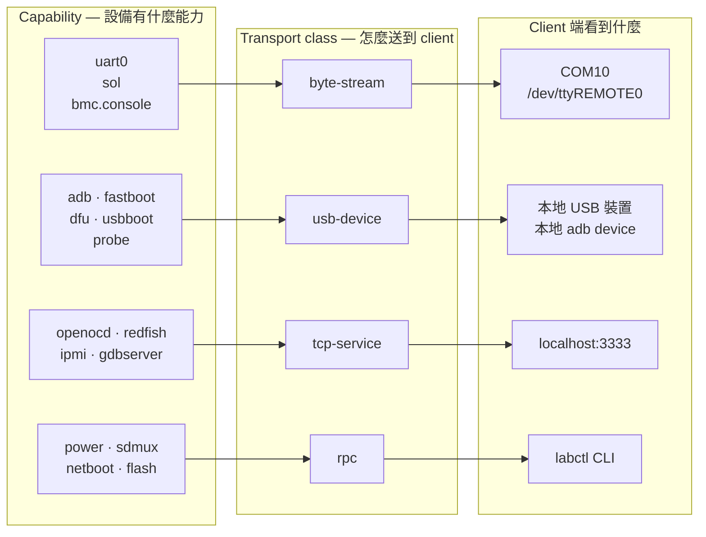
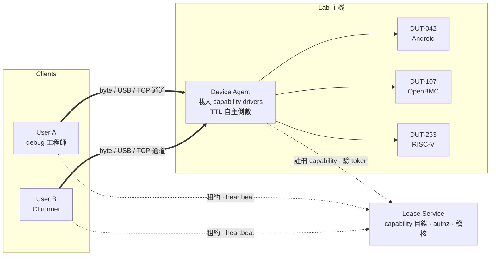
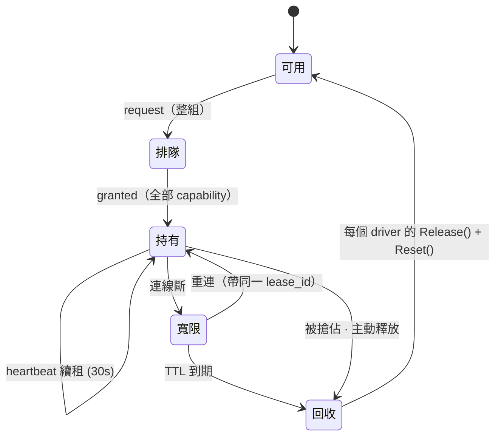
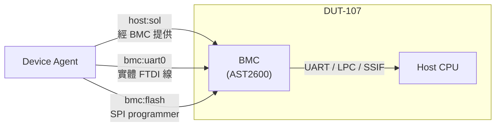

# 設備租約與遠端除錯通道

> 實驗室設備的租約服務。讓遠端使用者拿到設備的獨佔使用權，
> 並把除錯介面映射回本地，使既有工具不必改設定就能直接用。

| | |
|---|---|
| **狀態** | Draft |
| **版本** | v1.0 |
| **日期** | 2026-09-13 |
| **作者** | Alan Tseng |

**一句話**：把「設備有什麼能力」和「這個能力怎麼送到使用者手上」拆成兩層，
前者一個平台一個 driver，後者只有四種、各實作一次。

---

## 1. 問題

實驗室裡的 DUT 形態差異很大：

| 設備 | 除錯介面 |
|---|---|
| Android 平台板 | UART console、adb、fastboot |
| OpenBMC 板 | BMC 的 UART、host 的 Serial-over-LAN、SPI flash programmer、power |
| RISC-V / FPGA 板 | UART、JTAG probe（FTDI 或 CMSIS-DAP）、power relay |
| 純 MCU 板 | UART、SWD |

但需求完全相同：

- **互斥** — 同一個介面不能被兩個人同時開。而且互斥必須由**持有硬體的那端**強制，
  不能靠使用者自律，因為 CI 不會看公告。
- **透明** — 拿到租約之後，使用者手上就多一個 `COM10`、一個本地 `adb device`、
  或一個 `localhost:3333` 的 gdbserver。既有工具照用。
- **可回收** — 人跑掉、CI job 被 kill、網路斷掉，設備都要能自動回到可用狀態。

常見的現況是誰坐在機器前面誰就能用，遠端的人只能請人幫忙插拔線。

**不在範圍內**：設備的實體管理（插線、標籤、機櫃）、測試框架本身、跨機房的設備遷移。

---

## 2. 核心抽象

如果為每種平台各做一套，你會得到三份互不相容的工具，而且第四種設備進來時要再寫一份。

觀察是：**設備的差異在「有什麼能力」，不在「怎麼傳」**。
UART、IPMI SOL、Redfish console 三者來源完全不同，但對使用者來說都是一條 byte 流，
都該變成一個虛擬序列埠。反過來說，同一塊板子上的 UART 和 JTAG 雖然實體相鄰，
傳輸方式卻完全不同。

所以拆兩層：



| 層 | 誰實作 | 有幾種 |
|---|---|---|
| **Capability** | 一個平台一個 driver，隨設備增加 | 開放集合 |
| **Transport class** | 核心，一次寫好 | **只有四種** |

新平台進來時只寫 driver，不動核心。這是整份設計成立的前提，
後面每一個決定都可以追溯回這裡。

四類 transport 的定義：

| Transport class | 機制 | 適用 |
|---|---|---|
| **byte-stream** | RFC2217 over WSS → 虛擬序列埠 | 任何 console |
| **usb-device** | USB/IP，或 protocol-aware proxy | 需要本地看到 USB 裝置 |
| **tcp-service** | 認證過的 port forward | 服務留在 lab 端比較好的東西 |
| **rpc** | 結構化呼叫，非串流 | 動作而非連線 |

---

## 3. 架構

第二個核心決定：**中央服務不在資料路徑上**。它只發租約和短期 token，
byte 流是 client 和 agent 之間的直連通道。

這樣中央服務重啟、部署、掛掉，都不會把正在 debug 的人踢掉。
對實驗室基礎設施來說，這個性質比任何功能都重要 —— 半夜跑的 CI 不該因為
有人在部署管理服務而整批紅掉。



> 虛線 = 控制平面（租約、認證、稽核）　　粗線 = 資料平面（bytes 端到端，不經中央）

| 元件 | 職責 | 掛掉的後果 |
|---|---|---|
| **Lease Service** | 設備與 capability 目錄、authz、排隊與搶佔、審計。發短期 token。 | 現有 session 不受影響；無法發新租約。 |
| **Device Agent** | 唯一能碰硬體的人。載入 driver、驗 token、開關通道、自己倒數 TTL。 | 該機設備不可用。重啟時先 reset 再重新註冊。 |
| **Client Daemon** | 持租約、建 tunnel、在本機把通道具現化成虛擬埠 / proxy / 本地 port。 | 租約進入寬限期，逾時後回收。 |

---

## 4. 資源模型

### 4.1 命名

粒度是 **設備 × 子系統 × 能力**。中段存在是因為一塊板子上可能有不只一顆可除錯的東西：

```
dut-042:soc:uart0        Android 板的主 console
dut-042:soc:adb
dut-042::power           沒有子系統時中段留空

dut-107:bmc:uart0        BMC 自己的 console（實體 FTDI 線）
dut-107:bmc:flash        SPI programmer
dut-107:host:sol         host console，由 BMC 提供
dut-107::power

dut-233:soc:uart0
dut-233:soc:jtag
dut-233::power
```

### 4.2 Capability driver 介面

```go
type CapabilityDriver interface {
    // 設備在不在、線通不通。定期跑，結果上報 Lease Service。
    Probe() Health

    // 開通道。回傳屬於哪一類 transport，以及連線資訊。
    Acquire(lease Lease) (Endpoint, error)

    // 關 fd / detach USB / kill OpenOCD。必須 idempotent。
    Release() error

    // 租約結束時把設備弄回已知狀態。level: soft | hard | power
    Reset(level ResetLevel) error

    // 這個 capability 不能和誰同時被「別人」持有
    ConflictsWith() []CapabilityID
}
```

`Acquire()` 回傳 transport class 而不是寫死，意味著同一個 capability
可以依環境選不同路徑 —— JTAG 在同機房走 `usb-device`、跨機房走 `tcp-service`，
對 client 來說只是拿到不同的 endpoint。

`Reset()` 是平台差異最大的地方，也正是為什麼它該在 driver 裡：

| 平台 | `soft` | `hard` | `power` |
|---|---|---|---|
| Android | `adb reboot` | `fastboot reboot` | relay 斷電 5s |
| OpenBMC (host) | `ipmitool chassis power reset` | `power cycle` | PDU 斷電 |
| OpenBMC (BMC) | BMC `reboot` | WDT | relay 斷電 |
| RISC-V + JTAG | OpenOCD `reset halt` | `reset init` | relay 斷電 |
| 純 MCU | SWD reset pin | — | relay 斷電 |

### 4.3 用 selector 租，不指定機器

沒有人真的想租 `dut-233`。他們想租的是「一台有 JTAG 的 RISC-V 板」。
讓 CI 硬編設備編號是排隊效率最差的做法：

```jsonc
POST /leases
{
  "select": {                        // 條件，不是設備名
    "arch": "riscv64",
    "has":  ["soc:uart0", "soc:jtag"],
    "tags": ["fpga", "!flaky"]
  },
  "caps":  ["soc:uart0", "soc:jtag", ":power"],
  "mode":  "exclusive",
  "ttl_sec": 120
}
```

Agent 註冊時上報自己的 capability 和 tag，Lease Service 做匹配。
要指定機器時 `select: { id: "dut-233" }`。

---

## 5. 租約

```jsonc
{
  "lease_id":   "lse_8f3a21",
  "device":     "dut-233",
  "caps":       ["soc:uart0", "soc:jtag", ":power"],   // 原子，全有或全無
  "owner":      "alan@lab",
  "mode":       "exclusive",         // exclusive | read-only
  "epoch":      7,                   // 單調遞增，agent 只認最新
  "ttl_sec":    120,
  "expires_at": "2026-09-13T14:32:10Z"
}
```

### 5.1 Composite lease 必須原子

一旦設備有多個 capability，天真的做法會立刻死鎖：

> A 拿到 `uart0`，等 `jtag`。
> B 拿到 `jtag`，等 `uart0`。
> 兩個人都在等對方，設備看起來「有人在用」但沒人在動。

**一個 request 裡的所有 capability 一次發、一次收**，中間不可分割。
排隊時整組排，拿不到就整組拿不到。這比事後做死鎖偵測簡單得多，
而且必須從第一版就有 —— 事後補會動到租約核心。

### 5.2 狀態機



**寬限**是刻意插進來的：Wi-Fi 抖一下不該讓人丟掉設備。
但寬限期間租約仍算被佔用，所以它必須比 TTL 短得多。

### 5.3 四個容易踩的點

1. **TTL 要雙邊生效。**
   Agent 自己跑倒數，不是等中央來叫它放。建議值：TTL `120s`、heartbeat `30s`、寬限 `30s`。
   中央斷線時設備最多被鎖兩分鐘，而不是永遠。

2. **Cleanup 是 driver 的事。**
   少了這步，CI 遲早會出現「上一個人留在 fastboot 模式」「OpenOCD 還 halt 著 CPU」
   「BMC 停在 u-boot prompt」—— 每種平台的鬼故事還不一樣，所以不能寫在核心裡。

3. **用 epoch，不要只靠時間。**
   每次發租約 epoch `+1`，agent 只接受不小於當前值的 token。
   時鐘不同步或 token 重放時，這是最後一道防線。

4. **搶佔要是明確事件。**
   人工 debug 優先於 CI job。被搶的一方要收到 `LEASE_PREEMPTED` 並有幾秒收尾時間
   （讓 OpenOCD 有機會 `resume` 再退出），而不是突然拿到 `EIO` 然後開 bug 說工具壞了。

---

## 6. 四類 transport

### 6.1 byte-stream — 虛擬序列埠

所有 console 類最後都變成這一類，不管來源是實體 UART、IPMI SOL、還是 Redfish websocket。
**轉換在 agent 端做**，client 只認得一種通道。

```
        ┌──────── Client 主機 ────────┐        ┌─────── Lab 主機 ───────┐

        終端程式      虛擬序列埠       client daemon      Device Agent      來源
        ┌────────┐   ┌─────────────┐   ┌───────────┐      ┌───────────┐   ┌──────────────┐
        │minicom │──▶│ Windows:    │──▶│ 持租約     │═════▶│ 驗 token   │──▶│ /dev/ttyUSB0 │
        │TeraTerm│   │ COM10↔CNCA0 │   │ RFC2217    │      │ epoch 檢查 │   │ ipmitool sol │
        │picocom │   │ (com0com)   │   │ 編解碼     │      │ 全程錄存   │   │ redfish ws   │
        └────────┘   ├─────────────┤   │ 斷線重連   │      └───────────┘   └──────────────┘
                     │ Linux/mac:  │   └───────────┘             ▲
                     │ /dev/tty    │          ▲                  │
                     │  REMOTE0    │          └──────────────────┘
                     │ (PTY)       │        RFC2217 over WSS
                     └─────────────┘        每 frame 驗 lease token

        帶內控制訊號：baud rate · DTR / RTS · break · line status 沿用 RFC2217 語意
```

**為什麼沿用 RFC2217** — console 不只是 byte 流。改 baud rate、拉 DTR 進 download mode、
送 break 打斷 bootloader、讀 line status 判斷對面死了沒有。
[RFC 2217](https://www.rfc-editor.org/rfc/rfc2217) 二十幾年前就定義完這套語意，
而且 `ser2net` 和 pyserial 的 `rfc2217://` 是現成可用的兩端 ——
「先用 ser2net 跑通、之後換自家 agent」因此是可行的漸進路徑。

三種來源在 agent 端的處理：

| 來源 | Agent 做什麼 | 注意 |
|---|---|---|
| 實體 UART | 開 `/dev/ttyUSB0` | 控制訊號全都有 |
| IPMI SOL | 跑 `ipmitool -I lanplus sol activate`，接管 stdio | UDP 623 留在 lab 內，不要 tunnel |
| Redfish console | 連 BMC 的 websocket，轉 byte stream | 沒有 DTR/break，相關指令要回 NAK |

最後一欄實務上會咬人：**不是每個來源都支援全部控制訊號**。
Driver 要誠實回報自己支援哪些，client 的虛擬埠才能在使用者按 break 沒反應時
給出有意義的錯誤，而不是靜默失敗。

**客戶端安裝**：Linux/macOS 用 `openpty()` 開 PTY 再 symlink 成 `/dev/ttyREMOTE0`，零額外安裝；
Windows 裝 `com0com` 建一對 `CNCA0 ↔ COM10`，daemon 開前者、使用者開後者。

**順手把整條 stream 存檔。** kernel panic 發生在你離開座位的那三分鐘，
有沒有錄到就是一天跟一週的差別。

### 6.2 usb-device — USB/IP 或 protocol proxy

**USB/IP** — agent 端 `usbip bind`，client 端 `usbip attach`，裝置完全在本地。
透明度 100%，`adb`、`fastboot`、`dfu-util`、`openocd` 通通不用改。
代價是 kernel module 依賴、對 latency 敏感（USB 有 timeout，跨機房會出現詭異的
`device offline` 和 JTAG 掉速）、Windows 端要第三方驅動。

**Protocol-aware proxy** — 針對特定協定寫會過濾的代理。比較穩，但每種協定要寫一次。
目前只有 adb 值得（§7.1）。

判斷標準要靠 JTAG transport 的 PoC 量測 ——
關鍵數字是「一次操作產生幾個 USB transfer」，因為在 USB/IP 下每個 transfer 都要過一次 RTT。

### 6.3 tcp-service — 認證過的 port forward

有一類東西留在 lab 端跑成服務比搬到 client 端好，JTAG 最典型：

```
Client                                    Lab 主機
gdb ──▶ localhost:3333 ──[tunnel]──▶ agent ──▶ openocd ──USB──▶ probe ──▶ DUT
                                                  │
                                      OpenOCD 在這邊，
                                      USB round-trip 都在本地網段
```

`gdb -ex "target remote :3333"` 就能用。Agent 負責起停 OpenOCD、餵對的 `.cfg`、
在租約結束時確保 CPU 沒被 halt 住。

**這一類都有同一個問題：沒有認證。** OpenOCD 的 3333/4444、adb 的 5037、
ipmitool 的 623、有些 BMC 的 Redfish 都是「連得到就是管理員」。
一律走認證過的 tunnel，agent 端只 listen 在 loopback。

### 6.4 rpc — 結構化呼叫

`power`、`sdmux`、`netboot`、`flash` 不是串流，是動作：

```bash
labctl power cycle dut-233 --off-ms 5000
labctl sdmux to-host dut-107          # SD 卡切到 host，燒完再切回
labctl flash bmc dut-107 image.mtd
```

把 `power` 開成**獨立 capability** 很重要：DUT 掛死、console 沒反應時，
使用者要能自己救。而且它常需要和別人共享（我在看 log，請你幫我重開）。

---

## 7. 抽象成不成立：三個平台

每個平台各暴露一個會破壞天真設計的性質。抽象撐不撐得住，看這三個。

### 7.1 Android — 工具生態綁死了介面

```
dut-042:soc:uart0    → byte-stream
dut-042:soc:adb      → usb-device（protocol proxy）
dut-042:soc:fastboot → usb-device（USB/IP）
dut-042::power       → rpc
```

adb 值得特別寫 proxy 而不是走 USB/IP，因為 **adb protocol 完全沒有認證**，
而且太多工具（Android Studio、CI script、自家 log parser）綁死在 `5037` 上。

```bash
# 使用者環境（一行設定，之後所有工具照常用）
export ADB_SERVER_SOCKET=tcp:localhost:5037   # 指向本地 proxy

# proxy 的過濾邏輯
host:devices        → 只回傳這個 user 目前租到的 serial
host:transport:X    → X 不在租約內就回 FAIL，連線關掉
host:kill           → 一律拒絕（不然別人的 session 會被砍）
其餘                → 透傳進 tunnel 給 agent 的 adb server
```

**這證明的是**：transport class 不能只有「USB 整顆搬過去」一種實作。
同一類裡容得下兩種機制，由 driver 選。

### 7.2 OpenBMC — console 是遞迴的，而且會自我毀滅



- **Host 的 console 是 BMC 提供的服務**，不需要實體線。BMC 好好的時候，這是最省事的路徑。
- **BMC 自己的 console 需要實體線**。平常沒人用，一旦要用就是出事的時候。
- **開發 BMC firmware 時，前者會消失。** 刷一版壞的 image，`host:sol` 立刻沒了。

所以 BMC 開發者的租約必須是 `bmc:uart0` + `bmc:flash` + `:power` 的原子組合。
少一個就是沒有救援路徑 —— 刷壞了連不上，也沒辦法重刷。

另外：**BMC 既是設備也是工具**。它提供 `host:sol` 和 `chassis power`，
但它自己也是被除錯的對象。`Probe()` 必須能表達「BMC 掛了，所以它提供的 capability 全部 unhealthy」，
否則系統會一直宣稱 host console 是好的。

**這證明的是**：§5.1 的 composite lease 不是理論潔癖，是有設備會因為缺它而變磚。

### 7.3 RISC-V / FPGA — capability 之間會互相破壞

```
dut-233:soc:uart0 → byte-stream
dut-233:soc:jtag  → tcp-service 或 usb-device（依網段）
dut-233::power    → rpc
```

- **單獨拿到 JTAG 而沒有 UART 是沒用的** —— 你需要看著 console 才知道 halt 在哪、reset 之後跑到哪。
- **OpenOCD halt 住 CPU 時，別人去斷電會讓它進入很難恢復的狀態。**
  Driver 宣告 `jtag conflicts with power`。
- **FPGA 的 bitstream 燒錄也走 JTAG**，所以 `flash` 和 `jtag` 共用同一顆 probe，
  也要宣告衝突，否則兩個人會同時操作同一個 FTDI。

**這證明的是**：`ConflictsWith()` 必須存在，而且必須在 driver 裡 ——
核心不可能知道「這顆 probe 同時被 flash 和 jtag 用到」。

---

## 8. 為什麼不那樣做

| 替代方案 | 為什麼不 |
|---|---|
| 網頁 terminal / VNC | 使用者的工具鏈（gdb、Android Studio、CI script、自家 log parser）全綁在本地介面上。要人改工作流的方案，實際使用率會趨近零。 |
| 中央代轉 bytes | 中央變成單點故障，部署一次就把所有人踢掉。實驗室基礎設施的可用性要求比功能高。 |
| SSH + `screen` 到 lab 主機 | 能解決 console，解決不了 adb、JTAG、以及「本地工具要看到本地裝置」。而且互斥還是沒有。 |
| ser2net + 人工協調（貼紙、群組公告） | 很多實驗室的現況就是這樣。三個人以內可行，超過就開始互相踩，而且 CI 不會看公告。 |
| 一台設備一個租約 | `power` 常需要共享；OpenBMC 板上 BMC 和 host 是兩個可獨立除錯的對象。粒度太粗會讓設備閒置。 |
| 直接暴露 OpenOCD / adb server 的 port | 兩個協定都沒有認證，等於把整個 lab 交出去。 |

---

## 9. 安全模型

- **mTLS 雙向認證** — agent 憑證由中央簽發，client 憑證綁使用者身分。
- **Token 綁死 `(lease_id, caps[], epoch, exp)`** — 有效期 5 分鐘，靠 heartbeat 換發。
  token 外洩的爆炸半徑是五分鐘的一台設備。
- **Agent 是最終權威** — 驗 token 簽章和 epoch，不信任 client 宣稱的身分。
  中央服務只是簽發者，不是執行者。
- **所有原生除錯介面只 listen 在 loopback** — OpenOCD 3333/4444、adb 5037、
  IPMI 623、ser2net。它們全都沒有認證。
- **全程稽核** — 誰、什麼時候、租了哪些 capability、做了什麼、console 錄影存在哪。

> ⚠️ Console 錄影會完整錄到 boot log、kernel 訊息，BMC 的還會錄到 IPMI 帳密和 host 序號。
> 保存期限和存取權限要先想清楚再開錄。

---

## 10. 失效模式

| 什麼壞掉 | 結果 | 對策 |
|---|---|---|
| Lease Service 掛掉 | 現有 session 正常；發不出新租約 | Agent 快取簽章公鑰；既有租約到期後 fail-closed |
| Client 網路斷 | Tunnel 斷，租約進寬限 30s | 重連帶同一 `lease_id` 續用；逾時才回收 |
| Agent 掛掉 / 重開機 | 該機所有租約失效 | 重啟時逐一跑 driver 的 `Reset()` 再重新註冊 |
| Client 程序被 `kill -9` | 虛擬埠殘留、OpenOCD 還活著 | Daemon 由 systemd / launchd 管；通道生命週期綁 daemon 而非租約 |
| DUT 掛死、console 無回應 | 使用者以為是工具壞了 | `Probe()` 回報 unhealthy；`power` 是獨立 capability 讓人自救 |
| 兩人同時搶同一設備 | 雙方都以為拿到了 | 租約以 CAS 建立，epoch 單調遞增，agent 只認最新 |
| 多 capability 互等 | 設備看似佔用但沒人在動 | Composite lease 原子發放，排隊時整組排 |
| BMC 被刷壞 | `host:sol` 消失，看起來像 agent 壞了 | Driver 分別回報 `bmc:*` 和 `host:*` 健康度 |
| OpenOCD 留著 halt 狀態 | 下一個人拿到停住的 CPU | `Release()` 先 `resume` 再退出；`Reset()` 保底 |

---

## 11. 實作順序

每一步都能單獨驗證，前四步做完就有人願意用了。

1. **Agent + 一台 hardcoded 設備 + raw TCP tunnel**
   先量 latency 和連續跑八小時的穩定度。這步會決定後面所有假設成不成立。

2. **定 driver 介面，只實作 `uart0`**
   介面要早定，因為它是之後所有平台的收斂點。但不要為了通用性先寫三個 driver ——
   寫一個、用起來、再抽。

3. **Lease Service：exclusive + TTL + composite**
   不做排隊、搶佔、selector。但 composite 從第一天就要有。

4. **Client daemon + PTY（Linux only）**
   到這裡有第一批真實使用者。拿他們的抱怨決定第 5 步。

5. **RFC2217 帶內控制**
   baud、DTR、break。沒有這個，進 download mode 還是得有人跑去插線。

6. **第二個 driver：`power`**
   最簡單，但會第一次逼你驗證「一個租約多個 capability」真的能跑。

7. **第三個 driver：挑手上最痛的平台**
   Android 就 adb proxy；OpenBMC 就 sol；RISC-V 就 OpenOCD 的 tcp-service。
   做完這步，driver 介面才算真的被驗證過。

8. **Windows com0com**
   大部分 Windows 使用者要的只是 Tera Term 能開起來。

9. **Selector、搶佔、read-only 觀看、錄影保存**
   規模變大之後才會痛的問題，提早做會做錯。

---

## 12. 待決策

| 優先 | 問題 |
|---|---|
| 🔴 **阻塞** | Client 和 agent 之間能不能直連？中間有 NAT 或不同網段的話，中央要多做 relay 模式，架構會複雜不少 —— 先確認網路拓樸再往下做。 |
| 🔴 **阻塞** | Console 錄影保存多久、誰能看？BMC console 會錄到憑證，先有政策再開功能。 |
| 🟡 影響範圍 | JTAG 走 tcp-service 還是 usb-device？等 PoC 量測。結論可能是「依 probe 型號分」而非二選一。 |
| 🟡 影響範圍 | `ConflictsWith()` 的判定放 driver 還是中央？放 driver 準確，但中央就無法在排隊階段先算出可行組合。 |
| 🟡 影響範圍 | Read-only 多人觀看要不要做？debug 時拉人一起看很有用，但 console 是全雙工的，要確保 read-only 端真的不能寫。 |
| 🟡 影響範圍 | 租約要不要綁 CI job id？綁了能在 job 結束時自動回收，不必等 TTL，但 daemon 要知道自己跑在哪個 job 裡。 |
| ⚪ 之後再說 | Selector 的 tag 由誰維護？人工標會過期，自動偵測又測不出「這台最近很 flaky」。 |
| ⚪ 之後再說 | Windows 端值不值得為 USB/IP 投資？先看 proxy 和 tcp-service 的體驗有多少人不滿意。 |

---

## 附錄：相關文件

- [com0com / com2tcp](./com0com-com2tcp.md) — §6.1 Windows 虛擬序列埠與 RFC2217 的實作細節
- [Serial over LAN](./serial_over_lan.md) — §6.1 IPMI SOL 來源
- [RFC 2217](https://www.rfc-editor.org/rfc/rfc2217) — telnet com port control option
