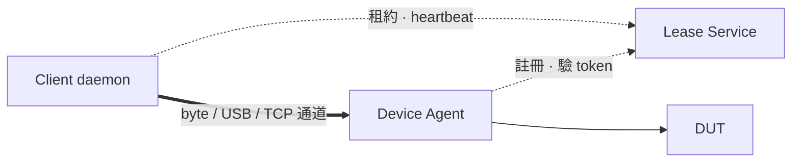

# 設備租約與遠端除錯通道

> 讓遠端使用者拿到開發板的獨佔使用權，並把除錯介面映射回本地，既有工具不必改設定。

**一句話**：把「設備有什麼能力」和「怎麼送到使用者手上」拆成兩層——前者一個平台一個 driver，後者只有四種、各實作一次。

## 1. 問題

DUT 形態差很多：Android 板有 UART／adb／fastboot，OpenBMC 板有 BMC UART／host SOL／SPI flash，RISC-V 板有 UART／JTAG，MCU 板有 UART／SWD。但需求一樣：

- **互斥**：同一介面不能兩人同時開，而且要由持有硬體的那端強制——CI 不會看公告。
- **透明**：拿到租約後本地就多一個 `COM10`、一個 `adb device` 或 `localhost:3333`，工具照用。
- **可回收**：人跑掉、job 被 kill、網路斷，設備都要自動回到可用狀態。

## 2. 核心抽象：capability × transport

設備的差異在「有什麼能力」，不在「怎麼傳」。UART、IPMI SOL、Redfish console 來源不同，對使用者都是一條 byte 流。

| Transport class | 機制 | Capability 例子 | Client 看到 |
|---|---|---|---|
| **byte-stream** | RFC2217 over WSS | `uart0`、`sol` | `COM10`／`/dev/ttyREMOTE0` |
| **usb-device** | USB/IP 或 protocol proxy | `adb`、`fastboot`、`dfu` | 本地 USB／adb 裝置 |
| **tcp-service** | 認證過的 port forward | `openocd`、`gdbserver` | `localhost:3333` |
| **rpc** | 結構化呼叫 | `power`、`sdmux`、`flash` | `devctl` CLI |

Capability 是開放集合，隨平台增加；transport 只有四種，核心寫一次。新平台只寫 driver，不動核心。

```go
type CapabilityDriver interface {
    Probe() Health                          // 設備在不在、線通不通
    Acquire(lease Lease) (Endpoint, error)  // 開通道，回傳 transport class 與連線資訊
    Release() error                         // 關通道，必須 idempotent
    Reset(level ResetLevel) error           // 租約結束時回到已知狀態：soft | hard | power
    ConflictsWith() []CapabilityID          // 不能和誰同時被別人持有
}
```

資源命名是 `設備:子系統:能力`，例如 `dut-107:bmc:uart0`、`dut-107:host:sol`、`dut-107::power`。

## 3. 架構：中央不在資料路徑上



| 元件 | 職責 | 掛掉的後果 |
|---|---|---|
| **Lease Service** | 目錄、authz、排隊、稽核；發短期 token | 現有 session 不受影響，發不出新租約 |
| **Device Agent** | 唯一碰硬體的；載 driver、驗 token、自己倒數 TTL | 該機設備不可用；重啟先 reset 再註冊 |
| **Client Daemon** | 持租約、建 tunnel、在本機生出虛擬埠／port | 租約進寬限期，逾時回收 |

中央只發 token，bytes 直連——部署管理服務不會把半夜的 CI 整批踢紅。

## 4. 租約

```jsonc
{
  "lease_id": "lse_8f3a21",
  "select":   { "arch": "riscv64", "has": ["soc:jtag"] },  // 用條件租，不寫死設備
  "caps":     ["soc:uart0", "soc:jtag", ":power"],        // 原子，全有或全無
  "mode":     "exclusive",
  "epoch":    7,
  "ttl_sec":  120
}
```

幾條規則：

1. **Composite lease 原子發放**。否則 A 拿 `uart0` 等 `jtag`、B 拿 `jtag` 等 `uart0`，死鎖。整組排隊，從第一版就要有。
2. **TTL 雙邊生效**。Agent 自己倒數，不等中央叫它放。建議 TTL 120s、heartbeat 30s、斷線寬限 30s。
3. **Epoch 單調遞增**，agent 只認最新，防時鐘漂移與 token 重放。
4. **Cleanup 在 driver 裡**。「上一個人留在 fastboot」「OpenOCD 還 halt 著 CPU」每個平台不同，核心管不到。
5. **搶佔是明確事件**。人工 debug 優先於 CI，被搶方收到 `LEASE_PREEMPTED` 並有幾秒收尾。

## 5. 四類 transport 的要點

- **byte-stream**：轉換在 agent 端做（實體 UART、`ipmitool sol activate`、Redfish websocket），client 只認一種通道。沿用 [RFC 2217](https://www.rfc-editor.org/rfc/rfc2217) 是因為 console 不只是 bytes——baud、DTR、break 都要能遠端操作；`ser2net` 和 pyserial `rfc2217://` 現成可用。來源不支援的控制訊號（如 Redfish 沒有 break）要誠實回報。Linux/macOS 用 PTY，Windows 用 [com0com](./com0com-com2tcp.md)。整條 stream 順手錄下來。
- **usb-device**：USB/IP 透明度最高，但每個 USB transfer 都要過一次 RTT，跨網段 JTAG 會掉速。adb 另寫 protocol proxy（見 §6）。
- **tcp-service**：OpenOCD 留在設備端主機，USB round-trip 在本地；client `gdb -ex "target remote :3333"`。這類服務（OpenOCD、adb 5037、IPMI 623）都**沒有認證**，一律只 listen loopback、走認證 tunnel。
- **rpc**：`devctl power cycle dut-233`。`power` 是獨立 capability，DUT 掛死時使用者能自救。

## 6. 三個平台驗證抽象

**Android — adb 需要 proxy。** adb protocol 無認證，工具又綁死 `5037`。使用者設 `ADB_SERVER_SOCKET=tcp:localhost:5037` 指向本地 proxy：`host:devices` 只回租到的 serial、`host:transport:X` 不在租約內就拒絕、`host:kill` 一律拒絕。→ 同一 transport class 可以有不同實作。

**OpenBMC — console 會自我毀滅。** Host console（`host:sol`）是 BMC 提供的，刷壞 BMC image 它就消失。所以 BMC 開發者必須原子租 `bmc:uart0` + `bmc:flash` + `:power`，少一個就沒有救援路徑。`Probe()` 也要能表達「BMC 掛了，它提供的 capability 全部 unhealthy」。→ composite lease 不是潔癖。

**RISC-V / FPGA — capability 互相破壞。** OpenOCD halt 住 CPU 時別人斷電會卡死；bitstream 燒錄和 JTAG 共用同一顆 FTDI。Driver 宣告 `jtag` 與 `power`、`flash` 衝突。→ `ConflictsWith()` 必須在 driver 裡，核心不可能知道。

## 7. 為什麼不用別的做法

| 替代方案 | 為什麼不 |
|---|---|
| 網頁 terminal / VNC | 工具鏈都綁本地介面，要人改工作流就沒人用 |
| 中央代轉 bytes | 單點故障，部署一次踢掉所有人 |
| SSH + `screen` | 解決 console，解決不了 adb／JTAG，也沒有互斥 |
| ser2net + 人工協調 | 就是現況，三人以上開始互踩 |
| 直接暴露 OpenOCD / adb port | 沒有認證，等於交出同網段所有設備 |

## 8. 安全與失效

- mTLS 雙向認證；token 綁 `(lease_id, caps, epoch, exp)`，5 分鐘有效、靠 heartbeat 換發。
- Agent 是最終權威，驗簽章與 epoch，不信 client 宣稱的身分。
- Console 錄影會錄到 boot log、BMC 的 IPMI 帳密——**先定保存期限與存取權限再開錄**。

| 什麼壞掉 | 對策 |
|---|---|
| Lease Service 掛 | 既有 session 繼續；agent 快取公鑰，租約到期後 fail-closed |
| Client 斷線 | 寬限期內帶同一 `lease_id` 重連 |
| Agent 重開 | 逐一跑 `Reset()` 再重新註冊 |
| BMC 被刷壞 | 分別回報 `bmc:*` 與 `host:*` 健康度 |
| OpenOCD 留著 halt | `Release()` 先 `resume` 再退出 |

## 9. 實作順序

1. Agent + 一台設備 + raw TCP tunnel，先量 latency 與八小時穩定度。
2. 定 driver 介面，只實作 `uart0`。
3. Lease Service：exclusive + TTL + composite（不做排隊、selector）。
4. Client daemon + PTY（Linux），拿到第一批使用者。
5. RFC2217 帶內控制（baud、DTR、break）。
6. `power` driver，第一次驗證多 capability 租約。
7. 挑最痛的平台做第三個 driver（adb proxy／SOL／OpenOCD）。
8. 之後才做 Windows、selector、搶佔、read-only 觀看、錄影保存。

## 10. 待決策

- **Client 與 agent 能否直連？** 有 NAT 就要加 relay，架構會複雜不少——先確認網路拓樸。
- **Console 錄影保存政策。** BMC console 會錄到憑證，先有政策再開功能。
- **JTAG 走 tcp-service 還是 usb-device？** 等 PoC 量測，結論可能是依 probe 型號分。
- **`ConflictsWith()` 放 driver 還是中央？** Driver 準確，但中央就無法在排隊時算出可行組合。

## 相關文件

- [com0com / com2tcp](./com0com-com2tcp.md) — Windows 虛擬序列埠與 RFC2217
- [Serial over LAN](./serial_over_lan.md) — IPMI SOL 來源
