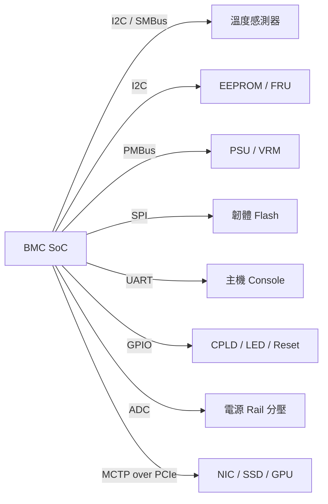
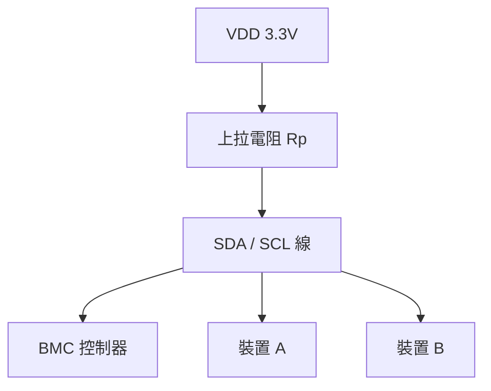
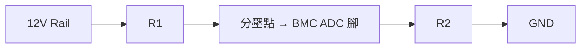
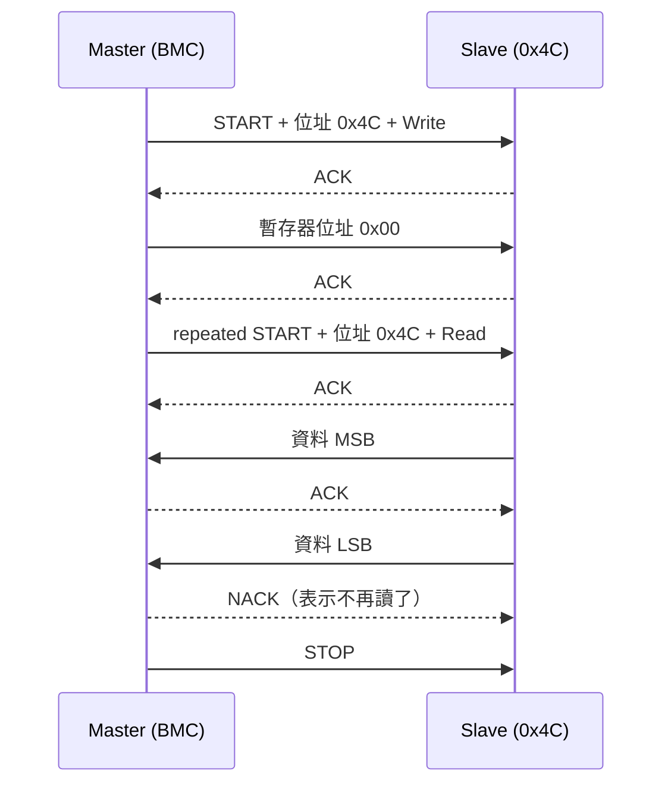
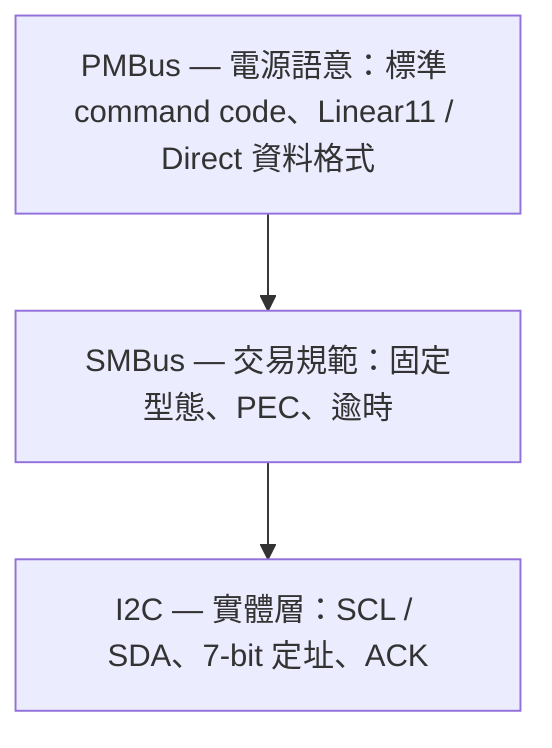
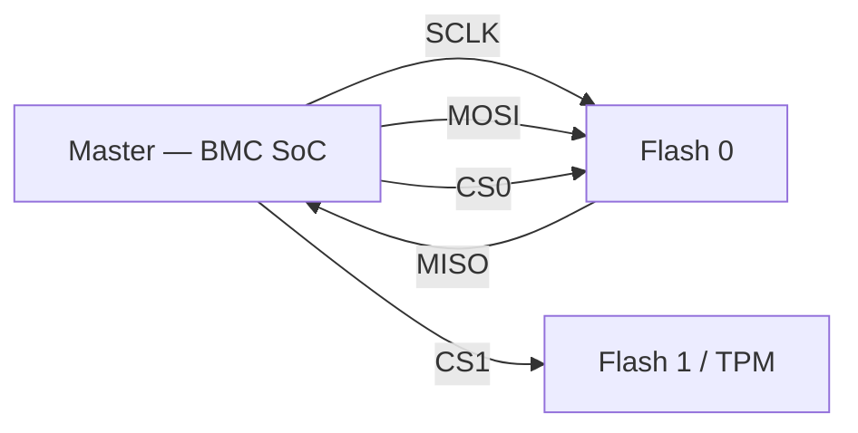
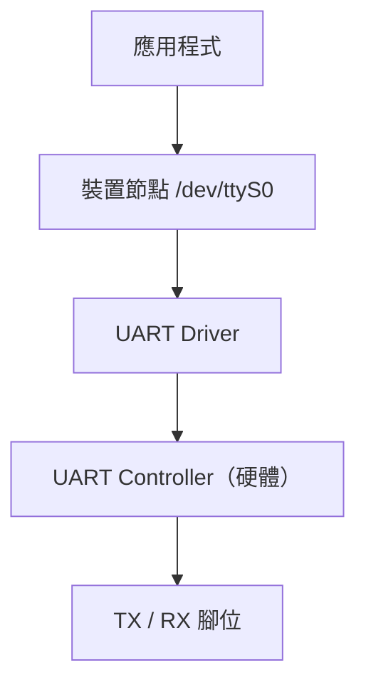
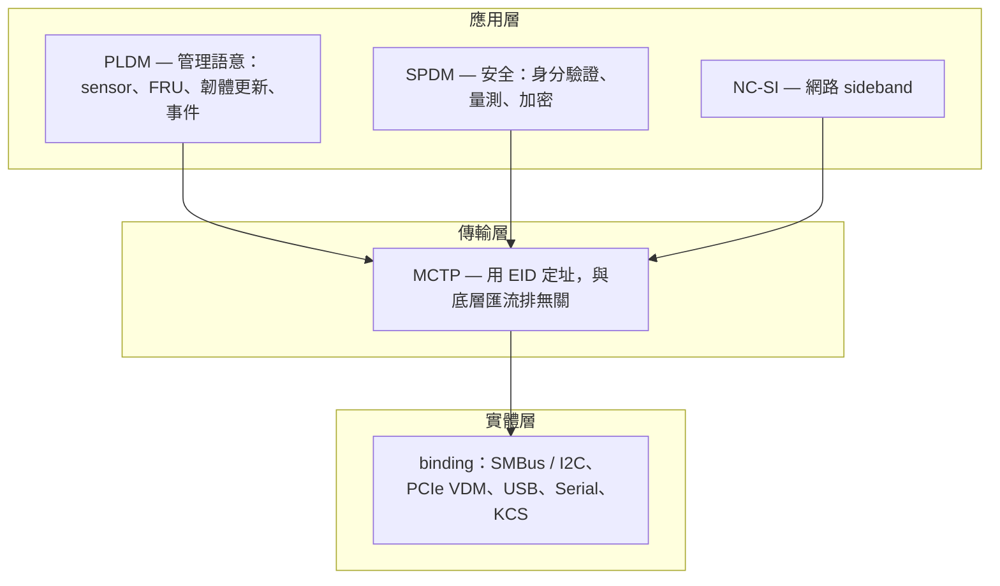

# BMC 硬體入門總覽

BMC 是一顆獨立於主機 CPU 之外、常駐供電的管理晶片。它要回答的問題永遠是那幾個：**這塊板子上有什麼？現在多熱？電壓正不正常？風扇要轉多快？韌體是哪一版？**

要回答這些問題，BMC 靠的不是高速匯流排，而是一堆低速介面與 GPIO。這頁把從「電阻電容」到「PLDM」的整條路徑串成一張地圖——**每一節都只講到夠用的深度，需要細節的地方直接連到對應的深入筆記**。



## 一、電子電路基礎

這一節不打算取代電路學課本，只挑**做 BMC 韌體真的會用到**的部分——每個概念後面都接一件你在板子上會遇到的事。

### 歐姆定律與功率

$$V = I \times R \qquad P = V \times I$$

這兩條式子在 BMC 開發裡最常見的用途是**驗證換算對不對**。從 PMBus 讀出一組電壓與電流之後，用 $P = IV$ 對一下裝置回報的功率值：三個數字對不起來，通常就是 Linear11／Direct 格式的係數套錯了。詳見 [PMBus](./pmbus.md)。

### 被動元件 vs 主動元件

| 比較項目 | 主動元件（Active） | 被動元件（Passive） |
|---|---|---|
| 是否提供能量 | 需要外部電源，可放大或產生能量 | 不提供能量，只吸收或儲存能量 |
| 能量轉換 | 可把電能轉成其他形式（放大、開關控制） | 只能消耗或暫存能量 |
| 控制能力 | 能主動控制電流 | 無法主動控制，響應取決於輸入 |
| 線性 | 多為非線性 | 多為線性 |
| 例子 | 電晶體（BJT、MOSFET）、二極體、IC、運算放大器 | 電阻 R、電容 C、電感 L |

對 BMC 韌體工程師來說，這張表的實際意義是：**看電路圖時，被動元件決定「數值怎麼換算」，主動元件決定「訊號什麼時候會動」。**

具體來說：

- **電阻**——最常出現在兩個地方：I2C 的**上拉電阻**（沒有它匯流排根本不會動），以及 ADC 前的**分壓電阻**（決定你讀到的數字要乘多少）。
- **電容**——去耦電容（decoupling）擺在每顆 IC 的電源腳旁，吸收瞬間電流。它跟韌體無關，但**訊號品質不好導致 I2C 偶發 NAK** 時，硬體同事第一個會問的就是這個。
- **RC 電路**——構成時間常數 $\tau = RC$，是各種 reset 延遲與去彈跳（debounce）的來源。GPIO 讀 button 讀到抖動時，問題常在這裡。
- **二極體**——防逆流與箝位保護，常見於熱插拔路徑上。
- **MOSFET**——當作開關使用，是 **power sequencing** 的執行單元：CPLD 或 BMC 拉一支 GPIO，MOSFET 把某一路電源打開。開機順序出錯的除錯，最後都會走到這裡（見 [CPLD](./cpld.md)）。
- **運算放大器 / 比較器**——把微弱的類比訊號放大到 ADC 讀得到的範圍，或直接做過壓／過流的硬體門檻偵測（超過就直接拉一支 alert 腳，不等軟體反應）。

### open-drain 與上拉電阻

這是 I2C 之所以能運作的關鍵，值得單獨拿出來講。

I2C 的裝置**只能把訊號線拉低，不能拉高**。放開的時候靠外接的上拉電阻把線拉回高電位。



這個設計帶來三個實際後果：

1. **多個裝置可以共用同一條線而不會打架**——沒有人會主動輸出高電位，所以不會出現「一邊拉高、一邊拉低」的短路。
2. **少了上拉電阻，匯流排就是死的**——`i2cdetect` 全部掃出 `--`。新板子第一次上電掃不到任何裝置時，先確認上拉電阻有沒有焊。
3. **上拉電阻的值決定速度上限**——電阻太大，訊號從低回到高的時間拉長，波形變成圓角，高速時就會誤判。掛的裝置越多、走線越長，越需要小一點的電阻。

### 分壓電路與 ADC

BMC 的 ADC 輸入通常只能吃 0～2V 左右，但板上要監控的電源動輒 12V。所以電路圖上會看到 rail 先經過兩顆電阻分壓再進 ADC：

$$V_{ADC} = V_{rail} \times \frac{R_2}{R_1 + R_2}$$



**韌體要做的事就是把這個比例乘回去**：

$$V_{real} = raw \times scale \times \frac{R_1 + R_2}{R_2}$$

這個分壓比會寫在 device tree 或 entity-manager 的設定裡。**電壓讀值差了一個固定倍數，八成就是分壓比填錯**，不是感測器壞掉。

## 二、通訊協定

### I2C

**I2C**（Inter-Integrated Circuit，Philips 提出，現屬 NXP）是兩線式、同步、支援多主多從的低速序列匯流排，也是 BMC 最主要的對外介面。

| | |
|---|---|
| 線 | `SCL`（時脈）＋ `SDA`（雙向資料） |
| 定址 | 7-bit slave address |
| 特性 | 同步、multi-controller / multi-target、open-drain |
| 典型用途 | 溫度感測器、EEPROM、GPIO expander、mux、PSU |
| 優點 | 接線少、協定簡單、通用性高 |
| 缺點 | 沒有內建錯誤檢測（無 CRC）、時序約束寬鬆、速度低 |

一次交易的結構：



三個要點：

- **ACK 是掃描的原理**——每個 byte 之後接收端要拉低 SDA 一個時脈。發出位址後沒收到 ACK，就代表那個位址上沒東西。`i2cdetect` 就是靠這件事逐一試出來的。
- **repeated START**——讀暫存器時「先寫 pointer、不放開匯流排、直接再發一次 START 轉成讀」，避免中途被其他 master 插隊。
- **clock stretching**——slave 來不及時可以壓住 SCL 讓 master 等。有些控制器對這行為支援不完整，是很難查的相容性問題來源。

常用指令：

```bash
i2cdetect -l                  # 列出系統上所有 i2c bus
ls /sys/class/i2c-dev/        # 同上，從 sysfs 看
i2cdetect -y <bus>            # 掃描某條 bus 上有哪些裝置

i2cget -y <bus> 0x50 0x10     # 讀一個 byte
i2cset -y <bus> 0x50 0x10 0x20  # 寫一個 byte

# 複雜交易：寫入 2 byte 位址後 repeated START 讀 128 byte
i2ctransfer -y <bus> w2@0x50 0x10 0x20 r128
```

掃描結果的三種狀態：

| 顯示 | 意義 |
|---|---|
| `--` | 該位址沒有裝置回應 |
| 數字（如 `60`） | 有裝置，且**沒有** kernel driver 佔用，可以用 `i2cget` 直接戳 |
| `UU` | 有裝置，且**已被 driver 綁定**——這其實是好消息，代表 driver 正常載入了 |

新手最常見的誤會是看到 `UU` 以為失敗。反過來才對：sensor porting 做完之後，你**希望**看到 `UU`。

:::warning
`i2cset` / `i2ctransfer` 的寫入是有破壞性的。打錯暫存器可能改掉 PSU 的過壓保護門檻或直接關掉輸出。正式機上動手前先確認自己在寫什麼。
:::

深入內容：協定細節與 sysfs 動態綁定見 [Hardware（硬體存取）](./hardware.md)，從電路圖推出 bus 編號與位址見 [Schematic 判讀](./schemantic.md)。

### SMBus

**SMBus**（System Management Bus，Intel 定義）是蓋在 I2C 之上的一層規範，把「可以怎麼傳」收斂成「應該怎麼傳」。

| 項目 | I2C | SMBus |
|---|---|---|
| 時脈 | 無下限，上限依模式 | 10 kHz ~ 100 kHz |
| 逾時 | 無 | 有（SCL 被壓過久視為逾時，裝置需自行復位） |
| 交易型態 | 自由 | 固定型態（Read Byte / Write Word / Block…） |
| 錯誤檢查 | 無 | 可選的 **PEC**（CRC-8） |
| 裝置發現 | 無 | 有標準化機制 |

實務上的一句話總結：**SMBus 裝置可以掛在 I2C 控制器上，反之不一定**。Linux 用 `i2c_smbus_*()` 系列 API 表達 SMBus 交易，控制器不支援時會用純 I2C 模擬。

### PMBus

**PMBus** 再蓋在 SMBus 之上，專門給電源裝置使用，定義了一整套標準 command code（讀電壓、讀電流、設保護門檻、開關輸出）與資料格式。PSU、VRM、hot-swap controller、eFuse 都走它。



三者對照：

| | I2C | SMBus | PMBus |
|---|---|---|---|
| 定義者 | Philips（現 NXP） | Intel | PMBus 組織 |
| 相對前一層的改進 | — | 資料格式、時序約束、CRC 檢查、裝置發現、標準化命令 | 標準化的電源管理指令集、跨廠商互通、精細控制 |
| 典型用途 | 感測器、EEPROM | 系統關鍵元件通訊（溫度、電壓監控） | PSU、VRM、數位電源模組 |
| 優點 | 通用性高、協定簡單 | 穩定、內建錯誤檢測 | 減少廠商相容性問題、電源參數可監控可配置 |
| 缺點 | 無錯誤檢測、時序約束鬆 | 不如 I2C 靈活、速度上限低 | 只給電源裝置用，不通用 |

深入內容：Linear11／Linear16／Direct 三種格式的公式與 driver 移植流程見 [PMBus](./pmbus.md) 與 [Porting PMBus Driver](./device_driver/porting_pmbus_driver.md)。

### SPI

**SPI**（Serial Peripheral Interface）是四線式、同步、全雙工的短距離匯流排，速度遠高於 I2C。



**沒有位址概念**——靠 `CS`（Chip Select）選擇裝置，掛幾顆就要拉幾條 CS 線。

BMC 上的三個主要用途：

1. **系統啟動**——BMC 上電後由 boot ROM 從 SPI flash 讀 u-boot；主機 CPU 也是從 SPI flash 讀 BIOS。
2. **韌體更新**——BMC 在系統運行時透過 SPI 更新主機的 BIOS。
3. **遠端修復**——主機韌體損毀時，BMC 從旁路重新寫入。

為了提高吞吐量，SPI flash 演化出多線模式，差別在**資料階段同時用幾條線**：Single（1 線）／Dual（2 線）／Quad（4 線，借用 `WP#` 與 `HOLD#` 腳）／Octal（8 線）。細節與 device tree 寫法見 [Hardware（硬體存取）](./hardware.md)。

### UART

**UART**（Universal Asynchronous Receiver/Transmitter）是**序列通訊的硬體控制器**，負責把 CPU 那側的平行資料轉成一條線上的位元流。

「非同步」是關鍵字：**沒有共用時脈線**，兩端靠事先約好的 baud rate 各自計時，所以速率設錯就是滿螢幕亂碼。

#### UART Controller 與 COM Port 的分工

這兩個詞常被混用，但講的是不同層次的東西：

| | UART Controller | COM Port |
|---|---|---|
| 本質 | 硬體模組（在 SoC、南橋、MCU 裡） | 作業系統抽象出來的裝置節點 |
| 功能 | 位元／字元轉換、傳輸控制邏輯、FIFO | 提供 user space 讀寫介面 |
| 名稱 | 內建 IP 或外接晶片 | Windows：`COM1`；Linux：`/dev/ttyS0` |
| 與使用者的關係 | 背後的黑盒 | 使用者直接讀寫的對象 |



Controller 實際負責的事：

- **位元編碼與解碼**——例如 `8N1`：8 個資料位、無 parity、1 個停止位。
- **波特率**——如 115200 bps。BMC console 幾乎都是 `115200n8`。
- **中斷控制**——收滿或送完觸發 IRQ 通知 CPU。
- **FIFO buffer**——硬體緩衝，避免 CPU 來不及取而漏字元。傳統 16550 UART 的招牌功能就是這個 16-byte FIFO。

一個 frame 的組成：


#### 裝置節點對照

Windows：

| 名稱 | 對應意義 |
|---|---|
| `COM1` | 第一個 UART 控制器（傳統上對應 I/O port `0x3F8`） |
| `COM2` | 第二個 UART 控制器（`0x2F8`） |

Linux：

| 節點 | 說明 |
|---|---|
| `/dev/ttyS0` | 第一個傳統 UART 控制器 |
| `/dev/ttyUSB0` | 透過 USB-to-Serial 轉接器產生的虛擬 UART |
| `/dev/ttyAMA0` | 部分 ARM SoC（如 PL011 控制器）上的 UART |

常見的 UART 存在位置：MCU 內部（如 STM32 的 USART）、SoC 內建（PL011、miniUART）、PC 南橋或 LPC-to-UART、以及擴充卡上的 16550 晶片。

#### UART routing

BMC SoC 上通常有一整排 UART，**哪一條接到哪裡是板子設計決定的**，kernel 不會自己知道。所以要在 device tree 裡宣告每條 UART 的角色與接腳對應，這件事叫 **UART routing**。

對 OpenBMC 來說，需要回答三個問題：

1. 哪一條 UART 是**主機的 serial console**？（會被拿去做 SOL）
2. 哪一條**接外部裝置**？（MCU、CPLD、sensor）
3. 哪些是**沒用到、要 disable 的**？

BMC SoC 通常還提供 **Virtual UART**：讓主機和 BMC 同時看到同一個 console，這是 SOL 能運作的基礎。相關內容見 [SOL](./sol.md) 與 [Serial over LAN（完整版）](./serial_over_lan.md)。

## 三、板上元件

### EEPROM 與 FRU

**EEPROM** 是板上的小容量非揮發記憶體，透過 I2C 存取，位址習慣落在 `0x50`–`0x57`。容量從幾 Kb 到幾百 Kb 都有（例如常見的 64 Kb 型號）。

**FRU**（Field Replaceable Unit）則是**存在這些 EEPROM 裡的資料格式**——依 IPMI 的 FRU Information Storage Definition 規範，記錄這塊板子或模組的製造商、型號、序號、製造日期，用於資產追蹤與維修。

兩者的關係很單純：**EEPROM 是容器，FRU 是內容。**

讀 EEPROM datasheet 時要特別確認的三件事：

1. **位址寬度是 1 byte 還是 2 byte**——容量超過 2 Kb 的通常是 2 byte，這決定你的 `i2ctransfer` 要寫 `w1@` 還是 `w2@`。填錯就是讀到完全錯的位置。
2. **page size**——寫入時跨頁會 wrap around 回到頁首覆蓋掉前面的資料，不是自動接續。
3. **`WP#` 腳**——寫入保護，被拉高時寫入會被硬體擋掉且不報錯。

```bash
i2cdump -y <bus> 0x50               # 看原始內容，FRU 開頭應該是 0x01（版本）
ipmitool fru print                  # 透過 BMC 解析後的結果
busctl tree xyz.openbmc_project.FruDevice   # OpenBMC 掛在 D-Bus 上的結果
```

深入內容見 [FRU](./fru.md)、[IPMI](./ipmi.md)、[Spec / Datasheet 判讀](./spec.md)。

### 溫度感測器（以 TMP75 為例）

TMP75 系列是最典型的 I2C 溫度感測器，也是練習「讀 datasheet → 寫 driver → 驗證」的最好教材。

重點只有兩個：

**暫存器配置**——由一個 pointer register 選擇要存取哪一顆暫存器：

| Pointer | 暫存器 | 用途 |
|---|---|---|
| `0x00` | Temperature | 溫度讀值（唯讀） |
| `0x01` | Configuration | 解析度、shutdown、alert 模式 |
| `0x02` | `T_LOW` | 低溫門檻 |
| `0x03` | `T_HIGH` | 高溫門檻 |

**換算**——12-bit 模式下每個 LSB 代表 **0.0625°C**（即 $1/16$）。溫度值靠左對齊在 16 bit 裡，所以要先右移再乘：

$$T = (raw \gg 4) \times 0.0625$$

#### 一個一定要踩過的坑：word 模式的 byte order

假設室溫下你這樣讀：

```bash
i2cget -y <bus> 0x48 0x00 w
0x1027
```

看到 `0x1027` 千萬別急著換算成 4135。**`i2cget` 的 word 模式是小端序**：先收到的 byte 放低位。感測器實際送出的順序是 `0x27` `0x10`，所以：

- 高位 byte（真正的溫度整數部分）是 **`0x27`**
- $0x27 = 2 \times 16 + 7 = 39$
- 結果就是 **39°C**

低位的 `0x10` 是小數部分，右移 4 位得 1，$1 \times 0.0625 = 0.0625$。合起來是 39.0625°C。

**大端序的裝置配上小端序的讀法**，是感測器移植裡最常見的一類 bug。用 byte 模式分兩次讀（`i2cget ... 0x00` 與 `... 0x01`）就能立刻分辨到底是誰的順序錯了。

深入內容見 [Spec / Datasheet 判讀](./spec.md) 與 [Sensor Porting](./sensor_porting.md)。

### GPIO

BMC 用大量 GPIO 做 presence 偵測（模組插了沒）、reset 控制、power button、LED、以及各種 strap 讀取。

每支腳可以設定成：

- **輸入**——讀外部狀態，可搭配內部 pull-up / pull-down 決定沒接東西時的預設值。
- **輸出**——推高或拉低，控制 LED、reset、enable 訊號。
- **中斷來源**——邊緣觸發，用於「有東西被插入／拔出」這類事件。

Linux 的 GPIO 介面經歷過一次大改版：

| | 舊：sysfs | 新：character device |
|---|---|---|
| 路徑 | `/sys/class/gpio/` | `/dev/gpiochipN` |
| 定址 | 全域編號 | chip 名稱 + chip 內 offset |
| 狀態 | **已 deprecated** | 目前標準 |
| 工具 | `echo` 到 sysfs | `libgpiod`（`gpioget` 等） |

舊介面的全域編號會隨 kernel 版本與 probe 順序改變，腳本很容易失效。**新東西一律用 libgpiod：**

```bash
gpiodetect                    # 列出所有 gpiochip 與行數
gpioinfo <chip>               # 每一行的名稱、方向、目前用途
gpioget <chip> <line>         # 讀值
gpioset <chip> <line>=1       # 設值
gpiomon <chip> <line>         # 監看邊緣事件
```

`gpioinfo` 印出來的名稱來自 device tree 的 `gpio-line-names`。**板子有把名稱填好的話，這是對照電路圖最快的路。**

深入內容見 [Hardware（硬體存取）](./hardware.md) 與 [GPIO Hog](./hog.md)。

### ADC

BMC SoC 內建 ADC，把[前面講過的分壓](#分壓電路與-adc)後的電壓轉成數位值。Linux 端由 **IIO**（Industrial I/O）子系統管理：

```bash
ls /sys/bus/iio/devices/iio:device0/
cat /sys/bus/iio/devices/iio:device0/in_voltage0_raw
cat /sys/bus/iio/devices/iio:device0/in_voltage_scale
```

OpenBMC 的 `adcsensor` 再把它接到 D-Bus，最終在 Redfish 上呈現。

## 四、管理協定：MCTP / PLDM / SPDM

前面講的都是**實體怎麼傳**。這一層講的是**傳什麼內容**——當 BMC 要管理的對象不再是一顆溫度感測器，而是一張 NIC、一顆 SSD、一片 GPU 這種本身就有韌體的智慧裝置時，就需要一套跨廠商的標準語言。

這三個協定都出自 DMTF，關係是分層的：



### MCTP（Management Component Transport Protocol）

**傳輸層。** 定義一套與實體介質無關的封包格式與定址方式，讓管理訊息可以在 I2C／SMBus、PCIe VDM、USB、Serial、KCS 上通用。

- 每個端點有一個 **EID**（Endpoint ID），就像管理網路裡的 IP。
- 提供分層結構，讓上層協定（PLDM、SPDM、NC-SI）可以共存於同一條通道。
- 在 BMC 裡，MCTP 常常就是管理通訊的骨幹。

OpenBMC 以 `libmctp` 與 mctp daemon 實作。細節見 [MCTP](./mctp.md)。

### PLDM（Platform Level Data Model）

**應用層的「做什麼」。** 統一了管理功能的資料結構與命令格式，分成幾個獨立的規格：

| 模組 | 用途 |
|---|---|
| PLDM for Firmware Update | 標準化的韌體更新流程 |
| PLDM for Sensor and Control | 感測器讀值與控制 |
| PLDM for Redfish Device Enablement | 讓裝置直接提供 Redfish 資源 |
| PLDM for Event Logging | 系統事件記錄 |

實際價值在於：**硬體廠商不必為每家 BMC 客製一套介面**，BMC 也不必為每家裝置寫專屬 driver。一張支援 PLDM 的 NIC，任何支援 PLDM 的 BMC 都能更新它的韌體。

### SPDM（Security Protocol and Data Model）

**應用層的「可不可信」。** 用於裝置之間的安全通訊：

- **雙向身分驗證**——裝置之間互相驗證憑證，不是只有單向。
- **量測（measurement）**——裝置回報自己韌體的雜湊值，BMC 可以比對是否被竄改。
- **以硬體信任根為基礎**——搭配 TPM 等安全元件。
- **加密與完整性保護**。

主要應對的是**供應鏈安全**：確認插進機箱的那張卡是真貨、跑的是原廠韌體，而不是被替換過的。

## 五、SoC：以 AST2600 為例

BMC 本身也是一顆 SoC。ASPEED 的 AST2600 是目前伺服器上最常見的一顆，OpenBMC 也是以它為主要支援平台。

| 面向 | 內容 |
|---|---|
| **主核** | 雙核心 ARM Cortex-A7 |
| **協處理器** | ARM Cortex-M3，用於即時控制 |
| **記憶體** | 支援 DDR4 / DDR3 |
| **儲存** | SPI、eMMC、SD |
| **網路** | 雙 GbE，支援 NC-SI sideband |
| **顯示** | 2D 硬體加速引擎，支援 VGA / HDMI 輸出 |
| **安全** | TPM 2.0、Secure Boot、AES / SHA / RSA 硬體加速 |
| **管理協定** | IPMI 2.0、Redfish、MCTP、PLDM、SPDM |
| **I/O** | PCIe、USB、多組 I2C 控制器、SPI、UART、GPIO |

（確切的頻率、容量與 pin 數以 ASPEED 官方 datasheet 為準。）

從韌體角度看，這張表真正重要的是最後兩列：**你能掛多少 I2C 裝置、有幾條 UART 可以路由**，直接決定了 device tree 怎麼寫。開機流程與 driver 對應見 [OpenBMC Boot Flow](./openbmc_boot_flow.md)。

## 六、練習題

以下是把上面的東西串起來的最小練習，**用任何一塊有 BMC 或 Linux 的開發板都能做**：

### 練習 1：找出板上有什麼

```bash
i2cdetect -l                  # 有哪些 bus？各自來自哪個控制器？
i2cdetect -y <bus>            # 每條 bus 上有什麼？
```

目標：畫出這塊板子的 I2C 拓撲圖，並把每個位址對回電路圖上的元件。分辨 `--` / 數字 / `UU` 三種狀態的意義。

### 練習 2：讀溫度

用 `i2cget` 直接讀溫度感測器的 `0x00` 暫存器，手動換算成攝氏度，再跟 `/sys/class/hwmon/hwmonN/temp1_input` 的值比對。

目標：確認自己的換算公式跟 kernel driver 算的一致——**這一步對上了，之後移植新感測器就有信心了**。順便踩一次 word 模式的 byte order。

### 練習 3：讀 FRU

```bash
i2cdump -y <bus> 0x50
ipmitool fru print
```

目標：對照 IPMI FRU 規格，在 raw dump 裡手動找出 header、各個 area 的 offset、以及製造商字串。理解 `ipmitool` 到底做了什麼解析。

### 練習 4：閃一顆 LED

用 `gpioinfo` 找出接 LED 的那一行，用 `gpioset` 讓它亮滅。

目標：建立「device tree 的 `gpio-line-names` → `gpioinfo` 顯示的名稱 → 電路圖上的網路名」這條對照鏈。

### 練習 5：驗證一路電壓

從 `/sys/bus/iio/devices/` 讀出 ADC 的 raw 值與 scale，查電路圖上的分壓電阻算出比例，推回真實電壓，再拿三用電表量同一個測試點比對。

目標：親手驗證一次「raw × scale × 分壓比 = 真實電壓」。誤差在 1% 以內就算成功。

### 練習 6：更新一次 flash

在安全的前提下（**確認有回復手段**）用 `flashcp` 或 `flash_erase` + `dd` 更新一個非關鍵的 flash 分割，並在重開機後確認生效。

目標：理解 MTD 分割配置與韌體更新的實際流程。相關內容見 [Flash](./flash.md)。

## 七、還沒寫的

- **邏輯分析儀**——I2C 掃不到裝置、偶發 NAK、clock stretching 相容性問題，最後都得靠它看波形。
- **JTAG**——SoC 卡在 boot ROM 連 console 都沒有時的最後手段。

## 參考

- [I2C-bus specification（NXP UM10204）](https://www.nxp.com/docs/en/user-guide/UM10204.pdf)
- [System Management Bus (SMBus) Specification](http://www.smbus.org/specs/)
- [PMBus Specification](https://www.pmbus.org/specification-archives/)
- [DMTF PMCI Working Group（MCTP / PLDM / SPDM）](https://www.dmtf.org/standards/pmci)
- [IPMI Platform Management FRU Information Storage Definition](https://www.intel.com/content/www/us/en/servers/ipmi/ipmi-second-gen-interface-spec-v2-rev1-1.html)
- [TI TMP75 Datasheet](https://www.ti.com/product/TMP75)
- [ASPEED AST2600 產品頁](https://www.aspeedtech.com/server_ast2600/)
- [libgpiod](https://git.kernel.org/pub/scm/libs/libgpiod/libgpiod.git/about/)
- [Linux kernel — IIO subsystem](https://docs.kernel.org/driver-api/iio/index.html)
