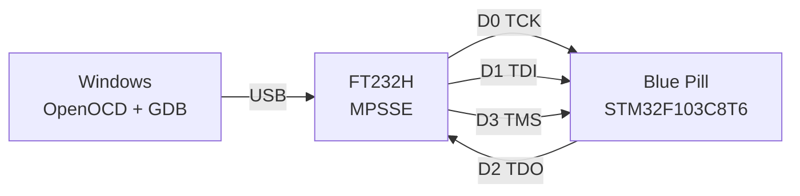

# 用 FT232H 當 JTAG 除錯器：掃 STM32 Blue Pill 的 TAP、燒 blink、GDB 停在 main

手上那塊驅動 TFT 用的 [FT232H](./ft232h-spi-tft.md)，D0–D3 剛好就是 JTAG 的 TCK／TDI／TDO／TMS。這篇把它接到一塊 STM32F103C8T6 Blue Pill，用 OpenOCD 從 **掃 JTAG 鏈** 開始，一路做到 **燒一支裸機 blink、用 GDB 停在 `main()`、單步、看暫存器**。主機是 Windows 11。

之前 [Blue Pill 跑 Zephyr](./zephyr-stm32-bluepill.md) 用的是 ST-Link，那是現成的除錯器，只看得到 SWD。換成 FT232H 的好處是看得到 **JTAG 本身**：TAP、IDCODE、IR 長度，這些在 ST-Link 上都被包起來了。

完整檔案放在 [`static/code/ft232h-jtag-stm32/`](https://github.com/alanhc/til/tree/main/static/code/ft232h-jtag-stm32)。

## 先講結論

- FT232H + OpenOCD 的 `ftdi` driver 就是一支能用的 JTAG 除錯器，設定檔只要 6 行。
- 不指定 target 直接 `scan_chain`，STM32F1 會出現 **兩個 TAP**：ARM 的除錯 TAP（`0x3BA00477`）和 ST 的 boundary-scan TAP（`0x16410041`）。
- **BOOT0 = 1** 讓晶片從 ROM bootloader 開機，JTAG 腳一定不會被韌體改掉，是最穩的起點。代價是 reset 後不會跑你的程式，GDB 裡要手動從向量表設 SP／PC。
- Windows 開著 **Smart App Control** 時，沒簽章的 `arm-none-eabi-gdb.exe` 會被擋（`0xC0E90002`），改用 Arm 官方有簽章的 Arm GNU Toolchain 就好。
- 中斷點要設在 **會被執行到的行**。設在無限迴圈 `main()` 的結尾大括號，`continue` 會永遠等不到。

## 不用接 ST-Link

FT232H 本身就是除錯器，這個練習裡它取代 ST-Link。兩支同時接在同一組 SWD／JTAG 腳上會互搶訊號，所以一次只接一支。

| | FT232H | ST-Link V2（clone） |
|---|---|---|
| 協定 | JTAG、SWD 都可以 | 只有 SWD |
| 看得到什麼 | TAP、scan chain、IR/DR | 主要是 GDB 除錯流程 |
| 接線 | 4 線 JTAG（PA13/14/15、PB3） | Blue Pill 尾端的 4 pin 排針 |

ST-Link 留著當對照組：FT232H 連不上時換 ST-Link 試，ST-Link 也連不上就是晶片或板子的問題。

## 接線

STM32F1 的 JTAG 腳是固定的：PA13 = TMS、PA14 = TCK、PA15 = TDI、PB3 = TDO。

Blue Pill 有個小陷阱：**PA13、PA14 不在兩側排針上**，而是在板子尾端的 4 pin SWD 排針，上面印 `3.3 / IO / CLK / GND`。PA15、PB3 則在側邊，印 `A15`、`B3`。

| FT232H | Blue Pill 標示 | 腳位 | JTAG 訊號 |
|---|---|---|---|
| D0 | 尾端 `CLK` | PA14 | TCK |
| D1 | 側邊 `A15` | PA15 | TDI |
| D2 | 側邊 `B3` | PB3 | TDO |
| D3 | 尾端 `IO` | PA13 | TMS |
| GND | `G` | — | 共地 |



接線前確認：

1. **只接 GND，不接電源**。Blue Pill 用自己的 micro USB 供電，FT232H 的 5V／3V 不要接過去，不然兩邊電源互灌。
2. **BOOT0 跳到 1** 再按 RESET。晶片從 ROM 裡的系統 bootloader 開機，PA15／PB3 不會被使用者韌體改成 GPIO。
3. FT232H 板上的 **I2C 開關撥 OFF**，否則 D1、D2 會被接在一起。
4. 如果 TFT 還接著，先拔掉，它也用 D0、D1。

## Windows 環境

- **驅動**：FT232H 要是 **WinUSB**。做 [TFT 那篇](./ft232h-spi-tft.md)時已經用 Zadig 換過，OpenOCD 直接沿用，不用再換。
- **OpenOCD**：[xPack OpenOCD](https://github.com/xpack-dev-tools/openocd-xpack/releases)，Windows 版是 zip，解壓縮就能用（這次用 0.12.0-7）。`target/stm32f1x.cfg` 等設定檔都在包裡。
- **GDB／GCC**：[Arm GNU Toolchain](https://developer.arm.com/downloads/-/arm-gnu-toolchain-downloads) 的 `mingw-w64-x86_64-arm-none-eabi` zip（這次用 14.3.rel1）。

### Smart App Control 會擋沒簽章的 GDB

一開始裝的是 xPack 的 arm-none-eabi-gcc，`arm-none-eabi-gcc.exe` 能跑，`arm-none-eabi-gdb.exe` 卻一執行就失敗，結束碼是 `-1058471934`，也就是 `0xC0E90002`（`STATUS_SYSTEM_INTEGRITY_POLICY_VIOLATION`）。

到「事件檢視器 → Microsoft-Windows-CodeIntegrity/Operational」看得到 3033／3077 事件，指名擋下的就是那支 gdb。原因是 Windows 11 的 **Smart App Control** 在強制模式，會擋掉沒簽章又沒有信譽的執行檔。

不用關掉 Smart App Control（關了就不能再打開），改用 **Arm 官方的工具鏈**就好。它的執行檔有 Arm Limited 的 Authenticode 簽章：

```powershell
Get-AuthenticodeSignature .\bin\arm-none-eabi-gdb.exe   # Status: Valid, CN=Arm Limited
```

## 設定檔：`ft232h-jtag.cfg`

```tcl
adapter driver ftdi
ftdi vid_pid 0x0403 0x6014
ftdi channel 0
ftdi layout_init 0x0008 0x000b
adapter speed 1000
transport select jtag
```

唯一需要解釋的是 `ftdi layout_init <value> <direction>`，兩個數字都是 ADBUS（D0–D7）的位元遮罩：

| bit | 腳 | 訊號 | direction（`0x000b`） | 初始值（`0x0008`） |
|---|---|---|---|---|
| 0 | D0 | TCK | 輸出 | 0 |
| 1 | D1 | TDI | 輸出 | 0 |
| 2 | D2 | TDO | **輸入** | — |
| 3 | D3 | TMS | 輸出 | **1** |

TMS 初始拉高，是因為 TMS 維持 1 連續 5 個 TCK 就會讓 TAP 回到 Test-Logic-Reset，從已知狀態開始。

## 練習 1：掃 JTAG 鏈

先不給 target 設定，讓 OpenOCD 自己探測鏈上有什麼：

```bash
openocd -f ft232h-jtag.cfg -c "init; scan_chain; shutdown"
```

```text
Warn : There are no enabled taps.  AUTO PROBING MIGHT NOT WORK!!
Info : JTAG tap: auto0.tap tap/device found: 0x3ba00477 (mfg: 0x23b (ARM Ltd), part: 0xba00, ver: 0x3)
Info : JTAG tap: auto1.tap tap/device found: 0x16410041 (mfg: 0x020 (STMicroelectronics), part: 0x6410, ver: 0x1)
Warn : AUTO auto0.tap - use "jtag newtap auto0 tap -irlen 4 -expected-id 0x3ba00477"
Warn : AUTO auto1.tap - use "jtag newtap auto1 tap -irlen 5 -expected-id 0x16410041"
```

鏈上有兩個 TAP，串在同一條 TDI→TDO 上：

| TAP | IDCODE | 版本 | Part | 製造商 | IR 長度 | 是什麼 |
|---|---|---|---|---|---|---|
| 1 | `0x3BA00477` | 3 | `0xBA00` | `0x23B` ARM | 4 | Cortex-M3 的 JTAG-DP，除錯都走這個 |
| 2 | `0x16410041` | 1 | `0x6410` | `0x020` ST | 5 | STM32F1 的 boundary-scan TAP |

IDCODE 的格式是 `[31:28] 版本 | [27:12] part number | [11:1] JEP106 製造商碼 | [0] 固定為 1`。ST 那顆的 part `0x6410` 低 12 位元就是 STM32F1 medium-density 的 DEV_ID `0x410`。

IR 長度也是 OpenOCD 自動探測出來的（IEEE 1149.1 規定 Capture-IR 時 IR 最低兩位元固定是 `01`，可以據此在移出的位元流裡找到每個 TAP 的 IR 邊界）。最後印出的 `jtag newtap ...` 就是寫 target 設定檔時要用的那一行，`target/stm32f1x.cfg` 裡宣告的正是這兩個 TAP。

## 練習 2：停住 CPU，讀晶片 ID

加上 target 設定，讓 OpenOCD 認得這是 Cortex-M3。接著用一小段 Tcl（[`ids.tcl`](https://github.com/alanhc/til/blob/main/static/code/ft232h-jtag-stm32/ids.tcl)）讀三個暫存器：

```tcl
init
sleep 200
halt
echo "DBGMCU_IDCODE: [read_memory 0xE0042000 32 1]"
echo "CPUID:         [read_memory 0xE000ED00 32 1]"
echo "FLASH_SIZE_KB: [read_memory 0x1FFFF7E0 16 1]"
resume
shutdown
```

```bash
openocd -f ft232h-jtag.cfg -f target/stm32f1x.cfg -f ids.tcl
```

```text
Info : [stm32f1x.cpu] Cortex-M3 r1p1 processor detected
Info : [stm32f1x.cpu] target has 6 breakpoints, 4 watchpoints
[stm32f1x.cpu] halted due to debug-request, current mode: Thread
xPSR: 0x81000000 pc: 0x1ffff3b6 msp: 0x200000c4
DBGMCU_IDCODE: 0x20036410
CPUID:         0x411fc231
FLASH_SIZE_KB: 0x40
```

- **PC = `0x1FFFF3B6`**：落在 System Memory（`0x1FFFF000` 起），證明 BOOT0 = 1 生效，現在跑的是 ROM bootloader。
- **DBGMCU_IDCODE**：DEV_ID `0x410`（medium-density），REV_ID `0x2003`（rev X）。
- **CPUID `0x411FC231`**：ARM Cortex-M3 r1p1，跟 [Zephyr 那篇](./zephyr-stm32-bluepill.md) 用來分辨正版的值一樣。
- **Flash 大小 `0x40` = 64 KB**。

三個 ID 都對得上原廠 STM32F103C8，所以不需要相容晶片常用的 `set CPUTAPID 0`。

> `init` 之後如果立刻 `halt`，會出現 `target was in unknown state when halt was requested`，而且後面的指令不會執行。中間加 `sleep 200`，讓 OpenOCD 先 poll 一次 target 狀態就好。

## 練習 3：燒一支裸機 blink

為了在 GDB 裡每一行都看得懂，blink 不用 HAL 也不用 CMSIS，直接寫暫存器，啟動程式也寫在同一個檔案裡。整支只有 272 bytes。

```c
#define RCC_APB2ENR (*(volatile uint32_t *)0x40021018)
#define GPIOC_CRH   (*(volatile uint32_t *)0x40011004)
#define GPIOC_ODR   (*(volatile uint32_t *)0x4001100C)

volatile uint32_t blink_count;   /* 給 GDB 看的 */

int main(void)
{
    RCC_APB2ENR |= (1u << 4);              /* IOPCEN：打開 GPIOC 時鐘 */
    GPIOC_CRH &= ~(0xFu << 20);            /* PC13 的設定在 CRH[23:20] */
    GPIOC_CRH |= (0x2u << 20);             /* push-pull 輸出，2 MHz */

    for (;;) {
        GPIOC_ODR ^= (1u << 13);           /* 切換 LED（低電位點亮） */
        blink_count++;
        delay(200000);
    }
}
```

啟動的部分只做三件事：把 VTOR 指到 `0x08000000`、從 Flash 複製 `.data`、把 `.bss` 清零，然後呼叫 `main()`。向量表只放 SP、Reset 和幾個 fault handler。完整檔案：[`blink.c`](https://github.com/alanhc/til/blob/main/static/code/ft232h-jtag-stm32/blink.c)、[`stm32f103c8.ld`](https://github.com/alanhc/til/blob/main/static/code/ft232h-jtag-stm32/stm32f103c8.ld)、[`build.ps1`](https://github.com/alanhc/til/blob/main/static/code/ft232h-jtag-stm32/build.ps1)。

編譯：

```bash
arm-none-eabi-gcc -mcpu=cortex-m3 -mthumb -O0 -g3 -ffreestanding -nostdlib -Wall -T stm32f103c8.ld -o blink.elf blink.c
```

`-O0 -g3` 是為了讓 GDB 單步時一行 C 對應得清楚。PowerShell 裡 `-Wl,-Map=blink.map` 要加引號，不然逗號會被當成陣列語法。

用 OpenOCD 的 `program` 燒錄並驗證：

```bash
openocd -f ft232h-jtag.cfg -f target/stm32f1x.cfg -c "program blink.elf verify; shutdown"
```

```text
Info : device id = 0x20036410
Info : flash size = 64 KiB
** Programming Started **
** Programming Finished **
** Verify Started **
** Verified OK **
```

## 練習 4：GDB 停在 main

開兩個終端機。第一個開著 OpenOCD 當 GDB server（預設 port 3333）：

```bash
openocd -f ft232h-jtag.cfg -f target/stm32f1x.cfg
```

### BOOT0 = 1 時要手動啟動

BOOT0 還是 1，所以 `monitor reset halt` 之後 CPU 會從 ROM 開始，不會跑到 Flash 裡的 blink。解法是照硬體 reset 的做法自己來：Flash 開頭 `0x08000000` 是初始 SP，`0x08000004` 是 Reset_Handler 的位址，讀出來設進去就好。這就是 [`debug.gdb`](https://github.com/alanhc/til/blob/main/static/code/ft232h-jtag-stm32/debug.gdb)：

```gdb
file blink.elf
target extended-remote localhost:3333
monitor reset halt
set $sp = *(unsigned int *)0x08000000
set $pc = *(unsigned int *)0x08000004
break main
continue
```

`Reset_Handler` 裡把 VTOR 設成 `0x08000000` 也是同一個原因：BOOT0 = 1 時位址 0 映射的是 System Memory，不設的話一有例外就會跳進 ROM 的向量表。

第二個終端機：

```bash
arm-none-eabi-gdb -x debug.gdb
```

### 實際的除錯過程

```text
Breakpoint 1, main () at blink.c:21
21	    RCC_APB2ENR |= (1u << 4);              /* IOPCEN: clock GPIOC */
(gdb) next
22	    GPIOC_CRH &= ~(0xFu << 20);
(gdb) next
23	    GPIOC_CRH |= (0x2u << 20);
(gdb) next
26	        GPIOC_ODR ^= (1u << 13);
(gdb) p/x *(unsigned*)0x40011004
$1 = 0x44244444                 ← CRH[23:20] = 0x2，PC13 已經是輸出
(gdb) break 26
(gdb) continue
Breakpoint 2, main () at blink.c:26
(gdb) p blink_count
$2 = 1
(gdb) p/x *(unsigned*)0x4001100C
$3 = 0x2000                     ← ODR bit13 = 1，LED 滅
(gdb) continue
Breakpoint 2, main () at blink.c:26
(gdb) p blink_count
$4 = 2
(gdb) p/x *(unsigned*)0x4001100C
$5 = 0x0                        ← bit13 = 0，LED 亮
```

每按一次 `continue`，板子上的 LED 就換一次狀態。GDB `detach` 之後 CPU 繼續跑，LED 就自己閃了。

可以再玩的指令：

| 指令 | 作用 |
|---|---|
| `x/8i $pc` | 反組譯 PC 之後 8 條指令（Thumb-2） |
| `stepi` | 單步一條機器指令 |
| `info registers` | 看全部暫存器 |
| `watch blink_count` | 用硬體 watchpoint，值一變就停 |
| `set var blink_count = 100` | 直接改 RAM |
| `monitor reset halt` | 透過 OpenOCD 重置並停住 |

這支 blink 不會動到 JTAG 腳，所以練習完可以把 **BOOT0 跳回 0**，上電就會自己閃，JTAG 一樣連得上。

## 踩到的坑

| 現象 | 原因 | 解法 |
|---|---|---|
| `arm-none-eabi-gdb.exe` 結束碼 `0xC0E90002`，沒有任何輸出 | Smart App Control 擋下沒簽章的執行檔 | 改用 Arm 官方有簽章的工具鏈 |
| `halt` 出現 `target was in unknown state`，後面的指令沒執行 | `init` 後立刻 `halt`，target 狀態還沒 poll | 中間加 `sleep 200` |
| `continue` 之後 GDB 一直不回來 | 中斷點設在 `main()` 的結尾 `}`，無限迴圈永遠跑不到 | 把中斷點設在迴圈裡會執行的行 |
| reset 後 PC 在 `0x1FFFxxxx`，不是自己的程式 | BOOT0 = 1，從 System Memory 開機 | 手動從向量表設 SP／PC，或把 BOOT0 跳回 0 |
| PowerShell 編譯時 `Missing argument in parameter list` | `-Wl,-Map=...` 裡的逗號被當成陣列 | 整個參數加單引號 |

## 下一步：SWD

SWD 只要兩條線，但 SWDIO 是雙向的，FT232H 沒有雙向腳，所以要用電阻把 D1（輸出）和 D2（輸入）合成一條：

```text
FT232H                Blue Pill
 D0 ───────────────── CLK  (SWCLK)
 D1 ──[ 470Ω ]──┐
 D2 ────────────┴──── IO   (SWDIO)
GND ───────────────── GND
```

FT232H 送資料時走 D1，讀資料時從 D2 讀。電阻是為了在雙方同時輸出時限制電流，保護腳位。OpenOCD 那邊改成 `transport select swd`，這部分等實測後再補。

## 參考資料

- [OpenOCD User's Guide：`ftdi` adapter driver](https://openocd.org/doc/html/Debug-Adapter-Configuration.html#FTDI-based-adapters)
- [OpenOCD User's Guide：JTAG Commands / `scan_chain`](https://openocd.org/doc/html/JTAG-Commands.html)
- [xPack OpenOCD releases](https://github.com/xpack-dev-tools/openocd-xpack/releases)
- [Arm GNU Toolchain downloads](https://developer.arm.com/downloads/-/arm-gnu-toolchain-downloads)
- [RM0008：STM32F10x Reference Manual](https://www.st.com/resource/en/reference_manual/rm0008-stm32f101xx-stm32f102xx-stm32f103xx-stm32f105xx-and-stm32f107xx-advanced-armbased-32bit-mcus-stmicroelectronics.pdf)（GPIO、RCC、DBGMCU_IDCODE、JTAG ID code）
- [FTDI AN_135：MPSSE Basics](https://ftdichip.com/wp-content/uploads/2020/08/AN_135_MPSSE_Basics.pdf)
- [Smart App Control 說明（Microsoft）](https://support.microsoft.com/en-us/topic/what-is-smart-app-control-285ea03d-fa88-4d56-882e-6698afdb7003)
