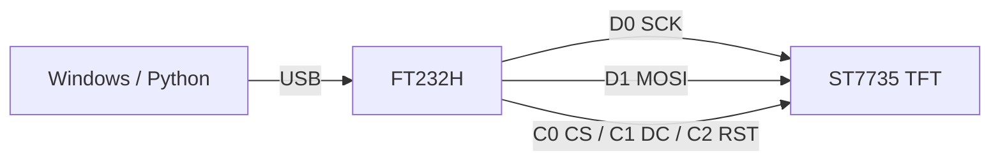

# FT232H 驅動 0.96" SPI TFT（ST7735）

用 FT232H 當「USB 轉 SPI」，直接從 Windows 上的 Python 驅動一片 0.96 吋 SPI 彩色 TFT，最後做成新聞 + 時鐘小螢幕。

重點心得：**這種小螢幕不要相信賣場寫的規格或網路上的預設值，要自己量出可見視窗的位置。**

## FT232H 是什麼

FTDI 的單通道 USB 2.0 Hi-Speed 晶片。一般當 USB 轉 UART，但它有 **MPSSE**（Multi-Protocol Synchronous Serial Engine），可以把一組腳變成 SPI / I2C / JTAG，剩下的腳當 GPIO。等於讓電腦多一組「像 MCU 一樣的腳位」，不用寫韌體。

## FT232H 腳位定義

板子上分兩排：**D0–D7**（ADBUS0–7）和 **C0–C9**（ACBUS0–9，Adafruit 板引出 C0–C7）。

### ADBUS（D0–D7）：MPSSE 用

| 腳位 | ADBUS | SPI 模式 | I2C 模式 | JTAG |
|---|---|---|---|---|
| D0 | ADBUS0 | **SCK**（時脈） | SCL | TCK |
| D1 | ADBUS1 | **MOSI**（主機輸出） | SDA（輸出） | TDI |
| D2 | ADBUS2 | **MISO**（主機輸入） | SDA（輸入） | TDO |
| D3 | ADBUS3 | CS0（pyftdi 硬體 CS） | — | TMS |
| D4–D7 | ADBUS4–7 | GPIO / 額外 CS | GPIO | GPIO |

- D0–D2 在 MPSSE 模式下是**固定功能**，不能拿去當別的。
- I2C 要把 D1 和 D2 接在一起當 SDA。Adafruit 的 FT232H 板上有一顆 **I2C 開關**就是做這件事：用 I2C 時撥 ON，**用 SPI 時一定要撥 OFF**，不然 MOSI 和 MISO 會短在一起。

### ACBUS（C0–C9）：GPIO

| 腳位 | 用途 |
|---|---|
| C0–C7 | 一般 GPIO，Blinka 裡叫 `board.C0`…`board.C7` |
| C8、C9 | 部分板子有，常被拿來接 LED 指示燈 |

### 電源腳

| 腳位 | 說明 |
|---|---|
| 5V | 直接來自 USB VBUS |
| 3V | 板上穩壓的 3.3V，給周邊用 |
| GND | 地 |

I/O 電位是 3.3V。

## 接線

TFT 模組的排針通常是 `GND VCC SCL SDA RES DC CS BLK`。名字很容易誤導人：**SCL/SDA 在這裡是 SPI 的 SCK/MOSI，不是 I2C**。

| TFT | FT232H | 說明 |
|---|---|---|
| GND | GND | |
| VCC | 3V | 不確定模組有沒有穩壓就接 3V |
| SCL | **D0** | SPI 時脈 |
| SDA | **D1** | SPI 資料（MOSI） |
| RES | C2 | 重置 |
| DC | C1 | 0 = 命令，1 = 資料 |
| CS | C0 | 片選 |
| BLK | 3V | 背光，不接通常也會亮 |

D2（MISO）不用接，這片螢幕只收不回。CS 我用 C0 這個 GPIO 由 Blinka 控制，沒有用 D3 的硬體 CS。



## Windows 環境

1. **換驅動**：插上 FT232H，Windows 會把它當成 `USB <-> Serial Converter`（VID `0403`、PID `6014`）。要讓 libusb 存取它，必須用 [Zadig](https://zadig.akeo.ie/) 換成 **WinUSB**。
   - Options → List All Devices → 選 `USB <-> Serial Converter` → WinUSB → Replace Driver
   - 換完它就不是 COM port 了。想還原，就到裝置管理員把這個裝置的驅動解除安裝。
2. **裝套件**：
   ```bash
   pip install pyftdi adafruit-blinka adafruit-circuitpython-rgb-display pillow libusb-package
   ```
3. **讓 pyusb 找得到 libusb DLL**：Windows 預設沒有 `libusb-1.0.dll`，pyftdi 會報 `ValueError: No backend available`。`libusb-package` 這個套件有附 DLL，把它的目錄加到 `PATH` 就好：
   ```python
   import os, libusb_package
   os.environ["PATH"] = os.path.dirname(libusb_package.get_library_path()) + os.pathsep + os.environ["PATH"]
   os.environ["BLINKA_FT232H"] = "1"   # 一定要在 import board 之前
   ```
4. **確認抓得到裝置**：
   ```bash
   python -c "from pyftdi.ftdi import Ftdi; Ftdi.show_devices()"
   # ftdi://ftdi:232h:FTAD44YR/1  (USB <-> Serial Converter)
   ```

### 錯誤訊息對照

| 錯誤 | 原因 |
|---|---|
| `ValueError: No backend available` | 找不到 libusb DLL（第 3 步） |
| `NotImplementedError: Operation not supported or unimplemented on this platform` | 抓得到 DLL，但裝置還是 FTDI 原廠驅動，沒換成 WinUSB（第 1 步） |
| `python -m venv` 時 `ensurepip` 失敗 | 路徑太深太長，把 venv 換到短一點的路徑 |

## ST7735 的坑：可見視窗在 RAM 的哪裡

ST7735 控制器內部的顯示 RAM 是 **132 × 162**，但面板只露出其中一塊。這塊可見視窗在 RAM 裡的起點，就是程式裡的 `x_offset` / `y_offset`。

```
  RAM 132 x 162
  ┌───────────────────────┐
  │                       │
  │   (x_offset, y_offset)│
  │   ┌───────────────┐   │
  │   │ 可見的面板    │   │
  │   └───────────────┘   │
  │                       │
  └───────────────────────┘
```

網路上「0.96 吋 TFT」幾乎都寫 80×160、offset 26/1、invert、BGR。**我這片全部不對**：它其實是 **128×64**。

### 症狀對照

| 看到的現象 | 原因 |
|---|---|
| 畫面側躺 | 寬高 / rotation 搞錯（把 128×64 當成 80×160） |
| 某一邊的白框不見 | offset 錯，框畫到可見範圍外了 |
| 邊緣有雜點或一條黑線 | offset 錯，看到 RAM 裡沒畫到的區域 |
| 紅藍對調 | `bgr` 設反 |
| 像底片一樣反色 | `invert` 設反 |
| 紅→黃、綠→紫、藍→淺藍 | **`invert` 和 `bgr` 兩個都設反** |

最後一種最難猜：純紅經過 R/B 對調變成純藍，再反相就變成黃。綠色不受對調影響，反相後變紫。

### 校正方法：在整塊 RAM 上畫刻度尺

不要一組一組猜 offset。直接把顯示器當成 132×162、offset 設 0，在整塊 RAM 上畫格線和座標標籤。面板邊緣看到的數字就是 offset。

1. **粗刻度**：每 16 列畫一條橫線並標上列號，每 16 欄畫一條直線。看最上面露出哪一個列號（我看到 `y64`）。
2. **細刻度**：在那附近每 4 列畫一條不同顏色的線並標號。最左邊 0–4 欄各畫一條 1px、顏色不同的直線，看最左邊露出的是哪個顏色。
3. **輪播候選值**：用算出來的幾組 offset 各畫一個 128×64 的白框，標上編號輪流顯示，挑四邊都完整的那組。
4. **找底邊**：固定上緣，輪播不同高度的框，看底線從哪一個開始出現。用「底邊 − 高度 + 1」反推上緣。

每換一組設定前，先把整塊 132×162 清成黑色，不然上一輪的殘影會被誤認成雜點。

我這片最後的結果：

```python
from adafruit_rgb_display import st7735
import board, digitalio

disp = st7735.ST7735R(
    board.SPI(),
    cs=digitalio.DigitalInOut(board.C0),
    dc=digitalio.DigitalInOut(board.C1),
    rst=digitalio.DigitalInOut(board.C2),
    width=128, height=64,
    x_offset=2, y_offset=67,   # 可見視窗 = RAM 的第 2~129 欄、第 67~130 列
    invert=False, bgr=False,
    baudrate=24_000_000,
    rotation=0,
)
```

- `x_offset=2`：(132 − 128) / 2，左右各留 2 欄，很合理。
- `y_offset=67`：一開始量到 70，結果上方多一條黑線、下方白線不見。量出底邊在第 130 列，反推上緣是 130 − 64 + 1 = 67 才對。
- `rotation` 在 `adafruit_rgb_display` 裡只是在送出前用 PIL 把圖**逆時針**旋轉，不會改控制器的 MADCTL。所以 90 / 270 度時，你畫的圖寬高要對調。

## 應用：新聞 + 時鐘

- **上方**：`HH:MM:SS`（Consolas Bold 16px）和日期星期（微軟正黑體）。
- **下方**：Google 新聞台灣版 RSS（`https://news.google.com/rss?hl=zh-TW&gl=TW&ceid=TW:zh-Hant`）的頭條，用 12px 微軟正黑體，一次顯示 3 行。標題太長時每 3 秒往上捲一行。

幾個小技巧：

- **中文斷行**要按像素寬度逐字斷（`font.getlength()`），不能用 `textwrap`。
- **抓 RSS 放背景 thread**，網路慢的時候時鐘才不會卡住。
- **只在內容變了才送畫面**：秒數、頁數或狀態有變才重畫，省下 SPI 頻寬。
- Google News 的標題後面會帶「 - 媒體名」，部分媒體還會帶「| 作者 | 分類」，可以先切掉，在 128 px 寬的螢幕上很省空間。
- **先把畫面存成 PNG 放大來看**，確認排版正確後再送到螢幕，不用每次都盯著小螢幕調。

## 參考

- [Adafruit FT232H 教學](https://learn.adafruit.com/circuitpython-on-any-computer-with-ft232h)
- [pyftdi 文件](https://eblot.github.io/pyftdi/)
- [Zadig](https://zadig.akeo.ie/)
- [adafruit_rgb_display](https://github.com/adafruit/Adafruit_CircuitPython_RGB_Display)
