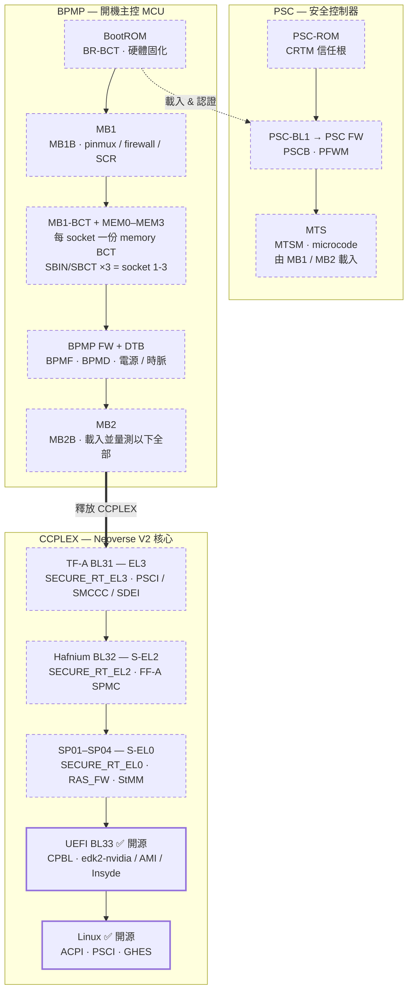
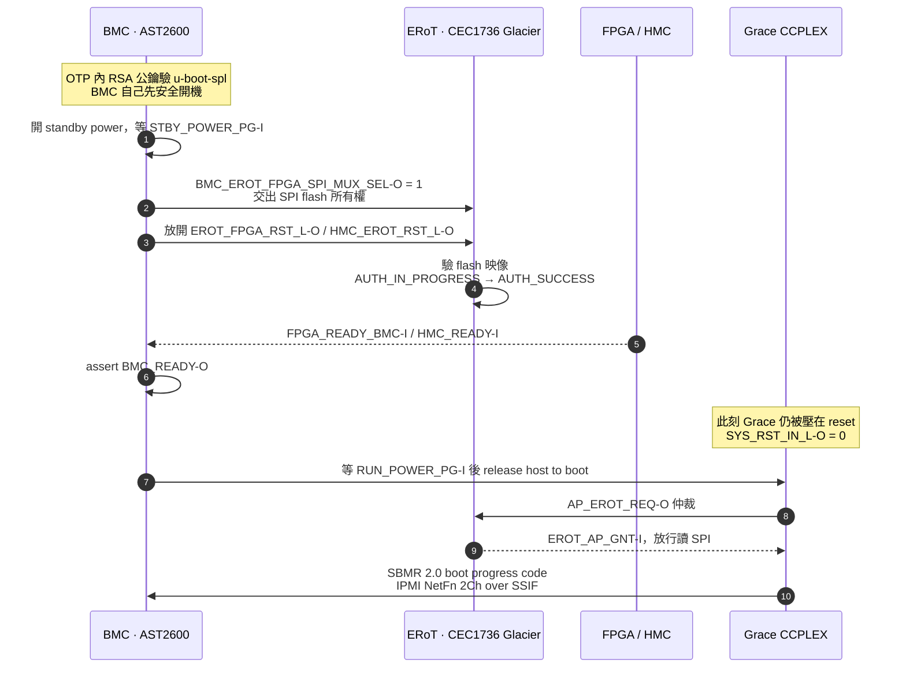
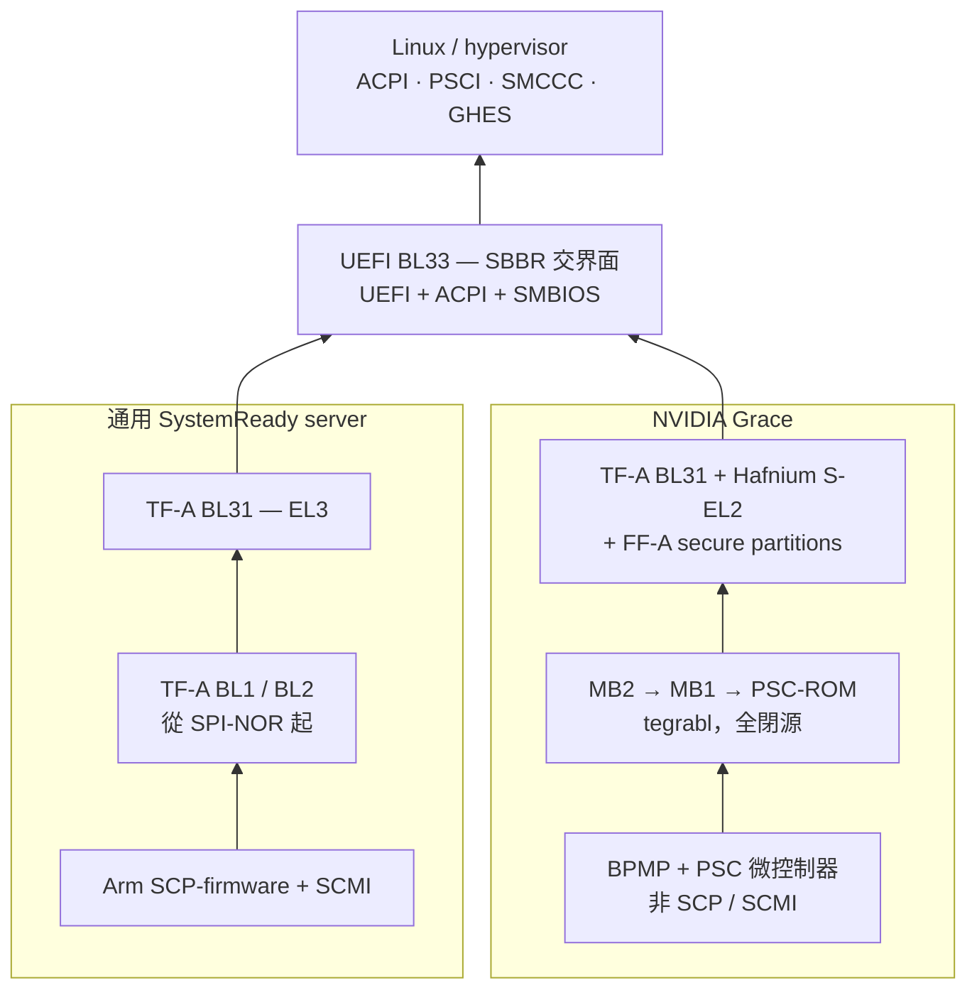

# 從 coreboot 到 Hafnium：重建 NVIDIA Grace 的 ARM Server Boot Flow

> **本文所有素材皆來自公開來源**：開源 repo、upstream commit、公開規格、廠商新聞稿。不涉及任何非公開資訊。
>
> 每一項結論標註證據等級：`[實證]` 公開資料逐字可查、`[推論]` 由多個實證交叉推出但無單一文件明講、`[未證實]` 找不到公開依據。

## TL;DR

- 問題起點是五個常被混在一起的名字：**coreboot、depthcharge、TF-A、Hafnium、EDK2**。答案是：**TF-A、EDK2、Hafnium 三個在 ARM server 上同時跑**；coreboot 是 SBBR recipe 底下被承認的 UEFI 實作之一（但沒人在 ARM server 上真的用）；depthcharge 純粹是 ChromeOS 的 payload，完全不在路徑上。
- NVIDIA 從未公開 Grace 的 boot flow。但 `NVIDIA/edk2-nvidia` 為了做 measured boot，**在原始碼裡把每個開機階段的名字列成表**，整條鏈因此可以還原。
- **Grace 有兩個身分**：UEFI 以上是乾淨的 Arm SystemReady SR；UEFI 以下根本不是 SBBR 那一套，而是 Tegra 的 `tegrabl` 架構放大到四 socket。
- upstream 的「缺席」是最強的證據：TF-A 沒有 `plat/nvidia/grace`、SCP-firmware 連 `NVIDIA` 字串都沒有、edk2-platforms 沒有 `Silicon/NVIDIA`。

---

## 0. 先把五個名字歸位

| 元件 | 在哪一層 | 跟 ARM server 的關係 |
| --- | --- | --- |
| **TF-A** | EL3（BL1/BL2/BL31） | **核心**。SBBR 的必要元件，提供 PSCI / SMCCC / SDEI runtime |
| **EDK2** | BL33，non-secure | **核心**。SBBR 要求的 UEFI 實作，產出 ACPI / SMBIOS |
| **Hafnium** | S-EL2 | **有，而且在 Grace 上是實際跑的**。FF-A 的 SPMC，隔離 secure partition |
| **coreboot** | UEFI 的替代實作 / platform init | **規格上有，實務上沒有**。Arm 2025 的 SBBR recipe 圖把 UEFI 實作列為 `EDK2 / Project Mu / LinuxBoot / coreboot` 四選一；但出貨的 ARM server 幾乎清一色 EDK2。coreboot 的 ARM port 主力仍是 Chromebook |
| **depthcharge** | ChromeOS payload | **無**。純 Chromebook verified boot，server 完全沒有 |

規範層面，ARM server 的關鍵字是 **Arm SystemReady**：`BSA`（硬體）+ `BBR`（開機介面）+ `BBSR`（安全介面）。

`[實證]` **這套分類在 2024 年 11 月改過。** 依 Arm SystemReady Compliance System Requirements Specification v3.0（2024-11-21）的 change history 逐字：

> • Move from Certification to Compliance
> • Merge SystemReady ES and SR into the new SystemReady
> • Change the SystemReady IR name to SystemReady Devicetree
> • Deprecate SystemReady LS

所以現在只剩兩個 band：**SystemReady band**（ACPI 路線，涵蓋原本的 SR 與 ES）與 **SystemReady Devicetree band**（原 IR）。**LS 廢止、VE 併入**，而且從 Arm 主導認證改為**廠商自我宣告（self-declared compliance），Arm 不再公布合規清單**。本文提到 SR / ES / IR / LS 時，指的都是 2024 年以前的舊制。

另外 `[實證]`：**SBSA 8.0（2025-07-24）廢掉了 "Level" 的概念** —— "Earlier versions of this specification used SBSA levels ... From SBSA 8.0, this concept is no longer used, and is replaced with SBSA specification version numbers." BSA 1.2（2025-07-01）同月一起廢。所以下文出現的 "SBSA Level 4" 是**發證當時**的講法。

相對地，Android / Chromebook 的 ARM SoC 共用了下半段（BootROM → TF-A，BL31 提供 PSCI 給 kernel 做 CPU hotplug/suspend），差別在 BL33 換成 LK / U-Boot / depthcharge，且用 device tree 而非 ACPI。

---

## 1. 關鍵突破：TCG 事件表洩漏了整條鏈

找 Grace 的 boot flow 文件是找不到的 —— NVIDIA 只替 Jetson 與 DRIVE 出過 boot flow 頁面。

但 `NVIDIA/edk2-nvidia` 是 BSD-2-Clause-Patent 開源的，而裡面這個檔案為了做 TCG measured boot，**必須**把每一個被量測的階段列成表：

```
Silicon/NVIDIA/Library/PlatformResourceLib/TH500Tcg2EventLog.c
```

（`TH500` 是 Grace 在 NVIDIA 內部的代號；SoC family 是 `T24X`，upstream Linux 則叫它 `Tegra241`。`Platform/NVIDIA/KconfigIncludes/SocT24X.conf` 裡的註解寫著 `# Support for T24X hardware (e.g. Grace)`。）

表中每一列是四字元 magic 加上 TCG 事件字串，其中四個字串**直接把 exception level 寫死了**：

| magic | TCG 事件字串 | 是什麼 |
| --- | --- | --- |
| `CPBL` | `BL_33` | UEFI 就是 BL33 |
| `BL31` | `SECURE_RT_EL3` | **TF-A** |
| `BL32` | `SECURE_RT_EL2` | S-EL2 runtime = **Hafnium** 當 SPMC |
| `SP01`–`SP04` | `SECURE_RT_EL0_n` | 四個 S-EL0 **FF-A secure partition** |
| `ATFD` / `HAFD` / `SD01`–`SD04` | `SECURE_DTB_EL3` / `EL2` / `EL0_n` | 各層的 device tree |

`[實證]` 以上全部逐字來自公開 repo。

再往前推，同一張表的前半段全是 Tegra 的命名：

```
FUSE → BCTB → PSCB → CRTM("PSCROM xx.yy") → MB1B → MBCT
     → MEM0..MEM3 → MINF → SBIN/SBCT ×3 → MTSM
     → PFWM → BPMF → BPMD → MB2B → CPBL → BL31 → BL32 → SP01..SP04
```

`MEM0..MEM3` 與 `SBIN/SBCT ×3` 揭露了另一件事：**每個 socket 有自己的 memory BCT，最多四 socket**，和 `TH500MB1Configuration.h` 裡的 `TEGRABL_SOC_MAX_SOCKETS 4` 對得起來。

`[推論]` 這張表是**量測順序**（MB2 載入東西時逐一量測），不是執行順序。下一節畫的是執行順序：MB2 全部載入後跳 BL31，BL31 起 secure world，最後才交棒 BL33 —— 這是 TF-A 的標準行為。

---

## 2. Grace 的完整開機鏈

```
  PSC                      BPMP                    CCPLEX
  (安全控制器)              (開機主控 MCU)           (Neoverse V2 核心)
 ─────────────           ──────────────          ──────────────────
  PSC-ROM                  BootROM
  CRTM / 信任根             BR-BCT / 硬體固化
      │                        │
      │  ◄── 載入 & 認證 ───────┤
      ▼                        ▼
  PSC-BL1 → PSC FW           MB1
  PSCB · PFWM                MB1B · pinmux/firewall/SCR
      │                        │
      │                        ▼
  MTS  ◄─────────────  MB1-BCT + MEM0..MEM3
  MTSM · microcode         每 socket 一份 memory BCT
                           SBIN/SBCT ×3 = socket 1-3
                               │
                               ▼
                           BPMP FW + DTB
                           BPMF · BPMD · 電源/時脈
                               │
                               ▼
                           MB2  ──── 釋放 CCPLEX ────┐
                           MB2B                      │
                           載入並量測以下全部          ▼
                                            ┌──────────────────────┐
                                            │ TF-A BL31            │  EL3
                                            │ PSCI / SMCCC / SDEI  │
                                            └──────────┬───────────┘
                                                       ▼
                                            ┌──────────────────────┐
                                            │ Hafnium  BL32        │  S-EL2
                                            │ FF-A SPMC            │
                                            └──────────┬───────────┘
                                                       ▼
                                            ┌──────────────────────┐
                                            │ SP01–SP04            │  S-EL0
                                            │ RAS_FW · StMM        │
                                            └──────────┬───────────┘
                                                       ▼
                                            ┌══════════════════════┐
                                            ║ UEFI  BL33           ║  ← 唯一開源
                                            ║ edk2-nvidia / AMI /  ║
                                            ║ Insyde               ║
                                            └══════════┬═══════════┘
                                                       ▼
                                            ┌══════════════════════┐
                                            ║ Linux                ║
                                            ║ ACPI · PSCI · GHES   ║
                                            └══════════════════════┘

  ┌───┐ 虛線框 = 閉源二進位，NVIDIA 金鑰簽章，upstream 完全沒有
  ╔═══╗ 雙線框 = 原始碼公開
```

同一張圖的 mermaid 版本（虛線框＝閉源二進位，實線粗框＝原始碼公開）：



兩個值得記住的重點：

1. **CCPLEX（跑 Linux 的那些 Neoverse V2 核心）一直到 MB2 才被放出 reset。** 最先醒的是 BPMP 這顆微控制器，不是 CPU。這跟通用 ARM server「核心一出 reset 就跑 EL3 firmware」完全不同。
2. **整條鏈上只有最後兩格是開放的。** NVIDIA 只公開 BL33 這一層，而且連這層 OEM 都可以換成 AMI 或 Insyde。

`[推論]` Grace 是否與 Tegra 共用同一份 PSC-ROM / MB1 / MB2 程式碼，沒有公開依據。已知的是命名慣例與 `tegrabl` 資料結構一致（`TEGRA_CPUBL_PARAMS_V0/V1`、`CARVEOUT_MB2_PARAMS`、`CARVEOUT_BPMP`、`CARVEOUT_PSC_TZ`、`CARVEOUT_TZDRAM`、`CARVEOUT_EGM` …）。

---

## 3. Grace 走 ACPI，不走 device tree

這點有硬證據。

`[實證]` SMMUv3 CMDQV 驅動的 commit `918eb5c856f`（"iommu/arm-smmu-v3: Add in-kernel support for NVIDIA Tegra241 (Grace) CMDQV"）訊息最後一句：

> As the initial version, the CMDQV driver only supports ACPI configurations.

`[實證]` 驅動的發現路徑在 `arm-smmu-v3.c` 的 `acpi_smmu_dsdt_probe_tegra241_cmdqv()`，註解寫著 `/* Look for an NVDA200C node whose _UID matches the SMMU node ID */` —— 也就是 **IORT SMMUv3 node + DSDT companion device**。這個 `NVDA200C` HID 在 `edk2-nvidia` 的 `Dsdt_TH500.asl` 裡逐字對得上，而 NVIDIA 的公開 wiki 也寫明 `NVDA200C = SMMU CMDQV, introduced in Grace`。

`[實證]` `arch/arm64/boot/dts/nvidia/` 底下只有 tegra132/186/194/210/234，**沒有 tegra241**；repo-wide grep `nvidia,grace` 零命中。

Grace 的 UEFI 會產出的 ACPI 表（來自 `Silicon/NVIDIA/Drivers/ConfigurationManagerData/` 的 parser 目錄）：

```
FADT MADT GTDT DSDT SSDT MCFG SPCR DBG2
PPTT SRAT SLIT HMAT IORT APMT MPAM TPM2 WSMT SPMI
```

沒有 PCCT，也沒有 CEDT/CXL 產生器。FADT 的 ARM boot arch flag 只設 `EFI_ACPI_6_6_ARM_PSCI_COMPLIANT`（PSCI 走 SMC conduit，不用 HVC）。

### 3.1 errata 靠 SMCCC 認，不靠 MIDR

`[實證]` kernel 裡每一個 Grace quirk —— GICv3 的 `T241-FABRIC-4`、MPAM 的 `T241-MPAM-1/4/6`、`acpi/arm64/thermal_cpufreq.c` —— 都是用 `arm_smccc_get_soc_id_version()` 比對 `SMCCC_SOC_ID_T241 = 0x036b0241`（JEP106 `036b` = NVIDIA，SoC `0241`）。

也就是說 **SoC 身分是 EL3 firmware 透過 SMCCC 報給 OS 的**，不是從 CPU register 讀的。這正是 firmware-first 的思路。

`[實證]` 對照組很有意思：`cputype.h` 裡 NVIDIA implementer `0x4E` 底下有 Denver(`0x003`)、Carmel(`0x004`)、Olympus(`0x010`)，**沒有 Grace**。Grace 的核心在 kernel 眼中就是 stock Neoverse V2（`0x410fd4f0`），只有 SoC fabric 是 NVIDIA 特規。而後繼的 **Tegra410 / Olympus（即 Vera）** 在 2026 年拿到了真正的自研核心 errata（`NVIDIA_OLYMPUS_1027_ERRATUM`、`ARM64_ERRATUM_4118414`）。Grace 用 Arm 的核心，Vera 開始用自己的。

---

## 4. upstream 的「缺席」本身就是證據

把 repo clone 下來 grep，而不是看搜尋摘要。缺席比存在更能說明架構：

| Repo | 找 Grace / TH500 / Tegra241 | 意義 |
| --- | --- | --- |
| `arm-trusted-firmware` | **零命中。**`plat/nvidia/` 底下只有 `tegra/soc/t194`；t210、t186 已在 2026-01 被 deprecate 移除 | Grace 的 BL31 來自**閉源 fork**。NVIDIA 有 680 個 commit 進 TF-A，但全部是通用層（SDEI、GICv3、SPMD/FF-A、RMMD、xlat_tables），沒有一個 platform port |
| `SCP-firmware` | 零命中，連 `NVIDIA` 字串都沒有 | Grace 不用 Arm SCP + SCMI。它用自己的 **BPMP + PSC**。這是 Tegra 血統最直接的證據 |
| `edk2-platforms` | 沒有 `Silicon/NVIDIA`，也沒有 `Platform/NVIDIA` | NVIDIA 的 UEFI 走自己的 `NVIDIA/edk2-nvidia`，不進 tianocore 主線 |
| `linux` | 沒有 tegra241 DT、沒有 `nvidia,grace` compatible、CPU part 表裡沒有 Grace | Grace 走純 ACPI，OS 只需要四個小 quirk 加兩個 driver |

一個有趣的細節：`[實證]` TF-A 裡唯一跟 Grace 相關的 commit 是 `a02a45dfe`（"fix(gicv3): workaround for NVIDIA erratum T241-FABRIC-4"），它修的是**共用的** `drivers/arm/gic/v3/`，掛在通用的 `GICV3_IMPL_GIC600_MULTICHIP` build flag 底下 —— 現在的樹裡連 `T241` 這個字串都留不下來，只有 commit message 裡有。

---

## 5. RAS 跑在 Hafnium 底下的 secure partition 裡

這是我覺得整件事最漂亮的一條線索，也是 **Hafnium 在 server 上的實際用途**，不只是規格書上的名詞。

`[實證]` `edk2-nvidia` 的 `Silicon/NVIDIA/Include/Server/RASNSInterface.h` 顯示 Grace 的 RAS 實作不在 UEFI 裡、也不在 kernel 裡，而是在一個**閉源的 secure partition** 裡，UEFI 靠 FF-A direct message 跟它講話：

```c
RAS_FW_UUID_0            0x3c99b242
RAS_FW_NS_BUFFER_REQ     0xC0270001
RAS_FW_GUID_COMMUNICATION 0xC0270002
```

`FfaAllocateAndMapRxTxBuffers()` 呼叫 `ARM_SVC_ID_FFA_RXTX_MAP`，註解原文：

> Buffers allocated and mapped with Hafnium

`[實證]` UEFI 這側，`Silicon/NVIDIA/Server/TH500/Drivers/ApeiDxe/` 產生 **HEST、BERT、EINJ** 並使用 **SDEI**。

`[實證]` OS 那側，2026 年 Kai-Heng Feng（NVIDIA）把 `drivers/acpi/apei/ghes-nvidia.c` 推上 upstream，綁 ACPI HID `NVDA2012`，解 Grace 的 vendor CPER section。commit message：

> The NVIDIA CPER section contains a fixed header with error metadata (signature, error type, severity, socket) followed by variable-length register address-value pairs for hardware diagnostics.

`[實證]` `drivers/edac/` 裡完全沒有 Grace 驅動 —— 因為記憶體錯誤是 firmware 先接。

整條路徑：

```
硬體錯誤 → RAS_FW (S-EL0 secure partition)
        → Hafnium (S-EL2, FF-A SPMC)
        → TF-A BL31 (EL3)
        → SDEI / GHES + HEST/BERT/EINJ
        → Linux ghes-nvidia.c → CPER decode
```

同一份 patch series 順帶洩漏了 Vera 的一點消息：`[實證]` "Vera uses a different section GUID and event layout."

---

## 6. 帶外：CPU 被放出 reset 之前，已經跑完一輪

`NVIDIA/openbmc` 下游樹（不是 upstream 的 `meta-nvidia`，那層很薄）裡的 shell script 把 GB200 NVL 的上電順序寫得非常白。以下全部 `[實證]`，出自 `bmc_ready.sh` 與 `powerctrl.sh`：

1. AST2600 用 OTP 裡的 RSA 公鑰驗 `u-boot-spl`，**BMC 自己先安全開機**
2. BMC 打開 standby power，等 `STBY_POWER_PG-I`
3. BMC 設 `BMC_EROT_FPGA_SPI_MUX_SEL-O=1` —— **把 SPI flash 的所有權交給 ERoT**
4. 放開 `EROT_FPGA_RST_L-O`、`HMC_EROT_RST_L-O`，ERoT 開始驗它負責那顆晶片的 flash 映像
5. 放開 HMC，等 `HMC_READY-I`、`FPGA_READY_BMC-I`，然後 assert `BMC_READY-O`（註解：*informs FPGA that BMC GPIO signals are trustworthy*）
6. 上電時 `powerctrl.sh` 先 `SYS_RST_IN_L-O=0` **把 Grace 壓在 reset**，等 `RUN_POWER_PG-I`，才「*release host to boot*」
7. Grace UEFI 開機，透過 `AP_EROT_REQ-O` / `EROT_AP_GNT-I` 仲裁去讀自己的 SPI
8. UEFI 用 **Arm SBMR 2.0** 的 IPMI 指令（NetFn `2Ch`，Command `02h`/`03h`）經 **SSIF** 回報 boot progress code 給 BMC

同一段時序：



### 6.1 ERoT 是什麼

`[實證]` **ERoT = Microchip CEC1736，NVIDIA 內部代號 Glacier**（出自 `nvbmc-docs` 的 "Enable PLDM FW Update for AP with an ERoT (CEC1736/Glacier)"）。每顆主要晶片配一個：`ERoT_CPU_0/1`、`ERoT_GPU_*`、`ERoT_FPGA_0`、`ERoT_HMC_0`、`ERoT_BMC_0`。它是那顆晶片的 **SPDM responder**，也是 **PLDM Type 5 的 firmware device**，甚至可以對 BMC 拉 `#SRST`。

`[實證]` `wait_for_erot_auth.sh` 裡的狀態碼（註解寫 *these are from the Glacier Firmware Design Document*）洩漏了它在驗什麼：

```
0  NOT_AUTHENTICATED          4  ROLLBACK_PROTECTION_CHECK_ERR
1  AUTH_SUCCESS               6  AUTH_ERR
2  VALIDATE_PUBLIC_KEY_ERR    7  SPI_READY_ERR
3  KEY_REVOKE_CHECK_ERR      15  AUTH_IN_PROGRESS
```

`[推論]` ERoT 實體串在它負責那顆晶片的 SPI flash 上 —— 從 GPIO 名稱（`AP_EROT_REQ-O`、`EROT_SPI_ERR_CPU_INT`）與錯誤字串（`SPI_READY_ERR: "Failed to read spi during authentication"`）推得，沒有文件明說。

`[未證實]` 出貨韌體是否真的**等 CPU ERoT 認證通過才放 reset**。`wait_for_erot_auth.sh` 放在 `samples/` 底下，而 `powerctrl.sh::power_on` 並沒有呼叫它。

### 6.2 一個反直覺的結論

**BMC 不供應 host firmware。** 它管的是電源、reset、以及「誰擁有那條 SPI bus」；真正驗證並放行 host 映像的是 ERoT。

協定分層（`[實證]`，出自 `nvbmc-docs`）：

```
Redfish (bmcweb) ── UpdateService / SPDM measurements / BootProgress
      │ D-Bus
pldmd (PLDM T5, DSP0267)   spdmd (SPDM v1.1, DSP0274)   nsmd (NVIDIA VDM 0x7E)
      └──────────── MCTP (DSP0236) ────────────┘
   bindings: PCIe VDM · USB · SMBus/I2C · SPI (Glacier SPB-AP)
```

- **韌體更新 = PLDM Type 5**，打包成 `.fwpkg`，經 Redfish `UpdateService` 推下去，BMC 先驗簽章再分發
- **Attestation = SPDM over MCTP**，BMC 當 Requester。**BMC 自己不做驗證**，只代收 measurement 交給外部 verifier。憑證是 TCG DICE，rooted in NVIDIA root cert
- **Telemetry = NSM**，NVIDIA 自訂的 MCTP VDM type `0x7E`，規格不公開

---

## 7. 對照：通用 SystemReady SR server vs Grace

| 面向 | 通用 SystemReady SR server | NVIDIA Grace |
| --- | --- | --- |
| 誰先出 reset | CPU 核心，直接跑 EL3 firmware | **BPMP 微控制器**；CCPLEX 到 MB2 才被放出來 |
| 信任根 | 多為 SPI-NOR + BL1 | **PSC-ROM 當 CRTM**，外加板上 ERoT |
| pre-EL3 | 通常沒有，或 BL1+BL2 | **PSC-ROM → MB1 → MB2**（`tegrabl`），全閉源、NVIDIA 金鑰簽章 |
| EL3 | TF-A BL31，多半有 upstream plat port | TF-A BL31，**閉源 fork**，upstream 無 `plat/nvidia/grace` |
| S-EL2 / S-EL0 | 選配（OP-TEE、StMM） | **Hafnium S-EL2 + 多個 FF-A S-EL0 SP**（RAS_FW、StandaloneMM） |
| SCP | 常見 Arm SCP-firmware + SCMI | **BPMP + PSC**，NVIDIA 專有 |
| 交棒 OS | UEFI + ACPI（SBBR） | **相同** |
| ACPI 表 | FADT/MADT/GTDT/MCFG/SPCR/DBG2/PPTT/SRAT/SLIT/IORT | 相同，**再加 HMAT、APMT、MPAM、SPMI、WSMT** |
| OS 可見介面 | PSCI、SMCCC、CPPC、GHES | **完全相同** |



一句話：**SBBR 只規範 UEFI 這條界線以上；界線以下 Grace 是 Tegra，不是 SystemReady。**

### 7.1 Arm 自己畫的參考 server firmware 堆疊

`[實證]` Dong Wei（Arm Fellow）在 UEFI 2025 Developers Conference（2025-10-10）的 "Arm System Firmware Architecture" 裡，"Example Server System Software" 那張圖列的階段是：

```
BL1 (TF-A stage 1) → BL2 (TF-A stage 2)
  → BL31 (TF-A, Root Monitor / EL3 Runtime Firmware)
  → BL32 (SPM / Hafnium)
  → RMM (TF-RMM, Realm Management Monitor)
  → BL33 (UEFI, Non-trusted Firmware)
旁路：RSE (Runtime Security Engine, MCUBoot) + SCP runtime (DVFS / Power Control)
```

把它跟本文第 2 節重建出來的 Grace 鏈疊在一起看，對應關係非常乾淨：

| Arm 參考架構 | Grace 的對應物 |
| --- | --- |
| RSE（Runtime Security Engine，跑 MCUBoot） | **PSC**（PSC-ROM → PSC-BL1 → PSC FW） |
| SCP runtime（DVFS / Power Control） | **BPMP FW + DTB** |
| BL1 / BL2 | **MB1 / MB2**（`tegrabl`，非 TF-A） |
| BL31 Root Monitor | TF-A BL31（閉源 fork） |
| BL32 SPM / Hafnium | Hafnium（`SECURE_RT_EL2`） |
| Secure Partitions | SP01–SP04（RAS_FW、StMM） |
| RMM / TF-RMM（CCA） | **無公開證據** |
| BL33 UEFI | edk2-nvidia / AMI / Insyde |

`[推論]` 換句話說，Grace **不是偏離 Arm 的參考架構**，而是把 BL1/BL2 那兩格換成自家的 `tegrabl`、把 RSE/SCP 換成自家的 PSC/BPMP。上下兩端（BL31 以上、以及交棒給 OS）都對得起來，中間那段是 NVIDIA 的私有資產。

`[未證實]` Grace 是否有 RMM / CCA 的實作。Arm 的參考圖有 TF-RMM，但 Grace 這邊找不到任何公開痕跡。

---

## 8. 未證實清單

寫出來提醒自己（和讀者）不要當事實用：

- NVIDIA **從未公開任何 Grace boot flow 文件**。本文整條鏈是從 measured-boot 事件表 + Jetson 文件對照重建的，不是官方說法。
- Grace 的 PSC-ROM / MB1 / MB2 是否與 Tegra 共用同一份程式碼，無公開依據。
- ~~Arm 官方清單裡找不到 NVIDIA~~ —— **這條原本寫錯，已更正。** Arm 自己的 CDN 上有一份 NVIDIA 專屬證書 PDF（`armkeil.blob.core.windows.net/.../arm-systemready-sr-certification-nvidia.pdf`），共 **14 筆**，涵蓋 2023-08-18 到 2025-04-08：GB200 NVL Reference System、GH200 x4 P4496、GH200 P4351、Grace Superchip P4352、1RU Air Cooled MGX C1、MGX GH200 / MGX Grace CPU Reference System。等級由 SR v2.4 → **SR v2.5**，全部 SBSA Level 4 + SBBR v1.0，2023-09 之後幾乎都帶 **SIE v1.2**。
  更值得注意的是**發證的 firmware 有三種**：`NVIDIA SBIOS 00.20.00`（NVIDIA 自己的）、`AMI Aptio V`、`INSYDE H2O`。也就是說 **NVIDIA 自家的 SBIOS 本身就過了 SystemReady 認證**，不是只有 IBV 拿。
- **Caliptra 沒有證據用在任何出貨的 NVIDIA 產品上。** NVIDIA 確實有貢獻 `caliptra-sw`（近 500 個 commit 裡有 10 個，含 PCR reservation、PL0 checks、ML-KEM FIPS KAT、DPE），但 GB200 上的 RoT 全部是外掛的 Glacier。
- **Vera 的 firmware 架構幾乎沒有公開資料。** 唯一實質線索是 CPER patch 說 Vera 用了不同的 section GUID 與 event layout，以及 Tegra410 開始有自研核心 errata。
- NSM（NVIDIA System Management，MCTP VDM type `0x7E`）規格不公開。
- Glacier 韌體設計文件不公開，ERoT 內部的量測鏈無從得知。
- Hafnium upstream 是否有 NVIDIA/Grace platform 未能驗證（`git.trustedfirmware.org` 從本次環境無法存取）。Grace 使用 Hafnium 是從 `edk2-nvidia` 這側確立的。

---

## 參考資料

**核心證據**

- [NVIDIA/edk2-nvidia](https://github.com/NVIDIA/edk2-nvidia) — `TH500Tcg2EventLog.c`、`Dsdt_TH500.asl`、`RASNSInterface.h`、`TH500ResourceConfigPrivate.h`、`TH500MB1Configuration.h`
- [edk2-nvidia ACPI HID List](https://github.com/NVIDIA/edk2-nvidia/wiki/ACPI-HID-List)

**upstream（含缺席證據）**

- [ARM-software/arm-trusted-firmware](https://github.com/ARM-software/arm-trusted-firmware)
- [ARM-software/SCP-firmware](https://github.com/ARM-software/SCP-firmware)
- [tianocore/edk2-platforms](https://github.com/tianocore/edk2-platforms)
- [Linux: NVIDIA Tegra241 uncore PMU](https://docs.kernel.org/admin-guide/perf/nvidia-pmu.html)
- [Linux: Silicon Errata and Software Workarounds](https://www.kernel.org/doc/html/latest/arch/arm64/silicon-errata.html)
- [LWN: ACPI: APEI: GHES: Add NVIDIA Vera CPER decoding](https://lwn.net/Articles/1087102/)
- [NVIDIA T241-FABRIC-4 errata](https://developer.nvidia.com/docs/t241-fabric-4/nvidia-t241-fabric-4-errata.pdf)

**帶外 / BMC**

- [NVIDIA/openbmc](https://github.com/NVIDIA/openbmc) — `bmc_ready.sh`、`powerctrl.sh`、GB200 NVL device tree
- [NVIDIA/nvbmc-docs](https://github.com/NVIDIA/nvbmc-docs) — MCTP / SPDM / PLDM T5 / SBMR boot progress 設計文件
- [NVIDIA/open-nvfwupd](https://github.com/NVIDIA/open-nvfwupd)
- [GB200/GB300 Rack Firmware Update](https://docs.nvidia.com/mission-control/docs/rack-bring-up-install/2.0.0/rack-firmware-update.html)
- [OSFC 2024: Adapting OpenBMC for NVIDIA Platforms](https://talks.osfc.io/osfc-2024/talk/KA3ZWC/)

**標準與對照組**

- **Dong Wei, "Arm System Firmware Architecture", UEFI 2025 Developers Conference & Plugfest, 2025-10-10** — [slides](https://uefi.org/sites/default/files/resources/13.%20Arm%20System%20Firmware_Arm_Wei_FINAL.pdf)（本文第 7.1 節的參考堆疊出自此）
- Samer El-Haj-Mahmoud & G Edhaya Chandran, "Advancing Firmware Compliance in the Arm Ecosystem", UEFI 2025, 2025-10-10 — [slides](https://uefi.org/sites/default/files/resources/9.%20Advancing%20Firmware%20Compliance_Arm_Chandran%20and%20El%20Haj%20Mahmoud_final.pdf)
- Samer El-Haj-Mahmoud & Jose Marinho, "Evolving ACPI Standards for Arm Systems", UEFI 2025 — [slides](https://uefi.org/sites/default/files/resources/12.%20Evolving%20ACPI%20Standards_Arm_El%20Haj%20Mahmoud%20and%20Marinho_FINAL.pdf)
- Sunny Wang, "Integrate Arm SystemReady Band Compliance Test Suites", UEFI 2025 — [slides](https://uefi.org/sites/default/files/resources/15.%20Integrate%20Arm%20SystemReady_Arm_Wang_FINAL.pdf)
- Dong Wei & Samer El-Haj-Mahmoud, "Arm SystemReady and the UEFI Firmware Ecosystem", UEFI 2021 Virtual Plugfest, 2021-01-26 — [slides](https://uefi.org/sites/default/files/resources/Arm%20SystemReady%20and%20the%20UEFI%20Firmware%20Ecosystem_0.pdf)（band 分類已過時，但 System Firmware Landscape 與 Firmware Interfaces 兩張圖仍好用）
- [Arm × NVIDIA × Insyde: Designing standards compliant servers with Arm SystemReady and the NVIDIA Grace open ecosystem](https://www.insyde.com/wp-content/uploads/Designing-standards-compliant-servers-with-Arm-SystemReady-and-the-NVIDIA-Grace-open-ecosystem.pdf)
- [Arm: Previously Awarded SystemReady Certifications](https://www.arm.com/architecture/system-architectures/systemready-compliance-program/systemready-past-certifications) · [NVIDIA 證書 PDF](https://armkeil.blob.core.windows.net/developer/Files/pdf/certificate-list/arm-systemready-sr-certification-nvidia.pdf)
- 現行規格：[BSA 1.2](https://developer.arm.com/documentation/den0094/latest/)（2025-07-01）· [SBSA 8.0](https://developer.arm.com/documentation/den0029/latest/)（2025-07-24）· [BBR 2.2](https://developer.arm.com/documentation/den0044/latest/) · [BBSR 1.4](https://developer.arm.com/documentation/den0107/latest/)（2025-07-14）· [SBMR 3.0](https://developer.arm.com/documentation/den0069/latest/)
- 測試套件：[ARM-software/sysarch-acs](https://github.com/ARM-software/sysarch-acs)（已取代 `bsa-acs` / `sbsa-acs`，兩者 2025-08 起 read-only）· [arm-systemready](https://github.com/ARM-software/arm-systemready)（現行 release `v26.03_SR_3.1.1`）· [bbr-acs](https://github.com/ARM-software/bbr-acs) · [sbmr-acs](https://github.com/ARM-software/sbmr-acs)（2026 新增，SBMR 3.0 ALP2）
- [QEMU `sbsa-ref` machine](https://www.qemu.org/docs/master/system/arm/sbsa.html) — 可在本機跑 upstream TF-A + EDK2 的 ARM server 環境
- [Jetson Thor Boot Flow](https://docs.nvidia.com/jetson/archives/r38.4/DeveloperGuide/AR/BootArchitecture/JetsonThorBootFlow.html)
- [Jetson Orin Boot Flow](https://docs.nvidia.com/jetson/archives/r36.5/DeveloperGuide/AR/BootArchitecture/JetsonOrinSeriesBootFlow.html)
- [TF-A: Secure Partition Manager](https://trustedfirmware-a.readthedocs.io/en/latest/components/secure-partition-manager.html)
