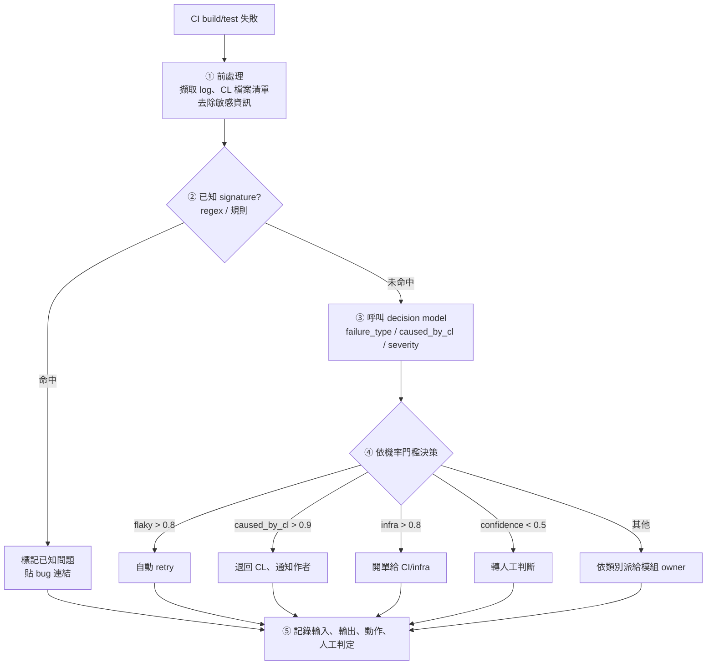

# Jev 是什麼？從 System One 決策模型看韌體 CI 自動化

## TL;DR

- **Jev** 是 TypeSafe AI 在 2026 年 9 月推出的「System One Model」（也叫 decision model）。它**不生成文字，只回傳帶機率的型別化判斷**。
- 跟傳統 LLM 相比，它強調**快**（70–500 ms）、**便宜**（輸入 $0.042 / 百萬 token，輸出免費）、**不會產生格式錯誤**（輸出受 schema 約束）。
- 對韌體工程師來說，它**不是跑在裝置裡的元件**，而是可以用來改善**開發與 CI 流程**的工具，例如 build 失敗分類、crash 分群、CL 風險評分。
- 導入的關鍵原則是：**規則先、模型後、人最後**，並且先用 shadow mode 驗證再逐步自動化。

---

## 1. Jev 是什麼

Jev 由 TypeSafe AI 開發，2026 年 9 月 15 日以有限 early access 形式發布，同時宣布由 DCVC 領投的 4,000 萬美元種子輪。創辦人 Diogo Almeida 曾在 OpenAI 參與 RLHF、InstructGPT 與 ChatGPT 的研究。

它的定位很明確：**給程式用的判斷器，不是給人讀的聊天機器人。**

使用方式是送進一個 `state`（要判斷的內容）和一組 `questions`，模型會平行回答所有問題。問題只有三種型別：

| 型別 | 用途 | 回傳 |
|---|---|---|
| `noul` | 是／否 | 0–1 的機率 |
| `choice` | 多選一（原生最多 255 個選項） | 選項 + 機率分布 + 信心值 |
| `score` | 分級評分 | 分數 + 各級機率 + 信心值 |

---

## 2. 跟傳統 LLM 有什麼不一樣

| 面向 | Jev | 傳統 LLM |
|---|---|---|
| 輸出 | 符合預定 schema 的型別值 | 自由文字 |
| 格式錯誤／幻覺 | 輸出格式上不可能出錯 | 可能亂寫、JSON 壞掉、捏造 tool call |
| 生成方式 | 非自回歸，一次平行輸出 | 逐 token 生成 |
| 延遲 | 70–500 ms（多數約 100 ms） | 數秒到數分鐘 |
| 價格 | 輸入 $0.042 / 百萬 token，輸出免費 | 輸入輸出都收費，輸出通常更貴 |
| 信心值 | 經過校準的機率 | 常常過度自信 |
| 訓練方法 | RLCD（Reinforcement Learning for Calibrated Decisions），合成資料 | RLHF／verifiable reward |

名稱中的「System One」借用了 Kahneman 的雙系統理論：

- **System 1**：快速、直覺的判斷 → Jev
- **System 2**：慢速、需要推理和表達 → LLM

兩者比較像**互補**，不是互相取代。LLM 適合寫程式、寫文件、多步推理；Jev 適合大量、重複、只需要一個判斷的工作。

### 限制與爭議

- **不能生成文字**，也還不支援圖片輸入。
- **比 LLM 更黑箱**：只拿到數字，沒有推理過程。Simon Willison 特別提醒，用在招募等敏感場景可能有偏見風險。
- **benchmark 由官方自行設計**：「快 193 倍、便宜 445 倍」這類數字，官方也承認可能落在真實情況的高端。
- **架構與權重未公開**，有人質疑它可能建立在既有的 open-weight LLM 之上。

---

## 3. 跟韌體有什麼關係

### 直接關係：幾乎沒有

- Jev 是雲端 API，不能燒進裝置。
- 70–500 ms 的延遲包含網路來回，對韌體的即時控制（µs 到 ms 級、需要可預測）太慢且不可靠。
- 開機早期、recovery mode 等環境本來就沒有網路。
- 安全相關的邏輯（power sequencing、secure boot）需要可驗證、可解釋，不適合交給機率黑箱。

### 間接關係一：開發與 CI 流程（最實際）

韌體／平台整合工作中，有大量「高量、格式固定、只需要一個判斷」的工作：

- CI build／test 失敗分類與派單
- Kernel panic／tombstone 分群與重複偵測
- CL 風險評分，決定要跑哪些測試
- Patch 是否碰到高風險區（bootloader、PMIC、AVB）

這些正好是 decision model 的強項。它的輸出是 enum 加機率，可以直接接進 Jenkins／Gerrit 的 `if/else`，不需要 parse 自由文字。

### 間接關係二：概念上接近 edge AI

Jev 做的是「輸入 → 帶機率的分類／分數」，這其實就是裝置端 NPU 一直在跑的工作（喚醒詞、異常偵測、sensor fusion）。差別在於：

- 傳統 edge 模型：**每個任務訓練一個**小模型
- Jev：**一個通用模型**，用自然語言定義問題就能分類

若未來這類 decision model 能蒸餾到夠小、跑在手機或平板的 NPU 上，可能會出現「裝置端的通用判斷器」。不過這只是推測，TypeSafe 目前沒有公布任何 on-device 計畫。

---

## 4. 實作範例

> API 格式參考第三方整理（`POST /v1/systemone`），實際使用前請以官方文件為準。

### 範例一：CI build 失敗自動分類與派單

```python
import os
import requests

API_URL = "https://api.typesafe.ai/v1/systemone"


def triage_build_failure(log_tail: str, changed_files: list[str]) -> str:
    resp = requests.post(
        API_URL,
        headers={"Authorization": f"Bearer {os.environ['TYPESAFE_API_KEY']}"},
        json={
            "model": "jev-latest",
            "state": {
                "log_tail": log_tail,            # 最後 200 行 log
                "changed_files": changed_files,  # 這次 CL 改動的檔案
            },
            "questions": {
                "failure_type": {
                    "type": "choice",
                    "instructions": "What caused this Android build failure?",
                    "criteria": {
                        "infra": "Server/network/disk/OOM, repo sync or ccache problems",
                        "flaky": "Timeout or nondeterministic test, likely passes on retry",
                        "compile": "C/C++/Java/Kotlin compile or link error",
                        "sepolicy": "SELinux policy / neverallow violation",
                        "vintf": "VINTF / HAL manifest / compatibility matrix mismatch",
                        "other": None,
                    },
                },
                "caused_by_this_cl": {
                    "type": "noul",
                    "instructions": "Is the error in or related to `changed_files`?",
                },
            },
        },
        timeout=5,
    ).json()

    a = resp["answers"]
    ft = a["failure_type"]

    if ft["choice"] == "flaky" and ft["probabilities"]["flaky"] > 0.8:
        return "RETRY"
    if a["caused_by_this_cl"]["noul"] > 0.9:
        return "BLOCK_CL"            # 退回給 CL 作者
    if ft["confidence"] < 0.5:
        return "HUMAN"               # 信心不足，轉給人
    return f"ASSIGN:{ft['choice']}"
```

回傳範例：

```json
{
  "failure_type": {
    "choice": "sepolicy",
    "probabilities": { "sepolicy": 0.91, "compile": 0.05, "other": 0.04 },
    "confidence": 0.82
  },
  "caused_by_this_cl": { "noul": 0.96 }
}
```

### 範例二：Kernel panic／tombstone 分群

```json
"questions": {
  "subsystem": {
    "type": "choice",
    "instructions": "Which subsystem does this crash originate from?",
    "criteria": {
      "display": "DRM/KMS, panel, composer",
      "camera": "ISP, sensor driver, camera HAL",
      "power": "PMIC, regulator, suspend/resume",
      "storage": "UFS/eMMC, f2fs",
      "wifi_bt": "Connectivity drivers/firmware",
      "other": null
    }
  },
  "known_issue": {
    "type": "noul",
    "instructions": "Does the stack match `known_signature` in state?"
  }
}
```

夜間測試跑出幾百個 crash 時，先依 subsystem 分桶，再把 `known_issue > 0.9` 的標為重複，工程師只需處理剩下的。

### 範例三：CL 風險評分，決定測試範圍

```json
"questions": {
  "risk": {
    "type": "score",
    "instructions": "How risky is this change to device boot and stability?",
    "criteria": [
      "Docs/tests/tooling only",
      "Userspace app or framework change",
      "HAL/driver/kernel, or init.rc/sepolicy change",
      "Bootloader, partition table, AVB/secure boot, PMIC sequencing"
    ]
  }
}
```

- `score >= 2.5` → 跑完整 boot + stress suite
- `score < 1` → 只跑 smoke test

可以省下不少 CI 機器時間。

---

## 5. 導入流程

### 5.1 單次失敗的處理流程



核心原則：**規則先、模型後、人最後。**

- 能用 regex 解決的不花錢呼叫模型。
- 模型只處理模糊地帶。
- 信心不足一律交給人。

### 5.2 專案導入階段

| 階段 | 時間 | 內容 |
|---|---|---|
| 0. 可行性確認 | ~1 週 | 確認資安政策（log 能否外送）；抽樣 200–500 筆歷史失敗並人工標註，建立評估集 |
| 1. 離線評估 | 1–2 週 | 算各類別 precision／recall；檢查信心值是否校準；依誤判代價設定門檻 |
| 2. Shadow mode | 2–4 週 | 接上真實 CI，只記錄不執行；每週比對人工判斷，調整 `criteria` 和門檻 |
| 3. 部分自動化 | — | 先開放低風險動作（自動 retry flaky、標記重複 crash）；高風險動作維持「建議 + 人確認」 |
| 4. 全面自動化 | 持續 | 開放其他動作；持續監控；新失敗類型回補評估集 |

### 5.3 成效指標

- **自動處理比例**：不需要人看的失敗佔多少
- **誤判率**：尤其是錯誤退回 CL 的次數，這會直接影響開發者信任
- **平均 triage 時間**：從失敗到派給正確 owner 的時間
- **人工覆寫率**：人推翻模型判斷的比例，越低越好

---

## 6. 注意事項

1. **資料外送**：原始碼、log 可能含有機密。在大型半導體或 OEM 環境中，多半無法直接送到外部 API。比較可行的做法是用內部部署的模型實作相同的「typed question + 機率門檻」模式。
2. **門檻要依自己的資料調整**：本文的 0.8、0.9 只是範例。
3. **誤判代價不對稱**：retry 錯了只浪費一點機器時間，錯誤退回 CL 會打擊開發者信任。門檻應該反映這個差異。
4. **可解釋性**：模型只給數字，所以要保留完整的輸入和輸出紀錄，事後才能追查誤判原因。

---

## 7. 結語

Jev 代表一個有趣的方向：**不是所有 AI 任務都需要生成文字。** 對 CI、log 分析這類工作，一個便宜、快速、輸出可預測的判斷器，可能比強大但昂貴、輸出不穩定的 LLM 更實用。

對韌體與平台整合工程師來說，現階段最實際的切入點是**用它（或同類模式）改善開發流程**，而不是把它放進產品裡。

---

## 參考資料

- [Introducing System One Models & Jev – TypeSafe AI Blog](https://typesafe.ai/blog/introducing-system-one-models-and-jev)
- [Jev introduces a new shape of LLM – Simon Willison](https://simonwillison.net/2026/Sep/21/jev/)
- [Jev (AI model) – Wikipedia](https://en.wikipedia.org/wiki/Jev_(AI_model))
- [A deep dive into Jev – Flavio Copes](https://flaviocopes.com/jev/)
- [A new kind of AI model from a ChatGPT inventor is thrilling developers – TechCrunch](https://techcrunch.com/2026/09/18/a-new-kind-of-ai-model-from-a-chatgpt-inventor-is-thrilling-developers/)
- [TypeSafe AI's Jev offers an alternative to LLMs – Tom's Hardware](https://www.tomshardware.com/tech-industry/artificial-intelligence/typesafe-ais-jev-offers-an-alternative-to-llms-that-claims-to-be-193x-faster-and-445x-cheaper-system-one-type-model-is-bespoke-for-probabilistic-decision-making)
