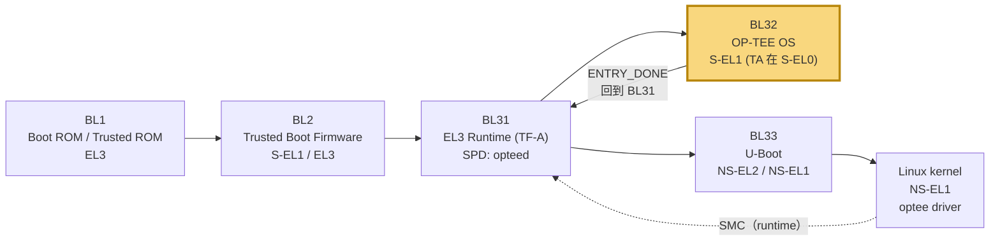
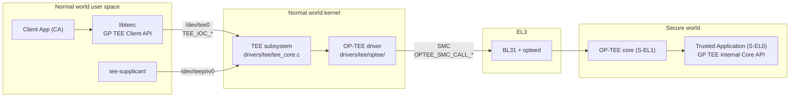
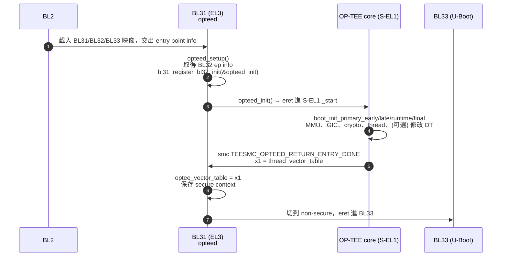
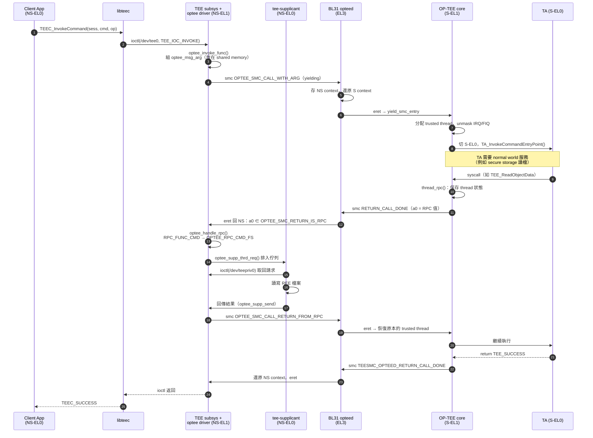
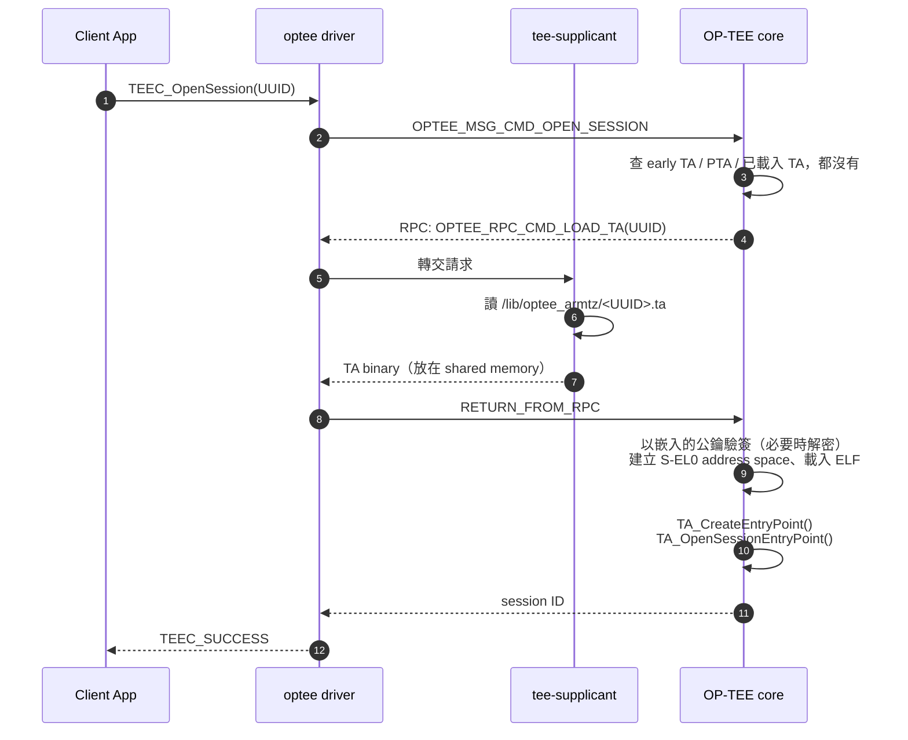
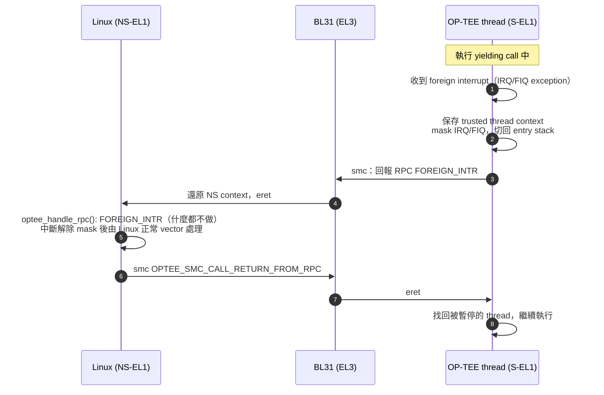

# ARMv8 開機鏈三部曲（二）：OP-TEE — 在 S-EL1 跑一個可信任的 OS

> **系列文章**：[（一）TF-A](./tf-a.md) ｜ **（二）OP-TEE（本文）** ｜ [（三）U-Boot](./u-boot.md) ｜ [實作篇：在 QEMU 上從原始碼拼完整開機鏈](./tf-a-optee-qemu-from-source.md)

## TL;DR

- **OP-TEE 是一個跑在 Secure EL1 的 Trusted OS**，在 ARMv8 開機鏈中扮演 **BL32**。TF-A 的 BL31 透過 **opteed**（OP-TEE Dispatcher，一種 SPD）把它帶起來，OP-TEE 初始化完成後用 SMC `TEESMC_OPTEED_RETURN_ENTRY_DONE` 把自己的 vector table 交還給 BL31，之後才輪到 BL33（U-Boot）[^1][^2]。
- **系統切成四塊**：`optee_os`（S-EL1 核心 + S-EL0 的 TA）、Linux kernel 的 **TEE subsystem + OP-TEE driver**（`drivers/tee/optee/`）、userspace 的 **libteec**（GlobalPlatform TEE Client API）以及 **tee-supplicant**（幫 secure world 存取 Linux 資源的 helper daemon）[^3][^4]。
- **Normal world → TA 的呼叫**：`TEEC_InvokeCommand()` → `ioctl(TEE_IOC_INVOKE)` → OP-TEE driver 發 `OPTEE_SMC_CALL_WITH_ARG` → EL3 的 opteed 切 context → OP-TEE 分配一個 trusted thread → 轉進 S-EL0 的 TA 執行 `TA_InvokeCommandEntryPoint()`。
- **反方向的 RPC**：secure world 需要記憶體、檔案系統、載入 TA、或遇到 normal world 中斷時，會用特殊的 SMC 回傳值「暫停」目前的呼叫、請 normal world 幫忙，做完再用 `OPTEE_SMC_CALL_RETURN_FROM_RPC` 回去 [^3][^5]。
- **面試常考**：為什麼需要 tee-supplicant、pseudo TA vs user TA、foreign interrupt 怎麼處理、TA crash 怎麼用 `scripts/symbolize.py` 解 abort dump。

### 為什麼需要 TEE？

在 Android / Linux 裝置上，Rich OS（REE）的程式碼量動輒數千萬行，加上各家 vendor driver，要保證「kernel 永遠不會被攻破」並不實際。TEE 的思路是**縮小需要信任的範圍**：把真正敏感的東西——金鑰、生物辨識比對、DRM 解密、密碼驗證、防 rollback 的計數器——搬到一個程式碼量小很多、有硬體隔離保護的環境裡。即使 REE 被完全控制，攻擊者頂多能「請 TEE 幫忙做事」，但拿不到金鑰本體，也無法竄改 TEE 的邏輯。

OP-TEE 是這個思路在 Arm TrustZone 上的開源實作，由 Linaro 維護，採用 GlobalPlatform 的標準 API，並且和 TF-A、Linux mainline、U-Boot 都有整合。對 BSP 工程師而言，它的好處是**整條鏈的原始碼都看得到**：從 EL3 的 dispatcher、S-EL1 的 OS、Linux driver 到 userspace daemon，出問題時可以一路追到底，這也是本系列選擇以它為 BL32 範例的原因。

---

## 在開機鏈中的位置



重點有兩個：

1. **OP-TEE 在 BL33 之前就初始化完**。BL31 在 `bl31_main()` 期間會呼叫 SPD 註冊的 BL32 init hook（opteed 在 `opteed_setup()` 裡透過 `bl31_register_bl32_init(&opteed_init)` 註冊），讓 OP-TEE 先跑完 cold boot 初始化，再回到 BL31，BL31 才去跳 BL33 [^2]。
2. **開機後 OP-TEE 不是「一直在跑」**，它是被動的：只有 normal world 發 SMC、或有 secure interrupt 時才會被 EL3 切進去。這個心智模型對理解 thread 與中斷處理很重要。

TF-A 文件也提到 opteed 有另一種模式：開啟 `OPTEE_ALLOW_SMC_LOAD`，由 kernel 開機後再透過 SMC 載入 OP-TEE（為 ChromeOS 加入的），但文件明講這可能不安全、預設且建議的方式仍是當作 BL32 在開機時載入 [^1]。Linux 端對應的 Kconfig 是 `OPTEE_INSECURE_LOAD_IMAGE`，kernel 文件列了四種攻擊面與緩解方式 [^3]。

---

## 核心概念

### 1. TrustZone：兩個世界的硬體基礎

ARMv8-A 的 TrustZone 把 CPU 的執行狀態分成 **Secure** 與 **Non-secure** 兩個 security state [^6]：

- **NS bit（`SCR_EL3.NS`）**：決定 EL3 以下的 exception level 處在哪個世界。只有 EL3 能改它，所以「切世界」一定要經過 EL3 的 secure monitor——在 TF-A 架構裡就是 BL31。
- **匯流排上的安全屬性**：CPU 發出的每一筆 memory transaction 都帶有 secure / non-secure 屬性。記憶體控制器前面的 **TZASC**（TrustZone Address Space Controller，例如 Arm 的 **TZC-400**，TF-A 裡有對應的 driver `drivers/arm/tzc/tzc400.c`）依照設定的 region 規則，擋掉 non-secure master 對 secure DRAM 的存取 [^6][^7]。
- 結果就是：OP-TEE 的 code/data 與 TA 的記憶體放在 secure DRAM，Linux 即使拿到 root、甚至 kernel 被打穿，也讀不到。

> **推論**：TZASC 的 region 通常由 BL2 或 BL31 的平台 code 設定（依平台而異），OP-TEE 本身多半只是「假設」某段記憶體已經是 secure。在 BSP bring-up 時，如果 secure DRAM 範圍和 OP-TEE 的 `CFG_TZDRAM_*` 類設定對不上，常見症狀是 OP-TEE 一開機就 data abort。

### 2. Exception Level 分工

| 世界 | EL | 跑什麼 |
|---|---|---|
| Secure | EL3 | TF-A BL31（secure monitor + opteed） |
| Secure | S-EL1 | OP-TEE core（`optee_os`） |
| Secure | S-EL0 | User TA |
| Non-secure | EL2 | Hypervisor（或 U-Boot 在 EL2 啟動 Linux） |
| Non-secure | EL1 | Linux kernel（TEE subsystem + optee driver） |
| Non-secure | EL0 | libteec、tee-supplicant、client app |

（S-EL2 在 ARMv8.4 之後才出現，後面 FF-A 一節會提到。）

### 3. OP-TEE 的組成元件

Linux kernel 文件有一張很經典的架構圖，我把它轉成 mermaid [^3]：



- **optee_os**：Trusted OS 本體。core 跑在 S-EL1，負責 MMU、thread、中斷、crypto、secure storage、TA 管理；user TA 跑在 S-EL0 [^5]。
- **Linux TEE subsystem**：通用框架，負責 TEE driver 註冊、shared memory 管理、提供通用的 userspace API [^4]。userspace 開 `/dev/tee[0-9]*`（一般 client）或 `/dev/teepriv[0-9]*`（supplicant），透過 `TEE_IOC_OPEN_SESSION`、`TEE_IOC_INVOKE`、`TEE_IOC_SHM_ALLOC` 等 ioctl 溝通 [^4]。
- **OP-TEE driver**（`drivers/tee/optee/`）：把通用 TEE 請求翻成 OP-TEE message protocol（`optee_msg.h`），再用 SMCCC 送出（`optee_smc.h`）[^3]。現在的 driver 同時有 `smc_abi.c`（傳統 SMC ABI）和 `ffa_abi.c`（FF-A ABI）兩條路徑 [^8]。
- **libteec**（`optee_client/libteec`）：實作 GlobalPlatform TEE Client API [^9]。
- **tee-supplicant**（`optee_client/tee-supplicant`）：處理 secure world 發來、driver 不處理的 RPC，例如從檔案系統讀 TA binary、REE FS secure storage 的檔案讀寫、RPMB 存取 [^3][^10]。

### 4. GlobalPlatform API：兩邊的「合約」

OP-TEE 實作 **GlobalPlatform TEE Client API v1.0（GPD_SPE_007）** 和 **TEE Internal Core API v1.3.1（GPD_SPE_010）** [^9][^11]。

**Client API（normal world，libteec）**：

```c
TEEC_InitializeContext()    // 建立與 TEE 的邏輯連線
TEEC_OpenSession()          // 以 UUID 開一個到某個 TA 的 session
TEEC_InvokeCommand()        // 帶 command ID + 最多 4 個參數呼叫 TA
TEEC_CloseSession()
TEEC_FinalizeContext()
TEEC_RegisterSharedMemory() / TEEC_AllocateSharedMemory()
```

**Internal Core API（secure world，TA 必須實作的 entry points）**，以 `optee_examples/hello_world/ta/hello_world_ta.c` 為例 [^12]：

```c
TEE_Result TA_CreateEntryPoint(void);          // TA instance 建立
void       TA_DestroyEntryPoint(void);         // TA instance 銷毀
TEE_Result TA_OpenSessionEntryPoint(uint32_t param_types,
                                    TEE_Param params[4], void **sess_ctx);
void       TA_CloseSessionEntryPoint(void *sess_ctx);
TEE_Result TA_InvokeCommandEntryPoint(void *sess_ctx, uint32_t cmd_id,
                                      uint32_t param_types, TEE_Param params[4]);
```

hello_world 的 host 端（`host/main.c`）流程就是 `TEEC_InitializeContext` → `TEEC_OpenSession`（帶 `TA_HELLO_WORLD_UUID`）→ `TEEC_InvokeCommand(TA_HELLO_WORLD_CMD_INC_VALUE)` → `TEEC_CloseSession` → `TEEC_FinalizeContext`，TA 端在 `TA_InvokeCommandEntryPoint` 裡 switch `TA_HELLO_WORLD_CMD_INC_VALUE` / `TA_HELLO_WORLD_CMD_DEC_VALUE` [^12]。

TA 的屬性放在 `user_ta_header_defines.h`，例如 `TA_UUID`、`TA_FLAGS`、`TA_STACK_SIZE`、`TA_DATA_SIZE`。`TA_FLAGS` 可以組合 `TA_FLAG_SINGLE_INSTANCE`、`TA_FLAG_MULTI_SESSION`、`TA_FLAG_INSTANCE_KEEP_ALIVE` [^13]。

### 5. TA 的種類

OP-TEE 文件把 TA 分成兩大類 [^13]：

| | Pseudo TA (PTA) | User mode TA |
|---|---|---|
| 執行層級 | S-EL1，**就是 core 的一部分** | S-EL0，比 core 低權限 |
| 建置方式 | 靜態編進 `tee.bin` | 獨立 ELF，簽章後成為 `<UUID>.ta` |
| 可用 API | OP-TEE core 內部函式，**不支援 GP Internal API** | GP TEE Internal Core API（libutee） |
| 隔離 | 無，bug 會直接拖垮整個 OP-TEE | 有 MMU 隔離、可開 ASLR（`CFG_TA_ASLR`） |
| 典型用途 | 給 TA 或 normal world 用的系統服務 | 一般的安全應用 |

原始碼裡的 PTA 集中在 `core/pta/`，例如 `core/pta/system.c`、`core/pta/device.c`（Linux 的 TEE bus 裝置列舉就是透過 OP-TEE 提供的 pseudo TA 取得 TA 清單）[^3][^14]。

User TA 依「存放位置」再細分 [^13]：

- **REE FS TA**：最常見。ELF 經過簽章（可選加密），以 `<UUID>.ta` 放在 normal world 的檔案系統，由 tee-supplicant 讀出來交給 OP-TEE core 驗證並載入。
- **Early TA**：直接 link 進 OP-TEE core binary 的特殊 data section，在檔案系統與 tee-supplicant 就緒之前就能用。開關是 `CFG_EARLY_TA`（預設 `n`）[^15]。
- **Secure Storage TA**：事先「安裝」進 secure storage，metadata 在 `dirf.db`，binary 加密且有完整性保護地存在 REE FS。

### 6. TA 簽章與驗證

- 建置 TA 時用 `scripts/sign_encrypt.py` 簽章，預設演算法 `TEE_ALG_RSASSA_PKCS1_V1_5_SHA256` [^13]。
- 簽章金鑰由 `TA_SIGN_KEY` 指定，預設 `keys/default_ta.pem`；對應的公鑰 `TA_PUBLIC_KEY`（預設等於 `TA_SIGN_KEY`）會**被嵌入 OP-TEE OS**，載入時用它驗證 TA。若簽章放在外部 HSM，可以讓 `TA_SIGN_KEY` 指向 dummy key，另外指定 `TA_PUBLIC_KEY` [^14]。
- **量產一定要換掉 `default_ta.pem`**——那把私鑰在 GitHub 上是公開的，用它等於任何人都能簽 TA。

> **推論**：這也說明了為什麼 TA 可以放在不可信的 REE 檔案系統：機密性不是靠「藏起來」，而是靠 OP-TEE 在 secure world 驗簽。攻擊者頂多能刪掉 TA（DoS），不能換成自己的。

### 7. Trusted thread：OP-TEE 的「並行」模型

OP-TEE 沒有排程器，也不會自己搶 CPU；它的「thread」比較像是**一個 yielding call 的執行 context**。`core/include/kernel/thread_private.h` 裡的 thread 狀態只有三種：`THREAD_STATE_FREE`、`THREAD_STATE_ACTIVE`、`THREAD_STATE_SUSPENDED` [^14]：

- **FREE → ACTIVE**：normal world 發 yielding call，OP-TEE 從 pool 裡挑一個空的 thread，綁到目前這顆 CPU 上執行。
- **ACTIVE → SUSPENDED**：遇到 RPC 或 foreign interrupt，thread 狀態被保存後回到 normal world。
- **SUSPENDED → ACTIVE**：normal world 發 `RETURN_FROM_RPC` 時恢復。注意恢復時**可能在另一顆 CPU 上**——Linux 那邊的呼叫者 task 可能被 migrate 了，所以 OP-TEE 在恢復時一定會重新把目前 TA 的 context 設定到新 CPU 上 [^5]。
- **ACTIVE → FREE**：`tee_entry_std()` 返回，工作做完，thread 被釋放 [^5]。

同步機制也很有特色。OP-TEE 提供 spin-lock、mutex、condvar 三種 primitive；其中 **mutex 拿不到時，不是在 secure world 裡空轉，而是發 RPC 到 normal world 去「睡」**，`mutex_unlock()` 若有等待者也會發 RPC 去喚醒對方 [^5]。換句話說，secure world 的阻塞其實是借用 Linux 的排程器完成的——這正是 kernel driver 裡 wait queue 相關 RPC（`OPTEE_RPC_CMD_NOTIFICATION`）存在的原因 [^16][^8]。

> **推論**：這個設計讓 OP-TEE 保持很小，但代價是 secure world 的行為強烈依賴 normal world 配合。如果 normal world 的 driver 有 bug（例如沒有正確回應 RPC），secure thread 就會一直停在 SUSPENDED，最後 thread pool 耗盡。

### 8. Pager：為什麼 QEMU 會有三個 BL32 檔案

OP-TEE 文件指出，OP-TEE kernel 需要超過 256 KiB 的記憶體；放在 TrustZone 保護的 DDR 沒有問題，但有些平台基於安全考量希望只用 on-chip 的 secure SRAM，而 SRAM 可能只有 128～256 KiB。**Pager（`CFG_WITH_PAGER=y`）** 就是為此設計：只有一小部分常駐 SRAM，其餘程式碼與資料按需分頁載入並做完整性檢查 [^5]。

這也解釋了前面 TF-A QEMU 範例中的三個檔案：`tee-header_v2.bin`（header）、`tee-pager_v2.bin`（常駐的部分）與 `tee-pageable_v2.bin`（可分頁的部分），分別對應 `BL32`、`BL32_EXTRA1`、`BL32_EXTRA2` [^17]。

> **推論**：從檔名看，即使平台沒啟用 pager，build 流程仍可能產出這組 `_v2` 檔案（pageable 部分為空或很小），所以看到三個檔案不代表一定跑在 pager 模式；要確認請看該平台的 `CFG_WITH_PAGER` 設定。

---

## 架構 / 原始碼導讀

以下路徑皆以各 repo 的 master 分支確認存在（撰寫時）。

### optee_os（`github.com/OP-TEE/optee_os`）[^14]

| 路徑 | 看點 |
|---|---|
| `core/arch/arm/kernel/entry_a64.S` | AArch64 入口 `_start`，依序呼叫 `boot_init_primary_early` / `_late` / `_runtime` / `_final`，最後 `adr x1, thread_vector_table` + `smc #0` 回報 `TEESMC_OPTEED_RETURN_ENTRY_DONE` |
| `core/arch/arm/kernel/thread_optee_smc_a64.S` | `thread_vector_table` 與 `vector_std_smc_entry`、`vector_fast_smc_entry` 等 entry |
| `core/arch/arm/kernel/thread.c` | trusted thread 的管理與 context switch [^5] |
| `core/arch/arm/kernel/thread_optee_smc.c` | SMC ABI 的 thread 處理 |
| `core/arch/arm/kernel/thread_spmc.c` | FF-A / SPMC 相關 |
| `core/arch/arm/kernel/boot.c` | 開機流程；也包含 `add_optee_dt_node()`，可在 DT 裡動態加入 `linaro,optee-tz` 節點（非 FF-A 模式時）|
| `core/arch/arm/kernel/abort.c` | abort 處理與 dump |
| `core/kernel/pseudo_ta.c`、`core/kernel/user_ta.c`、`core/kernel/tee_ta_manager.c` | TA 管理 |
| `core/kernel/ree_fs_ta.c`、`core/kernel/early_ta.c` | 從 REE FS / early TA 取得 TA binary |
| `core/tee/tee_ree_fs.c`、`core/tee/tee_rpmb_fs.c` | secure storage 兩種後端 |
| `core/include/optee_rpc_cmd.h` | RPC 命令定義（`OPTEE_RPC_CMD_LOAD_TA`、`_RPMB`、`_FS`、`_SHM_ALLOC` …） |
| `core/pta/` | pseudo TA |
| `mk/config.mk` | 所有 `CFG_*` 的預設值 |
| `scripts/sign_encrypt.py`、`scripts/symbolize.py`、`keys/default_ta.pem` | 簽章、除錯 |

`mk/config.mk` 裡幾個值得記住的預設（撰寫時）[^15]：

```make
CFG_NUM_THREADS ?= 2
CFG_REE_FS ?= y
CFG_RPMB_FS ?= n
CFG_WITH_USER_TA ?= y
CFG_TA_ASLR ?= y
CFG_CORE_ASLR ?= y
CFG_EARLY_TA ?= n
CFG_CORE_DYN_SHM ?= y
CFG_UNWIND ?= y
```

平台通常會在 `core/arch/arm/plat-<name>/conf.mk` 覆寫這些值（例如 QEMU 在 `plat-vexpress`）。

### optee_client（`github.com/OP-TEE/optee_client`）[^18]

- `libteec/src/tee_client_api.c`：GP Client API 實作，底層就是對 `/dev/tee0` 下 ioctl。
- `tee-supplicant/src/tee_supplicant.c`：主迴圈，開 `/dev/teepriv<N>`。
- `tee-supplicant/src/teec_ta_load.c`：依 UUID 組出 `xxxxxxxx-xxxx-xxxx-xxxx-xxxxxxxxxxxx.ta` 檔名，在 `CFG_TEE_CLIENT_LOAD_PATH`（預設 `/lib`）下的 `optee_armtz/` 目錄找 TA——也就是大家熟悉的 `/lib/optee_armtz/`。
- `tee-supplicant/src/tee_supp_fs.c`、`tee-supplicant/src/rpmb.c`：REE FS 與 RPMB 的 normal world 端。

### Linux（`drivers/tee/`）[^8]

| 檔案 | 角色 |
|---|---|
| `drivers/tee/tee_core.c`、`tee_shm.c` | TEE subsystem 本體、shared memory |
| `drivers/tee/optee/core.c` | 共用初始化 |
| `drivers/tee/optee/smc_abi.c` | SMC ABI：`optee_smc_do_call_with_arg()`、`optee_handle_rpc()`、DT match `linaro,optee-tz`、依 `method` 選 `arm_smccc_smc` / `arm_smccc_hvc` |
| `drivers/tee/optee/ffa_abi.c` | FF-A ABI：`optee_ffa_probe()`、`optee_ffa_abi_register()` |
| `drivers/tee/optee/call.c` | `optee_open_session()`、`optee_invoke_func()`、`optee_close_session()` |
| `drivers/tee/optee/rpc.c` | kernel 自己處理的 RPC（get time、wait queue、I2C、RPMB frames…） |
| `drivers/tee/optee/supp.c` | 與 tee-supplicant 的請求佇列：`optee_supp_thrd_req()`、`optee_supp_recv()`、`optee_supp_send()` |
| `drivers/tee/optee/optee_smc.h`、`optee_msg.h` | SMC function ID 與 message protocol |

### TF-A（`services/spd/opteed/`）[^2]

- `opteed_main.c`：`opteed_setup()`、`opteed_init()`、`opteed_smc_handler()`。
- `opteed_private.h`：`optee_vectors_t`，欄位包含 `yield_smc_entry`、`fast_smc_entry`、`cpu_on_entry`、`cpu_off_entry`、`cpu_resume_entry`、`cpu_suspend_entry`、`fiq_entry`、`system_off_entry`、`system_reset_entry`。
- `teesmc_opteed.h`：OP-TEE 回到 EL3 時用的 `TEESMC_OPTEED_RETURN_ENTRY_DONE`、`_CALL_DONE`、`_FIQ_DONE`、`_ON_DONE`、`_OFF_DONE` 等。

這個 vector table 的設計很值得在面試時講：**BL31 不需要知道 OP-TEE 內部怎麼實作，只要在對應事件（SMC、CPU on/off、suspend、FIQ）發生時，把 ELR_EL3 設成 table 裡對應的 entry 再 `eret` 過去即可**。

---

## 關鍵流程

### 流程一：OP-TEE 作為 BL32 開機



步驟 5 → 6 可以在 `opteed_smc_handler()` 裡看到：收到 `TEESMC_OPTEED_RETURN_ENTRY_DONE` 時，把 `x1` 存成 `optee_vector_table` [^2]。之後所有 normal world 的 OP-TEE SMC，都會根據 fast / yielding 分別跳到 `fast_smc_entry` 或 `yield_smc_entry`。

在 QEMU 平台上，TF-A 文件給了具體的 build 指令：OP-TEE 產出 `tee-header_v2.bin`、`tee-pager_v2.bin`、`tee-pageable_v2.bin`，分別對應 `BL32`、`BL32_EXTRA1`、`BL32_EXTRA2`，並以 `SPD=opteed` 建置 [^17]：

```bash
make CROSS_COMPILE=aarch64-linux-gnu- PLAT=qemu BL32=bl32.bin \
    BL32_EXTRA1=bl32_extra1.bin BL32_EXTRA2=bl32_extra2.bin \
    BL33=bl33.bin BL32_RAM_LOCATION=tdram SPD=opteed all fip
```

### 流程二：Linux 怎麼找到 OP-TEE

**SMC ABI 路徑**：靠 device tree 的 `firmware` 節點 [^19]：

```dts
firmware {
    optee {
        compatible = "linaro,optee-tz";
        method = "smc";   /* 或 "hvc"（中間有 hypervisor 時） */
    };
};
```

`interrupts` 屬性是可選的，用來讓 secure world 以非安全中斷通知 normal world（非同步通知）[^19][^3]。

`smc_abi.c` 的 `optee_dt_match` 比對 `linaro,optee-tz`，`get_invoke_func()` 讀 `method` 決定用 `arm_smccc_smc` 還是 `arm_smccc_hvc`。probe 期間會用一系列 fast call 做握手：`OPTEE_SMC_CALLS_UID`（確認對面是 OP-TEE）、`OPTEE_SMC_CALLS_REVISION`、`OPTEE_SMC_EXCHANGE_CAPABILITIES`（例如 `OPTEE_SMC_SEC_CAP_DYNAMIC_SHM`）、`OPTEE_SMC_GET_THREAD_COUNT`，若沒有 dynamic SHM 則用 `OPTEE_SMC_GET_SHM_CONFIG` 取得靜態 shared memory 範圍 [^8][^3]。

誰負責放這個 DT 節點？可以是 bootloader 的 DTS，也可以由 OP-TEE 自己在開機時加進去——`core/arch/arm/kernel/boot.c` 有 `add_optee_dt_node()`，在非 FF-A 模式時把 `linaro,optee-tz` 節點寫進傳給 normal world 的 DT [^14]。

**FF-A 路徑（替代方案）**：ARMv8.4 之後 Arm 推 **FF-A（Firmware Framework for Arm A-profile）**，secure world 由 **SPMC**（Secure Partition Manager Core）管理 secure partition，EL3 端用 `SPD=spmd`。OP-TEE 可以自己當 S-EL1 SPMC（`CFG_CORE_SEL1_SPMC=y`，TF-A 端 `SPD=spmd SPMD_SPM_AT_SEL2=0`）[^20]，`mk/config.mk` 裡也看得到 `CFG_CORE_SEL2_SPMC`（例如 S-EL2 跑 Hafnium，OP-TEE 當 partition）與 `CFG_CORE_EL3_SPMC` 的選項 [^15]。此時 Linux 不走 DT 的 `linaro,optee-tz`，而是由 FF-A bus 列舉，`optee_ffa_probe()` 接手 [^8]。

> **推論**：對 BSP 工程師來說，判斷一台板子走哪條路最快的方法是看 dmesg：SMC ABI 會看到 platform driver probe；FF-A 會先看到 `arm_ffa` 初始化，再看到 optee 的 FF-A probe。

### 流程三：一次 InvokeCommand 的完整旅程（含 RPC）



幾個細節：

1. **Fast vs Yielding**：fast call 在 entry stack 上執行、IRQ/FIQ 全程 mask，適合查版本這種短操作；yielding call 會被分配一個 **trusted thread**，執行期間 unmask 中斷，可以被 RPC 或 foreign interrupt 暫停 [^5]。
2. **RPC 是「回傳值」而不是新的呼叫**：OP-TEE 用 `OPTEE_SMC_RETURN_RPC_PREFIX`（`0xFFFF0000`）範圍的 a0 值告訴 driver「我還沒做完，要你幫忙」。driver 的 `optee_smc_do_call_with_arg()` 是一個迴圈：只要 `OPTEE_SMC_RETURN_IS_RPC(res.a0)` 就處理 RPC 再用 `OPTEE_SMC_CALL_RETURN_FROM_RPC` 回去，直到真正完成 [^8]。
3. **RPC 的種類**（SMC ABI）[^8]：
   - `OPTEE_SMC_RPC_FUNC_ALLOC` / `OPTEE_SMC_RPC_FUNC_FREE`：請 kernel 配置 / 釋放 shared memory。
   - `OPTEE_SMC_RPC_FUNC_FOREIGN_INTR`：純粹是讓 Linux 有機會處理中斷的「dummy RPC」。
   - `OPTEE_SMC_RPC_FUNC_CMD`：帶一個 `optee_msg_arg`，裡面是 `OPTEE_RPC_CMD_*`。kernel 自己處理 `GET_TIME`、`NOTIFICATION`（wait queue）、`SUSPEND`、`I2C_TRANSFER` 等；其他（`LOAD_TA`、`FS`、`RPMB`…）轉給 tee-supplicant [^16][^3]。較新的 kernel 在 `rpc.c` 裡也有 `OPTEE_RPC_CMD_RPMB_PROBE_RESET` / `_PROBE_NEXT` / `_FRAMES` 的處理，可經由 kernel 的 RPMB 子系統存取 RPMB 而不必透過 supplicant [^8][^16]。
4. **Thread 數量有限**：`CFG_NUM_THREADS` 決定同時能有幾個 yielding call 在 secure world 裡（預設 2，平台常調高）。都用完時 OP-TEE 回 `OPTEE_SMC_RETURN_ETHREAD_LIMIT`，driver 會在 call queue 上等待別人釋放再重試 [^5][^8]。

### 流程四：第一次 OpenSession 時載入 TA



這也是為什麼 **tee-supplicant 沒起來，第一次 open session 會卡住或失敗**——OP-TEE 自己沒有檔案系統 driver，拿不到 TA binary。

### Shared Memory

Normal world 與 secure world 交換參數靠 shared memory [^5]：

- **靜態（contiguous）**：開機時保留一段實體連續記憶體（`CFG_SHMEM_START` / `CFG_SHMEM_SIZE`），driver 透過 `OPTEE_SMC_GET_SHM_CONFIG` 得知範圍後自行管理。
- **動態（noncontiguous / registered）**：`CFG_CORE_DYN_SHM=y`（預設開啟），允許把 Linux 任意 page 組成的 buffer 註冊給 OP-TEE（`OPTEE_MSG_CMD_REGISTER_SHM`），需要先註冊才能在 SMC 中使用。好處是不必預留大塊記憶體，也能做到 zero-copy。

對應到 Client API：`TEEC_AllocateSharedMemory()` 是最有效率的零拷貝方式；`TEEC_RegisterSharedMemory()` 在條件不符時可能要退回用暫存 buffer 複製 [^9]。FF-A 模式下 shared memory 改用 FF-A 的 memory share 機制與 handle 管理（見 `ffa_abi.c` 的 `optee_shm_add_ffa_handle()` 等）[^8]。

### 中斷：Native vs Foreign

從 OP-TEE 的角度，中斷分兩種 [^5]：

- **Native interrupt**：OP-TEE 自己處理的 secure interrupt（目標是 S-EL1）。
- **Foreign interrupt**：OP-TEE 不處理的，包括 non-secure interrupt，以及目標是 EL3 的 secure interrupt。

GICv2 模式下 native = FIQ、foreign = IRQ；GICv3 模式（`CFG_ARM_GICV3=y`）下 foreign interrupt 以 FIQ 形式出現，可能由 EL3 或 normal world 處理 [^5]。

當 OP-TEE 正在跑 yielding call（中斷已 unmask）時來了一個 foreign interrupt：



重點是 **secure monitor 本身不在意剛剛轉送的是中斷，bookkeeping 都在 OP-TEE 的 thread 管理裡；而什麼時候恢復 secure thread，由 normal world 決定** [^5]。這樣的設計讓 Linux 的中斷延遲不會因為 TA 在跑長時間運算而失控。

另外，secure world 要主動通知 normal world 有兩種方法：同步通知（透過 `OPTEE_RPC_CMD_NOTIFICATION` RPC，只能在 yielding call 中使用）與非同步通知（non-secure edge-triggered 中斷 + fast call `OPTEE_SMC_GET_ASYNC_NOTIF_VALUE`，可用來實作 top half / bottom half 風格的 secure driver）[^3]。

### Secure Storage（簡述）

OP-TEE 提供兩種 GP 相容的 secure storage 後端 [^10]：

- **REE FS**（`CFG_REE_FS=y`，預設開）：加密後的物件存在 normal world 檔案系統，由 tee-supplicant 代為讀寫。OP-TEE 文件以 `/data/tee/` 為例；實際根目錄由 optee_client 的 `CFG_TEE_FS_PARENT_PATH` 決定（其 `config.mk` 預設 `/var/lib/tee`）[^18]。
- **RPMB**（`CFG_RPMB_FS=y`）：存在 eMMC 的 Replay Protected Memory Block，可防 rollback。OP-TEE 沒有 eMMC controller driver，傳統上靠 tee-supplicant 經由 kernel ioctl 存取。
- 兩者可同時啟用，用 `TEE_STORAGE_PRIVATE_REE` / `TEE_STORAGE_PRIVATE_RPMB` 區分。
- 金鑰階層：HUK → **SSK**（per-device）→ **TSK**（per-TA，`HMAC(SSK, TA_UUID)`）→ **FEK**（per-file，隨機產生並以 TSK 加密）。

secure storage 細節另文討論。

---

## Android 上的 TEE

雖然本文聚焦 OP-TEE，但對 Android 平台工程師來說，TEE 的價值主要體現在這幾個 HAL：

- **KeyMint（舊稱 Keymaster）**：Android 文件說明 KeyMint HAL 會把敏感操作委派給「跑在某種安全環境中的 TA」，而這個安全環境「最常見的是 ARM SoC 上的 TrustZone」[^21]。
- **Gatekeeper**：密碼 / 圖形鎖的驗證由 TEE 中的 Gatekeeper TA 執行，Android 端的 `IGatekeeper` HAL 只是中介 [^22]。
- **Widevine L1**：公開資料描述 L1 要求媒體解密與處理完全在 TEE 中進行 [^23]。
- **Trusty**：Google 自家的 TEE OS（kernel 衍生自 Little Kernel），被定位為專有 TEE 之外「可靠且免費的開源替代方案」[^24]。

所以在 Android 裝置上，TEE 可能是 OP-TEE、Trusty，或 SoC 廠商自己的 TEE。OP-TEE 官方也有 AOSP 的建置說明 [^25]。

> **推論**：在 Android BSP 裡，如果 KeyMint / Gatekeeper HAL 起不來（常見症狀是開機卡在解鎖畫面、或 keystore 相關 service crash），除了看 HAL log，也應該確認 TEE driver 有 probe、supplicant（若該 TEE 需要）有啟動、TA 檔案有放到正確路徑並且是用正確金鑰簽的。

---

## QEMU 實作

> 以下指令依官方文件整理，本文撰寫時未實際執行驗證。

OP-TEE 官方的 `build` repo 把 TF-A、OP-TEE、U-Boot（或 EDK2）、Linux、Buildroot rootfs、QEMU 全部串好，是理解開機鏈最省力的方式 [^26][^25]。

### 1. 取得原始碼與建置

先依官方 prerequisites 頁面安裝相依套件，然後 [^26]：

```bash
mkdir optee
cd optee
repo init -u https://github.com/OP-TEE/manifest.git -m qemu_v8.xml
repo sync
cd build
make toolchains
make run
```

`build.git` 的通用說明版本多了平行化參數，例如 `repo sync -j4 --no-clone-bundle`、`make -j2 toolchains` [^25]。想固定版本可以用 `repo init ... -b <tag>`（例如 `-b 3.16.0` 這種 tag 名稱）[^26]。若建置失敗需要看 log，文件建議不要用 `-j`，比較容易看出錯誤順序 [^25]。

### 2. 兩個 console

`make run` 之後你會停在 QEMU monitor，同時會**跳出兩個 UART console：一個是 secure world，一個是 normal world** [^26]。QEMU 會停著等輸入，在 QEMU console 輸入：

```
(qemu) c
```

接著就能在兩個視窗分別看到：

- **Secure world console**：OP-TEE 的開機 log（以及 TA 裡 `IMSG()` 等輸出）。
- **Normal world console**：TF-A → U-Boot → Linux 的開機訊息，最後登入 Buildroot shell。

這是觀察開機鏈最直觀的方式：normal console 先出現 TF-A BL1/BL2/BL31 的訊息（TF-A 的 QEMU port 把 console 設在 UART0，見 [TF-A 篇](./tf-a.md)），接著 secure console 出現 OP-TEE 的初始化訊息，OP-TEE 回到 BL31 之後，normal console 才繼續跑 U-Boot 與 kernel。

### 3. 執行 xtest

xtest（來自 `optee_test`）在建置時已經放進 rootfs，在 normal world console 直接執行 [^25][^27]：

```bash
xtest
```

全部通過時，結尾會類似：

```
+-----------------------------------------------------
23476 subtests of which 0 failed
67 test cases of which 0 failed
```

（數字依版本不同。）也可以只跑單一測試，例如文件的 GDB 範例用的是 `xtest 4002` [^26]。

### 4. 執行 hello_world

optee_examples 的所有 host 程式都以 `optee_example_` 為前綴，hello_world TA 的 UUID 是 `8aaaf200-2450-11e4-abe2-0002a5d5c51b` [^28]：

```bash
optee_example_hello_world
```

依 `host/main.c` 的程式碼，normal world 應該會印出 [^12]：

```
Invoking TA to increment 42
TA incremented value to 43
```

同時 secure world console 會出現 TA 的 `IMSG`，例如 `Hello World!`、`Got value: 42 from NW`、`Increase value to: 43`、`Goodbye!`。**一次操作、兩個視窗同時有輸出**，正好對應上面流程三的 sequence diagram。

（初始值 42 來自 hello_world 範例原始碼中的 `op.params[0].value.a = 42;`；上面的輸出是依原始碼推得，實際以執行結果為準。）

### 5. 延伸玩法

- **VirtFS 共享資料夾**：`make QEMU_VIRTFS_ENABLE=y QEMU_USERNET_ENABLE=y`，在 guest 裡 `mount -t 9p -o trans=virtio host /mnt/host`，改 TA 後不用重包 rootfs [^26]。
- **GDB 除錯 normal world 程式**：以 `GDBSERVER=y` 建置，guest 內 `gdbserver :12345 xtest 4002` [^26]。
- **自己改 hello_world**：在 TA 裡新增一個 command ID，host 端呼叫它，順便試試把 TA 簽章金鑰換掉，看看沒重建 OP-TEE 時載入會發生什麼事（驗簽失敗）。

---

## BSP bring-up 檢查清單

把上面的流程倒過來，就是新平台帶起 OP-TEE 時的檢查順序。以下是我整理的思路（**推論**，依一般 BSP 經驗與前文的公開資料歸納，實際項目依平台而異）：

1. **Secure DRAM 規劃**：確認 TZASC（例如 TZC-400）設定的 secure region、OP-TEE 的 `CFG_TZDRAM_START` 類設定（在 `plat-*/conf.mk`）以及 TF-A 載入 BL32 的位址三者一致。任何一個錯，最常見的症狀是 OP-TEE 一開機就 abort，或 normal world 存取 shared memory 時 bus error。
2. **TF-A 端**：`SPD=opteed`（或 FF-A 的 `SPD=spmd`）、BL32 的檔案有被打包進 FIP。secure console 完全沒有 OP-TEE log，通常先懷疑這裡。
3. **OP-TEE 回到 BL31**：secure console 有 OP-TEE 初始化 log，但 normal world 沒有後續輸出，要檢查 OP-TEE 是否順利走到 `TEESMC_OPTEED_RETURN_ENTRY_DONE`。
4. **DT 節點**：normal world 開起來了但 `/dev/tee0` 不存在，檢查傳給 kernel 的 DT 有沒有 `firmware/optee`（`linaro,optee-tz`），以及 kernel 有沒有開 TEE / OP-TEE 的 Kconfig。
5. **Shared memory**：若平台沒有 dynamic SHM，靜態 `CFG_SHMEM_START` / `CFG_SHMEM_SIZE` 那段記憶體必須從 Linux 的可用記憶體中排除（例如 reserved-memory），否則會被 Linux 拿去用。
6. **userspace**：tee-supplicant 要比任何 TEE client 早啟動；TA 放到 supplicant 找得到的路徑；TA 用和 OP-TEE 內嵌公鑰配對的私鑰簽章。
7. **驗證**：先跑 `xtest`，再跑自己的 TA。xtest 全過代表基本的 SMC、RPC、shared memory、secure storage 都通了，剩下的問題才比較可能是自己的 TA 或 HAL。

---

## 常見除錯 / 面試問題

### Q1：為什麼需要 tee-supplicant？

OP-TEE 在 secure world，**沒有檔案系統、沒有 eMMC controller driver**，但它需要：(1) 從檔案系統載入 REE FS TA；(2) REE FS secure storage 的實際檔案讀寫；(3) RPMB 存取（傳統做法）[^10][^13]。這些都透過 RPC 回到 normal world，kernel driver 只處理少數自己能做的（shared memory 配置、時間、wait queue 等），其他都轉給 tee-supplicant [^3]。supplicant 開的是 `/dev/teepriv0`，方向跟一般 client 相反：是 TEE 發請求、supplicant 回應 [^4]。

**延伸**：supplicant 在 normal world，所以它看得到的只有**加密後**的資料；安全性由 OP-TEE 的加密、驗簽、以及（RPMB 的）防 replay 保證。

### Q2：Pseudo TA 和 User TA 差在哪？

見上面的比較表。一句話：**PTA 是跑在 S-EL1 的 core 內建服務、沒有隔離也不能用 GP Internal API；User TA 跑在 S-EL0，有 MMU 隔離，用 GP Internal Core API 開發，以簽章後的 `<UUID>.ta` 形式載入** [^13]。PTA 的 bug 等於 kernel bug；user TA crash 只會影響那個 TA 的 session。

### Q3：OP-TEE 怎麼處理 normal world 的中斷？

OP-TEE 把它們歸類為 **foreign interrupt**。若在 OP-TEE 執行 yielding call 時發生：保存 thread context → mask 中斷 → 切回 entry stack → 以 SMC 回報 EL3 → EL3 回到 normal world，driver 收到 `OPTEE_SMC_RPC_FUNC_FOREIGN_INTR` 這個 dummy RPC，Linux 以正常 vector 處理中斷，然後再發 `RETURN_FROM_RPC` 恢復 secure thread [^5][^8]。fast call 期間中斷全程 mask，所以 fast call 必須很短。

### Q4：TA crash 怎麼 debug？

TA 發生 data / prefetch abort 或呼叫 `TEE_Panic()` 時，OP-TEE 會在 secure console 印出 **abort dump**，包含 register、memory region 對照與 call stack 位址 [^29]。在 **host（建置環境）** 上用 `scripts/symbolize.py` 把位址轉回函式名、檔名與行號：

```bash
cat dump.txt | ./optee_os/scripts/symbolize.py -d ./optee_examples/*/ta
```

`-d` 指定去哪些目錄找 TA ELF（`<uuid>.stripped.elf`）或 core 的 `tee.elf`；toolchain 要在 `PATH` 上。這支 script 也會被複製進 TA dev kit [^29]。其他技巧：調高 core 的 `CFG_TEE_CORE_LOG_LEVEL`（`mk/config.mk` 預設 2）與 TA 的 `CFG_TEE_TA_LOG_LEVEL`（預設 1），以及 `CFG_UNWIND`（預設開，讓 dump 能有 call stack）[^15]。

### Q5：OP-TEE 是怎麼被帶起來、又怎麼「還」控制權給 BL31 的？

BL2 把 BL32 映像載入 secure DRAM；BL31 的 opteed 在 `opteed_setup()` 註冊 `opteed_init()`，BL31 初始化時呼叫它 `eret` 進 OP-TEE `_start`；OP-TEE 初始化完用 `smc TEESMC_OPTEED_RETURN_ENTRY_DONE`，並把 `thread_vector_table` 位址放在 `x1` 傳給 BL31；BL31 記下這張表，之後再去啟動 BL33 [^2][^14]。runtime 時 BL31 依事件跳到表中對應的 entry。

### Q6：Linux 怎麼知道有 OP-TEE？SMC ABI 與 FF-A 差在哪？

SMC ABI：DT 的 `firmware/optee` 節點，`compatible = "linaro,optee-tz"`、`method = "smc"`（或 `"hvc"`）[^19]，probe 時用 `OPTEE_SMC_CALLS_UID` 等 fast call 握手。FF-A：EL3 跑 SPMD、secure world 由 SPMC 管理，OP-TEE 以 FF-A partition 身分被 FF-A bus 列舉，driver 走 `ffa_abi.c`，shared memory 改用 FF-A 的 memory sharing [^20][^8]。FF-A 的價值在於標準化 secure partition 的介面，讓多個 secure service 可以共存與隔離。

### Q7：`TEEC_OpenSession` 回 `TEEC_ERROR_ITEM_NOT_FOUND` 或卡住，你會查什麼？

依序：(1) `/dev/tee0`、`/dev/teepriv0` 是否存在（driver 有 probe 嗎？DT 節點對嗎？）；(2) tee-supplicant 有沒有在跑；(3) `/lib/optee_armtz/<UUID>.ta` 是否存在、檔名 UUID 格式對不對 [^18]；(4) secure console 有沒有驗簽失敗的 log——TA 若用與 OP-TEE 內嵌公鑰不同的私鑰簽，就會載入失敗 [^14]；(5) 若是 early TA，確認 `CFG_EARLY_TA` 與 TA 有被編進 core。

> **推論**：Android 上 TA 路徑常被放在 vendor partition，supplicant 的 `CFG_TEE_CLIENT_LOAD_PATH` 可設成多個路徑（optee_client 的 `config.mk` 註解舉例 `/lib:/vendor/lib`）[^18]，路徑不一致是很常見的整合錯誤。

### Q8：`CFG_NUM_THREADS` 要設多少？設太小會怎樣？

它決定同時能在 secure world 內「進行中」的 yielding call 數量，每個 thread 都要一份 stack，所以在記憶體受限的系統上很貴 [^5]。設太小時，多個 client 同時呼叫會拿到 `OPTEE_SMC_RETURN_ETHREAD_LIMIT`，driver 會讓呼叫者在 call queue 等待，表現為延遲變大而不是直接錯誤 [^8]。

> **推論**：一般會設成至少與 CPU 核數相當，再依實際同時使用 TEE 的 service 數（KeyMint、Gatekeeper、DRM…）調整。

### Q9：Fast call 和 yielding call 怎麼選？

Fast call 在 entry stack 上執行、全程 mask IRQ/FIQ、不分配 trusted thread，適合查詢版本、交換 capability、取非同步通知值這類極短的操作；yielding call 會分配 trusted thread、可被中斷與 RPC 暫停，所有 open session、invoke command 這種「可能很久」的工作都走這條 [^5]。Linux driver 的 probe 階段幾乎全是 fast call（`OPTEE_SMC_CALLS_UID`、`OPTEE_SMC_EXCHANGE_CAPABILITIES`…），而 `OPTEE_SMC_CALL_WITH_ARG` 則是 yielding call [^8]。面試時若被問「為什麼不能全部用 fast call」，重點是：fast call 期間 Linux 完全收不到中斷，會直接拉高系統延遲，甚至觸發 watchdog 或 RCU stall（推論）。

### Q10（加分題）：為什麼 TA 可以放在不可信的 REE 檔案系統？

因為安全性靠的是**驗簽**而不是藏檔案：OP-TEE 以嵌入 core 的公鑰驗證 TA，可選擇再加密。攻擊者最多刪掉或換成無效檔案造成 DoS，無法執行未授權的 TA [^13][^14]。前提是 OP-TEE 本身在 secure boot 鏈中被驗證過——這又回到 TF-A 的 Trusted Board Boot，開機鏈的每一段都在為下一段背書。

---

## 小結

把 OP-TEE 放回開機鏈來看，它是**唯一一個開完機還一直「活著」但又不主動執行的 stage**：BL1/BL2 做完就消失，BL33 把控制權交給 Linux 後也退場，而 BL31 與 BL32 常駐在記憶體裡，一個當門房（EL3 monitor + opteed），一個當保險箱（S-EL1 Trusted OS）。Linux 每一次 `TEEC_InvokeCommand`，都是一趟穿過 EL0 → EL1 → EL3 → S-EL1 → S-EL0 再原路返回的旅程，中間還可能因為 RPC 或中斷來回好幾次。

下一篇 [U-Boot](./u-boot.md) 會接著從 BL33 的角度，看 normal world 的第一個 bootloader 怎麼接手、又怎麼把 DT（包含 `firmware/optee` 節點）交給 Linux。也可以回頭看 [TF-A](./tf-a.md)，了解 BL31 和 SPD 的全貌。

---

## 參考資料

[^1]: TF-A Documentation — OP-TEE Dispatcher: https://trustedfirmware-a.readthedocs.io/en/latest/components/spd/optee-dispatcher.html
[^2]: TF-A 原始碼 `services/spd/opteed/`: https://github.com/TrustedFirmware-A/trusted-firmware-a/tree/master/services/spd/opteed
[^3]: Linux kernel documentation — OP-TEE driver: https://docs.kernel.org/tee/op-tee.html
[^4]: Linux kernel documentation — TEE Userspace API: https://docs.kernel.org/userspace-api/tee.html
[^5]: OP-TEE Documentation — Core（interrupt handling、thread、shared memory、SMC）: https://optee.readthedocs.io/en/latest/architecture/core.html
[^6]: Arm — Learn the architecture: TrustZone for AArch64: https://developer.arm.com/documentation/102418/latest/
[^7]: TF-A 原始碼 `drivers/arm/tzc/tzc400.c`: https://github.com/TrustedFirmware-A/trusted-firmware-a/blob/master/drivers/arm/tzc/tzc400.c
[^8]: Linux 原始碼 `drivers/tee/optee/`: https://github.com/torvalds/linux/tree/master/drivers/tee/optee
[^9]: OP-TEE Documentation — GlobalPlatform API: https://optee.readthedocs.io/en/latest/architecture/globalplatform_api.html
[^10]: OP-TEE Documentation — Secure storage: https://optee.readthedocs.io/en/latest/architecture/secure_storage.html
[^11]: GlobalPlatform — TEE Client API Specification (GPD_SPE_007): https://globalplatform.org/specs-library/tee-client-api-specification/
[^12]: linaro-swg/optee_examples（hello_world 原始碼）: https://github.com/linaro-swg/optee_examples
[^13]: OP-TEE Documentation — Trusted Applications: https://optee.readthedocs.io/en/latest/architecture/trusted_applications.html
[^14]: OP-TEE/optee_os 原始碼（`core/arch/arm/kernel/entry_a64.S`、`boot.c`、`ta/mk/build-user-ta.mk`、`mk/config.mk` 等）: https://github.com/OP-TEE/optee_os
[^15]: optee_os `mk/config.mk`: https://github.com/OP-TEE/optee_os/blob/master/mk/config.mk
[^16]: optee_os `core/include/optee_rpc_cmd.h`: https://github.com/OP-TEE/optee_os/blob/master/core/include/optee_rpc_cmd.h
[^17]: TF-A Documentation — QEMU virt Armv8-A: https://trustedfirmware-a.readthedocs.io/en/latest/plat/qemu.html
[^18]: OP-TEE/optee_client（libteec、tee-supplicant、`config.mk`）: https://github.com/OP-TEE/optee_client
[^19]: Linux DT binding `linaro,optee-tz.yaml`: https://github.com/torvalds/linux/blob/master/Documentation/devicetree/bindings/arm/firmware/linaro,optee-tz.yaml
[^20]: OP-TEE Documentation — SPMC: https://optee.readthedocs.io/en/latest/architecture/spmc.html
[^21]: Android Open Source Project — Hardware-backed Keystore: https://source.android.com/docs/security/features/keystore
[^22]: Android Open Source Project — Gatekeeper: https://source.android.com/docs/security/features/authentication/gatekeeper
[^23]: Wikipedia — Widevine（Security levels）: https://en.wikipedia.org/wiki/Widevine
[^24]: Android Open Source Project — Trusty TEE: https://source.android.com/docs/security/features/trusty
[^25]: OP-TEE Documentation — build.git（Get and build the solution）: https://optee.readthedocs.io/en/latest/building/gits/build.html
[^26]: OP-TEE Documentation — QEMU v7/v8: https://optee.readthedocs.io/en/latest/building/devices/qemu.html
[^27]: OP-TEE/optee_test（xtest）: https://github.com/OP-TEE/optee_test
[^28]: OP-TEE Documentation — optee_examples: https://optee.readthedocs.io/en/latest/building/gits/optee_examples/optee_examples.html
[^29]: OP-TEE Documentation — Abort dumps / symbolize.py: https://optee.readthedocs.io/en/latest/debug/abort_dumps.html
