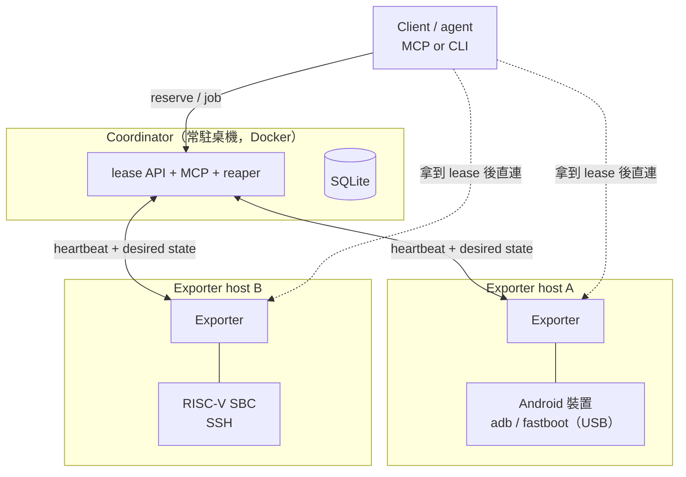

# device-loop：把手邊散落的開發板變成可預約的裝置 farm

原始碼與完整設計文件：[github.com/alanhc/device-loop](https://github.com/alanhc/device-loop)

## 一、起點：問題不是裝置不夠，是沒人知道誰在用哪一台

在 AOSP（Pixel kernel driver）、OpenBMC、llama.cpp 的 SIMD benchmark、box64 這些專案之間來回時，
反覆卡在同一件事：手邊有一堆異質裝置——Android 手機、RISC-V SBC、OpenBMC 板子、BeagleBone、
幾台不同微架構的 x86/arm64 主機——但「哪台機器接著哪個裝置」「UART 現在有沒有人在用」
「這台要不要先刷回去」，全部靠記憶跟慣例維護。

沒有任何系統記錄**誰現在在用哪台裝置**。一個人用的時候還撐得住；等到多個 agent 各自在同一台
Pixel 上排實驗，就會互相踩死。

所以做了 device-loop：一個輕量的多使用者、多裝置預約系統。所有 host 之間先用 Tailscale
串成一個扁平、彼此直接可達的 mesh，這是整份設計最重要的簡化前提——不必處理 NAT 穿透，
也不需要 SSH jump host。

### 為什麼會同時碰這麼多不相干的專案

常被問這件事。這些專案表面上確實不相干——kernel driver、BMC 韌體、LLM 推論的 SIMD kernel、
x86-on-ARM 的模擬層。但它們其實是同一個問題的不同切面：**同一段程式碼，在不同微架構上行為不一樣。**

一份 SIMD 補丁在 SVE2-128 上是加速，在 RVV-256 上可能是退化——向量長度差一倍，
編譯器選的策略就不同，結論可以完全相反。單指標的 benchmark 換一顆核心，正負號會翻過來。
要證明或推翻這類主張，**唯一的辦法是在真實而且夠多樣的硬體上跑過**，
不是在一台機器上量完就推廣。

所以裝置多樣性本身就是能力：多一種微架構，就多一個能被驗證（或被推翻）的維度。
代價是管理成本會隨裝置數線性成長——每多一台板子，就多一份「它接在哪、現在誰在用、
上次刷了什麼」的記憶負擔。**device-loop 就是為了不讓那個代價線性長上去而做的。**

## 二、先做調研：分類比造輪子重要

| 系統 | 借鑑之處 | 為什麼不整套採用 |
|---|---|---|
| **Labgrid**（Pengutronix） | coordinator / exporter / client 三層架構；每個 resource 在 host 上開一個專用小服務（ser2net 包 UART、`adb server --one-device` 包 ADB），回報 `host:port` 給中央 | 整套對現在的規模太重，但架構值得照抄 |
| **LAVA**（Linaro） | device dictionary、UART log 的想法 | job queue 導向，為自動化 kernel CI 農場設計 |
| **Beaker**（Red Hat） | bare-metal「借機器」的 TTL lease 語意 | 沒有 UART / flash 的概念 |
| **ser2net / obmc-console** | UART-over-network 的現成元件 | 是元件不是系統，屬於 exporter 那一層 |

調研最有價值的產出不是「決定用哪個」，而是一組分類：

> **NVIDIA 那一整族系統（Run:ai、Slurm GRES、MIG）是 scheduler，不是 lease。**

差別在於資源可不可互換。GPU 是 fungible 的——使用者說「給我一張 A100 80GB」，哪一張都行，
所以由系統挑；我的裝置是唯一的——那台 Pixel、那台 Jupiter，使用者指名要借誰。

所以 device-loop 是 **lease-by-identity**，不是 scheduler。這條界線一旦畫清楚，
後面「要不要做排隊」「要不要做配額」全部有了判準。（`devices.tags` 留著當種子：
哪天真的有五台一樣的板子、需要 `reserve(class='riscv-sbc')` 時，才是往 Run:ai 那個方向走的時機。）

## 三、三個真正影響架構的決定

實線是 control plane，虛線是 data plane——**coordinator 不轉發任何資料流**。

### 1. Coordinator 對 exporter 是 reconcile，不是 push

原本設計寫的是「coordinator 叫 exporter 啟動服務」。實作時才發現這條通道從來沒定義過：
`device_services` 建了表，卻沒有任何一行讀寫。

改成 exporter 拉取 desired state 後自行收斂：

- heartbeat 的**回應**帶上「這台 host 現在該跑哪些服務」（由 active lease 推導）。
  Exporter 比對實際在跑的，多的停、少的起——**level-triggered 的收斂，不是 edge-triggered 的指令**。
- 服務起來後，exporter 把實際的 `host:port` 寫回去。Port 是它當下挑的 free port，
  只有它知道，coordinator 無從預先決定。

好處是：heartbeat 通道本來就存在，exporter 不必再開 listening port；任一邊重啟後都會自動
回到正確狀態，不需要重送指令或追蹤「對方收到了沒」。

**代價要講清楚**：endpoint 變成最終一致。`reserve()` 回來的當下服務還沒起、endpoint 是空的，
最壞要等一個 heartbeat 週期。所以 lease 回應必須能表達「endpoint 尚未就緒」，
client 不能假設 reserve 一回來就連得上——那是 pending，不是錯誤。heartbeat 週期因此要壓到數秒級，
它同時決定了「借到裝置後多久才真的能用」。

### 2. 發現（discovery）不等於擁有（ownership）

USB 掃描有一個隱含前提：**插在我身上的裝置只有我能用**。所以 exporter 回報什麼，
`devices.host` 就填什麼，這個推論成立。

**網路裝置不成立。** 實測發現：同一台 RISC-V SBC 可以被三台不同的 host 同時摸到，
其中一台甚至跨網段。如果三台 exporter 都做網路發現、都回報「我看到它」，
coordinator 會判定它在 host 之間來回搬家，每輪 heartbeat 產生一筆 `device_moved`，
不斷打斷進行中的 lease。

於是定了四條規則：

- **發現與擁有分開。** 網路掃到的一律報成 candidate（`state='unregistered'`），**不自動填 host**。
- **識別碼不能用 IP。** DHCP 會換 IP，而身分綁在 `identifier` 的 UNIQUE 約束上，
  用 IP 等於每次換位址就變成一台新裝置。改用 MAC 或裝置自報的主機名／序號。
- **掃描結果會因觀察點而不一致。** 同一次實測裡，A 掃不到 B，但 B 明明在那個位址上——
  防火牆或無線客戶端隔離都會造成這種盲點。所以「某台沒掃到」**不能**當成裝置離線的證據；
  缺席判定只能用在 USB 這種可達性明確的來源上。
- **先窮盡 tailnet-native 再考慮掃描。** 跑得動 `tailscaled` 的裝置直接入 tailnet 就沒這些問題，
  身分就是 tailnet 節點。真正需要網路發現的只剩連不上 tailnet 的東西（BMC 介面、MCU）。

### 3. 只有破壞性操作走 mediation

UART、adb、scrcpy、video（把對準裝置的 camera 包成 MJPEG）、VNC 全部是
**client 拿到 lease 後直連 exporter**，coordinator 不插手。唯一例外是 **flash**：
它是唯一的破壞性操作，一律經 coordinator 轉發，並記錄 requester / image / 時間。

而且 `mediated` 這個欄位是**由 coordinator 自己填的，不接受 exporter 回報**（多送就回 422）。
理由很簡單：讓回報方宣告自己是否需要 mediation，等於把安全相關的事實交給被管制的一方。

一個附帶收穫是想清楚 video 跟 VNC 的分工：**VNC 是軟體 framebuffer，OS 活著才有；
video 是照著實體螢幕的 camera，OS 死了照樣看得到。** fastboot 選單、boot splash 卡住、
kernel panic 上螢幕的時候，adb 不存在，camera 是唯一的眼睛。而多個 agent 敢放心用遠端 flash 的前提，
正是「看得到」（camera）加「救得回」（known-good image registry）——少任何一半都只能盲猜。

## 四、真機才抓得到的兩個 bug

Phase 1 的 adb 路徑在真機驗證通過的那天（reserve → 收斂 → endpoint 發布 → `adb -H … -P …`
真的列出裝置並跑出 `getprop` → release → 服務停、endpoint 消失），順手抓到兩個
**單元測試永遠看不見**的 bug。它們的形狀值得記著：

**（一）測試替身比真東西寬容。**
preflight 起了 `adb kill-server` 卻沒等它跑完就 terminate——「它應該很快就結束」這個假設
被寫成註解，卻從來沒有被驗證過。而 fake runner 的 terminate 不會打斷真實工作，
所以測試永遠是綠的。修法除了補 `wait()`，更重要的是讓測試替身「只有被 `wait()` 到才算完成工作」。
**替身不能比真東西寬容**，否則它保護的是程式碼，不是行為。

**（二）觀測行為本身會改變被觀測的狀態。**
inventory 用 `adb devices` 掃描，會**啟動全域 adb server 並認領 USB 裝置**，
跟自己 per-device 的 `adb server --one-device` 互搶。改成直接讀 `/sys/bus/usb/devices`
的 ADB interface descriptor（`ff/42/01`），並加了一條回歸測試：**掃描期間執行任何子行程就算失敗**。

## 五、把 MCP 開成網路服務，放大了原本就有的洞

原本 MCP server 是 stdio-only：client 得在同一台機器上把它 spawn 起來、還要讀得到本機 DB 檔。
「各機器上的 agent 連進來共用裝置」在傳輸層就不成立，所以改成 HTTP/SSE，跟 REST API
掛在同一個 app、同一個 process，共用同一條 DB 連線與同一把鎖。

這個改動放大了一個原本就存在的問題：`user_id` 是呼叫者自己填的、系統完全信任。
stdio 時代還說得過去（能 spawn process 的人本來就在機器上）；開成網路服務之後，
tailnet 上任何連得到的人都能宣稱自己是任何人——包含釋放掉別人的 lease 再把裝置搶走。

現階段的處理方式是誠實標註，而不是假裝有解：

- README 直接寫「**目前唯一的實質防線是 tailnet ACL**，應用層沒有任何東西在擋」。
- 身分取得**收斂在一個函式** `authz.caller_identity()`，之後要接 tailnet identity
  （用對端 IP 查 `tailscale whois`）只改那裡，所有 tool 一行都不用動。
- 加一條守衛測試，確保沒有任何 tool 繞過它。

順帶一個踩很久的坑：MCP 的 streamable HTTP transport 有 **DNS rebinding protection，
預設只放行本機**。遠端 agent 連進來時 Host header 不是 localhost，會拿到
**421 Misdirected Request**——是「連得上但一直被拒」而不是連線失敗，
不知道有這個機制的話會查很久。解法是明確列出允許的 host（值是 **agent 實際撥的 `host:port`**，
不是容器內部綁的位址），並在啟動時 log 一行說明目前放行了誰。

另外注意：`allowed_hosts=["*"]` **沒有用**——wildcard 不是那樣匹配的，要嘛明確列出，要嘛整個關掉保護。

## 六、目前狀態與往下走的方向

Phase 1（schema、lease API、reaper、heartbeat、MCP 前門，支援 uart 與 adb）已在真機跑通；
UART 接真序列埠、多裝置 preflight 還沒驗證。

真正想做的其實在後面幾層，而且評估標準只有一個：**縮短「改完 code → 拿到可以放進 PR/Gerrit
的可信證據」的時間**，而不只是裝置互斥。

- **Job queue 疊在 lease 之上。** lease 仍然是唯一的互斥原語，scheduler 只決定下一個 lease 給誰。
  一條容易寫錯的規則：**`reserve` 不可以阻塞**——MCP tool call 卡幾分鐘會拖死呼叫端的 agent，
  正確形狀是立刻回一張號碼牌，之後輪詢。排序用 FIFO 加一條：人的 interactive 請求排在 agent
  的 batch 前面，因為 agent 等得起，人等不起。
- **Interstitial hooks 才是 scheduler 真正的難點**，比排序重要得多。連續的 agent 實驗會互相污染：
  上一個 job 留下的 module、還沒 reboot 的 kernel 狀態，都會讓下一個實驗不可信。
  benchmark job 更麻煩——手機的 thermal HAL 按 skin temp 節流，前一個重負載 job 會讓下一個
  benchmark 在半節流狀態起跑，量出漂亮但假的數字。**這種 device-class-specific 的知識要放進
  hook 裡，而不是要求每個 agent 自己記得。**
- **真機時間是稀缺資源，只花在非真機不可的事上。** job 宣告 `needs: 'real-hw' | 'any'`；
  `any` 的工作（lockdep、fuzzer、功能測試）一律導去 ephemeral VM 池平行跑，
  真機 queue 只留 thermal / perf / 驅動硬體相關的工作。
- **A/B paired job 與 matrix job。** upstream 的 perf 工作永遠是「baseline vs patch」，
  用 `pair_id` 綁成一對、在同一台裝置上 ABAB 交錯執行，自動抵消 thermal 與頻率漂移；
  `matrix_id` 則把一個 patch 展開到整個微架構矩陣（SVE2 / RVV / NEON-only / AVX-512 / AVX2），
  收攏成一張結果表。最後匯出成一份自足的 markdown——數字 + 環境指紋 + 重現步驟——
  直接貼進 PR 或 Gerrit。

最後這點是整個專案的動機所在：**perf 主張要寫成 reviewer 可以檢驗的敘述，
而不是「在我機器上快了 X%」。**

## 七、幾條可以帶走的結論

1. **先分類，再造輪子。** 「scheduler vs. lease」這條線比任何實作細節都更早決定了系統長什麼樣。
2. **reconcile 比 push 好，但要老實承認它換來的最終一致性**，並且讓 API 表達得出 pending 狀態。
3. **可達性不等於擁有權。** 能看到一台裝置的人，不代表有資格宣稱它是誰的。
4. **測試替身不能比真東西寬容**，否則綠燈只是在保護程式碼，不是在保護行為。
5. **安全欄位要由管制方填，不能由被管制方回報。**
6. **沒做的事就誠實標註，並把它收斂到一個函式裡**，讓「之後要補」是一個小改動而不是一場重構。
