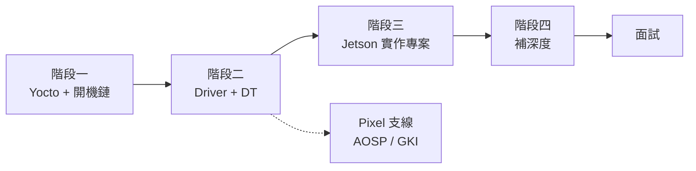

# Tegra BSP 學習地圖

> 更新：2026-09-21 ・ 作者：Alan Tseng
> 目標：約 6 個月內，做出一個能在面試中講清楚的 Jetson BSP 專案。主要瞄準 NVIDIA Tegra BSP，Pixel 為備選。

---

## 0. 目標與起點

- **現有優勢：** Android 平台整合（晶片廠 vendor 側）、BMC 韌體（OpenBMC）、build 和 log triage 經驗
- **主要缺口：**
  - 還沒有實際修改過開機鏈的各個階段
  - 還沒有自己寫過 kernel driver
  - 不熟 Tegra 專屬工具鏈（L4T、flash 流程）
  - 電源管理和底層除錯
- **路線：** 先用鐵人賽系列 [門外漢的嵌入式地獄](https://ithelp.ithome.com.tw/users/20146325/ironman/7163) 建立地圖，再換到 Jetson 實機上做一次，最後用 Bootlin 教材補深度。

階段三是整條路線的核心產出，其他階段都是為它鋪路。

---

## 1. 階段一：Yocto 與開機鏈（第 1–3 週）

速讀鐵人賽系列 Day 1–24。目的不是學會 STM32MP1，而是把開機的每一段都對應到 Tegra 上的角色。

| 系列篇目 | 重點 | 讀法 |
| --- | --- | --- |
| Day 1–10 Yocto | layer、recipe、bbappend | 跟著做，寫一個自己的 recipe |
| Day 11–17 開機鏈 + DT | TF-A → OP-TEE → U-Boot → Kernel | 畫出開機序列圖，記下每段的輸入和輸出 |
| Day 18–20 BSP + 燒錄 | 官方 BSP、分區表 | 懂概念即可，Tegra 的燒錄流程不同 |
| Day 21–24 改 BSP | 各段的 patch 方法 | 精讀，面試常問「你怎麼改的」 |

**開機鏈對照表（讀完這一段，要能不看資料自己填出來）**

| 角色 | STM32MP1（系列用的平台） | Jetson Orin |
| --- | --- | --- |
| Boot ROM 之後的第一階段 | TF-A BL2 | MB1 / MB2 |
| Secure monitor | TF-A BL31 | TF-A BL31 |
| Secure OS | OP-TEE | OP-TEE |
| Bootloader | U-Boot | UEFI（EDK2） |
| 建構系統 | Yocto | L4T 工具鏈或 meta-tegra |
| 燒錄 | STM32CubeProgrammer + `.tsv` | `flash.sh` / `l4t_initrd_flash.sh` |

**完成條件**

- [ ] 在 QEMU target 上跑完一次 `core-image-minimal`
- [ ] 寫一個自己的 recipe 和 bbappend
- [ ] 用自己的話畫出兩個平台的開機序列圖

---

## 2. 階段二：驅動開發（第 4–7 週）

系列的 Day 25–30 只精讀兩篇：Day 29（I2C RTC）和 Day 30（SPI）。重點是看懂 driver model 和 device tree binding 怎麼串起來。CAN 和 RS232/485 那幾篇可以跳過。

**要弄懂的概念**

- `platform_driver` / `i2c_driver` / `spi_driver` 的 probe 流程
- DT 的 `compatible` 字串怎麼比對到 driver
- `devm_*` 資源管理、regmap
- sysfs / character device 介面
- 中斷：threaded IRQ、GPIO 中斷

**練習**

- [ ] 在 QEMU（`virt` machine）上寫一個 out-of-tree 的 platform driver，DT node 自己加
- [ ] 替一顆實體 I2C 感測器寫 driver（例如 BME280 或 MPU6050），接 IIO 或 hwmon 子系統
- [ ] 替 driver 寫 DT binding 的 YAML 文件，並通過 `make dt_binding_check`

---

## 3. 階段三：Jetson Orin Nano 實作專案（第 8–16 週）

這是履歷上要放的專案。同樣的事在 NVIDIA 的平台上再做一次，而且做到可以展示。

**硬體**：Jetson Orin Nano Developer Kit，加上階段二用過的 I2C 感測器。

**里程碑**

1. **用官方 L4T 燒錄成功。** 先照 SDK Manager 或 `flash.sh` 的流程燒一次，讀懂 `flash.sh` 做了哪些事
2. **在 host 上自己 build kernel。** 下載 Jetson Linux 的 kernel source，cross-compile 後替換 Image 和 DTB
3. **改 device tree。** 在 40-pin header 的 I2C bus 上加入你的感測器 node，理解 Tegra 的 pinmux 設定
4. **把階段二的 driver 移植過來。** 開機後自動 probe，讀得到數值
5. **切換到 meta-tegra（Yocto）。** 用 [OE4T/meta-tegra](https://github.com/OE4T/meta-tegra) build 出最小 image，把 driver 和 DT 改動寫成自己的 layer
6. **修改開機鏈的一段（加分項目）。** 例如在 UEFI 加一行 debug 訊息，或替 OP-TEE 加一個最簡單的 TA
7. **寫文件。** 在 GitHub 放 README 和架構圖，寫一篇 TIL 文章記錄踩過的坑

**面試時要能講清楚的事**

- Orin 從上電到 userspace 的完整開機流程
- 你改了哪幾個地方、為什麼這樣改、怎麼驗證
- 遇過最難的 bug，以及你怎麼找到它（UART log、kernel oops、`dmesg`）

---

## 4. 階段四：補深度（第 12–24 週，與階段三並行）

鐵人賽系列只講到「能動」為止。這一段用 Bootlin 的免費教材（投影片加實驗）把深度補起來。

| 主題 | 教材 / 方法 | 產出 |
| --- | --- | --- |
| Embedded Linux 全貌 | [Bootlin Embedded Linux training](https://bootlin.com/training/embedded-linux/) | 做完實驗 |
| Kernel driver 深入 | [Bootlin Linux kernel driver training](https://bootlin.com/training/kernel/) | 做完實驗 |
| 除錯 | JTAG / OpenOCD、`ftrace`、`kgdb`、解讀 oops | 在 Jetson 上故意造成 panic 並分析 |
| 電源管理 | suspend/resume、runtime PM、clock 和 regulator framework、DVFS | 替自己的 driver 加上 runtime PM |
| DMA 與記憶體 | DMA API、IOMMU（Tegra 用 SMMU）、CMA | 筆記整理，能講出 coherent 和 streaming DMA 的差別 |
| 上游化 | `checkpatch.pl`、`git send-email`、mailing list 流程 | 送一個小 patch（文件或 DT binding 都算） |

你在 sse2neon、shecc 累積的開源經驗，可以直接用在上游化這一項。

---

## 5. Pixel 支線（選修）

如果同時要準備 Google Pixel / Tensor 的職缺，就在階段二之後加這一條。這部分和你現在的 Android 平台整合工作重疊最多。

- **AOSP 的 build 流程**：`lunch`、`m`、device tree 目錄結構（`device/<vendor>/<product>`）
- **GKI**：Generic Kernel Image 和 vendor module 怎麼切開，KMI 的 symbol list
- **Vendor 分區**：vendor_boot、DLKM、Treble / VINTF
- **練習**：用 Cuttlefish 或 Pixel 的 AOSP target build 一次，把一個 out-of-tree driver 編成 vendor module 並載入

面試時可以用「做過晶片廠 vendor 側的 Android 平台整合，熟 vendor 那一側」作為切入點。

---

## 6. 時程與面試準備

| 週次 | 主軸 | 里程碑 |
| --- | --- | --- |
| 1–3 | 階段一 | 開機鏈對照表、自己寫的 recipe |
| 4–7 | 階段二 | QEMU platform driver、I2C 感測器 driver |
| 8–16 | 階段三 | Jetson 專案里程碑 1–5 完成 |
| 12–24 | 階段四（並行） | Bootlin 實驗、runtime PM、送出一個 patch |
| 17–24 | 收尾 | 專案里程碑 6–7、履歷更新、模擬面試 |

**面試準備清單**

- [ ] 在白板上畫出 ARMv8 exception level（EL0–EL3）和各段開機軟體的對應
- [ ] 講清楚 device tree 從 `.dts` → `.dtb` → kernel 解析 → driver probe 的完整路徑
- [ ] 講一個 kernel crash 除錯的案例（最好是 Jetson 專案裡真的遇到的）
- [ ] 能比較 U-Boot 和 UEFI、Yocto 和 L4T 各自的取捨
- [ ] 用 STAR 格式準備 3 個故事：跨團隊整合、CI/build triage、Jetson 專案

---

## 資源

- [門外漢的嵌入式地獄（iThome 鐵人賽 2024）](https://ithelp.ithome.com.tw/users/20146325/ironman/7163)
- [NVIDIA Jetson Linux](https://developer.nvidia.com/embedded/jetson-linux)
- [OE4T/meta-tegra](https://github.com/OE4T/meta-tegra)
- [Bootlin training materials](https://bootlin.com/docs/)
- [Linux kernel driver-api 文件](https://docs.kernel.org/driver-api/)
- [Android GKI 文件](https://source.android.com/docs/core/architecture/kernel/generic-kernel-image)
