# Telemetry、OpenTelemetry、BMC 與 Grafana/Loki 的關係

> 一句話總結：**Telemetry 是資料本身；OpenTelemetry 是收集與傳輸的標準和工具；BMC 是硬體層的資料來源之一；Loki / Prometheus / Tempo 負責存，Grafana 負責看。**

---

## 1. Telemetry 是什麼

Telemetry（遙測）原意是「在遠端量測，把資料傳回來分析」。在電腦系統中，它指**把系統運作狀態收集起來，送到別處儲存與分析**。

軟體 observability 一般把 telemetry 分成三類訊號，近年再加上 profiles：[^3]

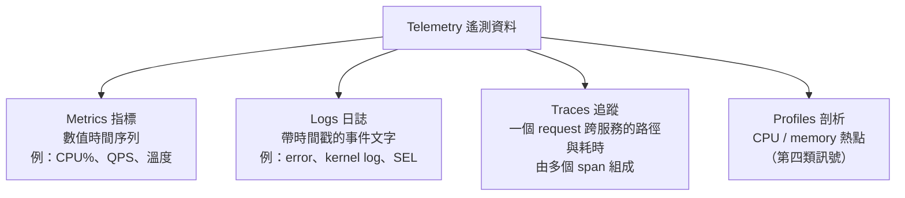

三者各自回答的問題不同：

| 訊號 | 回答的問題 | 特性 |
|---|---|---|
| Metrics | 「有沒有出問題？多嚴重？」 | 便宜、可聚合、適合告警 |
| Logs | 「發生了什麼事？」 | 細節多、量大、較貴 |
| Traces | 「慢在哪一段？」 | 跨服務因果關係 |

### Trace 的樣子

一個 request 經過多個服務，每一段就是一個 span：

```mermaid
gantt
    title 一個 HTTP request 的 trace（示意）
    dateFormat X
    axisFormat %L ms
    section api-gateway
    GET /order          :0, 120
    section order-svc
    createOrder         :10, 100
    section inventory-svc
    checkStock          :20, 50
    section db
    SELECT stock        :25, 45
    section payment-svc
    charge              :55, 95
```

---

## 2. OpenTelemetry 是什麼

OpenTelemetry（OTel）是 CNCF 專案，2019 年由 **OpenTracing + OpenCensus** 合併而成。[^1][^2] 它的目標是**統一 telemetry 的產生與傳輸標準**，避免被特定廠商綁住；儲存與視覺化則刻意留給其他工具。[^1]

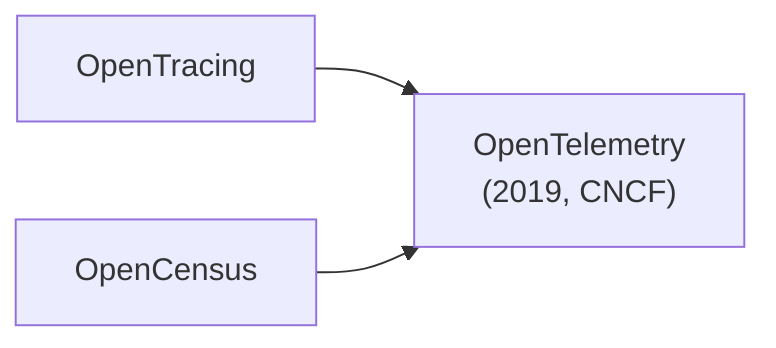

### OTel 的組成

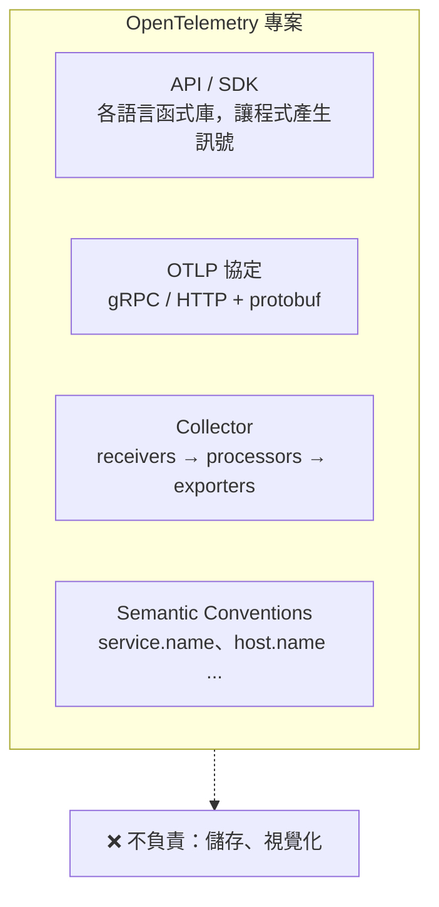

### Collector 內部 pipeline

Collector 是整個 OTel 生態裡最實用的元件，可以把它想成 telemetry 的路由器：[^4]

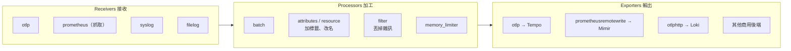

送進 Loki 用的是 `otlphttp`：Loki 3.0 起原生接收 OTLP，[^10] 早期專用的 `loki` exporter 在 2024 年 7 月標為 deprecated，並已在 Collector contrib v0.131.0 移除。[^9]

**比喻：** OTel 定義了水管與插頭的規格。下游接什麼水庫（Loki、Prometheus）、用什麼儀表（Grafana），都可以自由替換。

---

## 3. 跟 BMC 的關係

BMC 是一個**硬體層、out-of-band 的 telemetry 來源**。即使 host OS 當機或還沒開機，BMC 仍然能回報狀態。

### In-band 與 Out-of-band

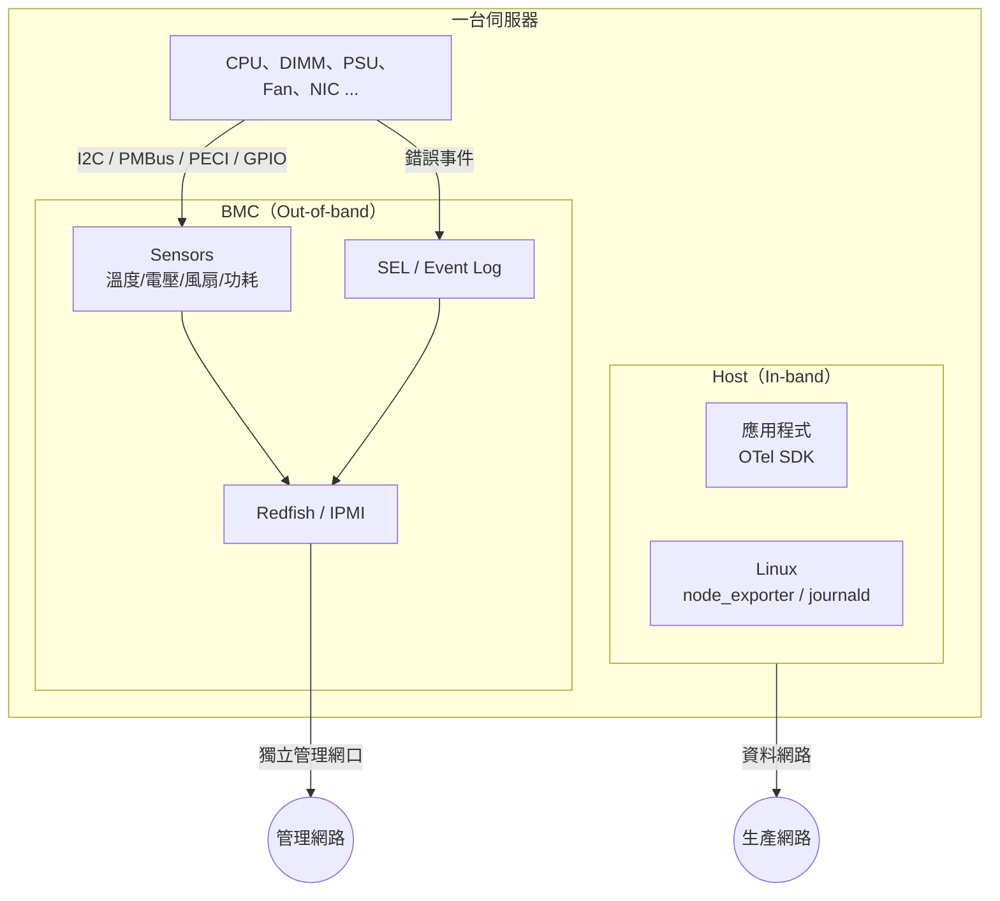

|  | In-band（Host 端） | Out-of-band（BMC） |
|---|---|---|
| 典型工具 | OTel SDK、node_exporter | Redfish、IPMI |
| 資料 | 應用效能、OS 資源 | 溫度、電源、風扇、硬體錯誤 |
| Host 當機時 | ❌ 看不到 | ✅ 仍可回報 |
| 誕生背景 | 雲原生 / 微服務 | 伺服器硬體管理 |

### OpenBMC 內部的 telemetry 資料流

圖中的 sensor、telemetry daemon 與 Redfish 服務都是 OpenBMC 的上游元件。[^6][^7][^8]

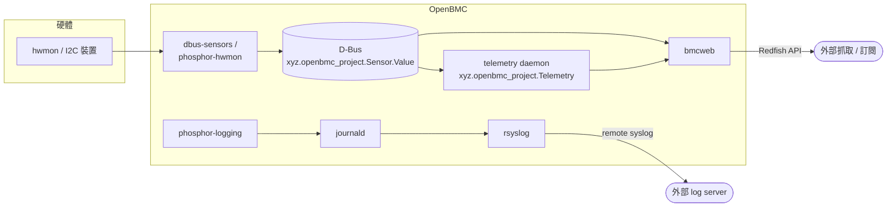

### Redfish TelemetryService 資源結構

資源名稱依 DMTF 的 TelemetryService schema。[^5]

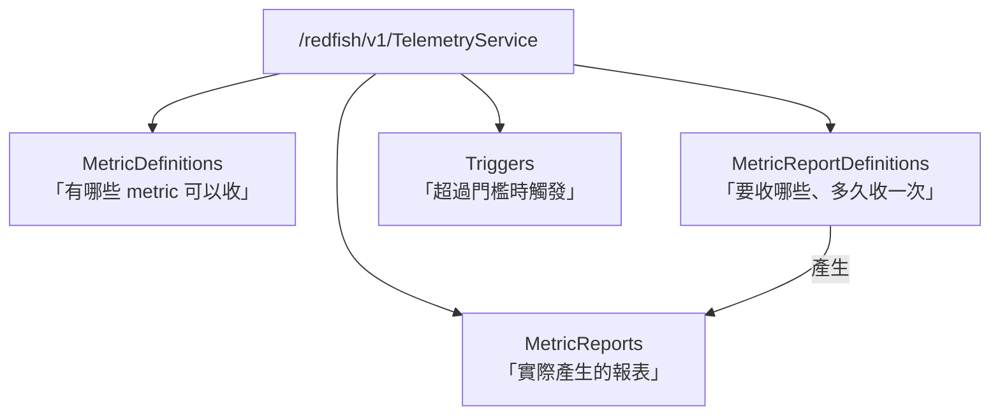

### Pull 與 Push 兩種取得方式

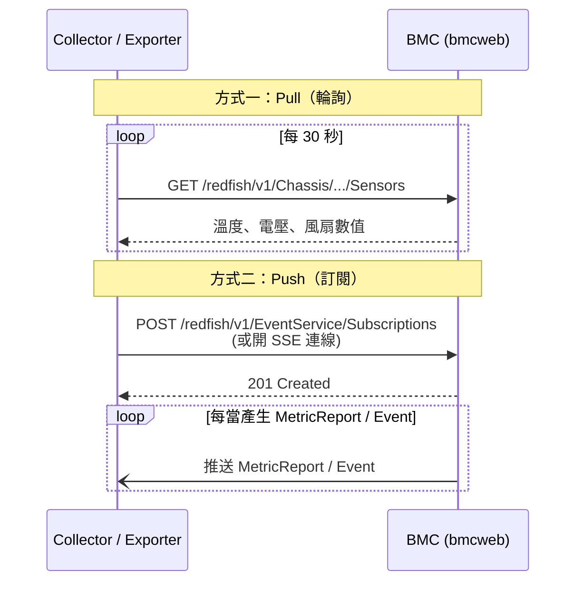

---

## 4. Grafana、Loki 這些是什麼

它們是**後端儲存與視覺化**，位於 OTel 水管的下游。Grafana Labs 的整套工具常被稱為 **LGTM stack**：

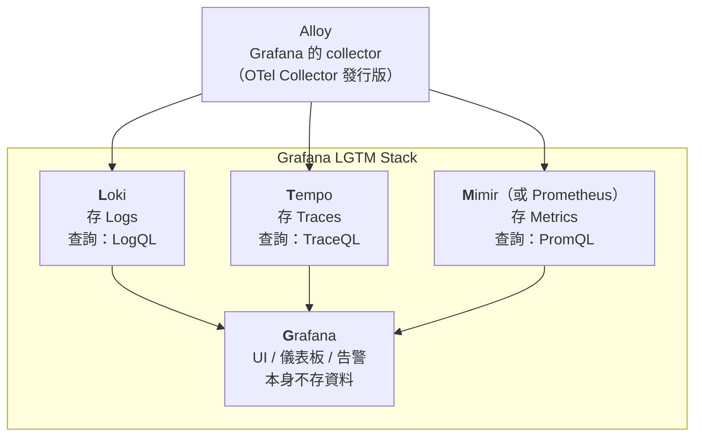

### Loki 為什麼便宜：只對 label 建索引

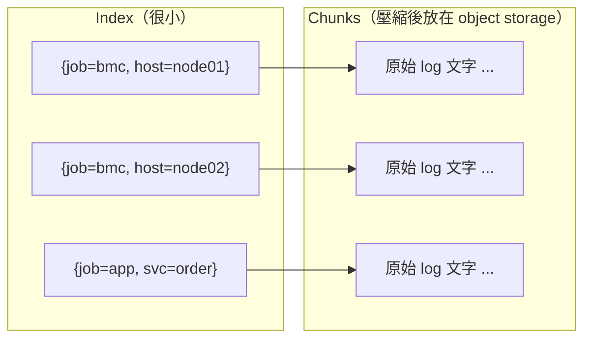

- **Elasticsearch**：對每個字建全文索引，查詢快，但儲存與運算都貴。
- **Loki**：log 內容本身不建索引，只用 label 找到 stream，再對 chunk 做 grep 式掃描。[^11]這種做法便宜，但 label 要設計好。高基數的欄位（如 request_id）不要放進 label。[^12]

---

## 5. 全部串起來：資料中心的整體架構

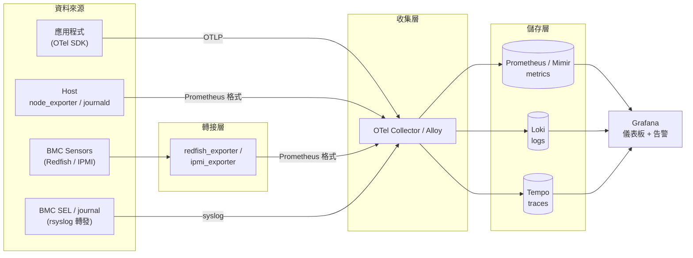

### 分層對照

| 層 | 做什麼 | 代表 |
|---|---|---|
| 來源 | 產生 telemetry | 應用程式、Linux、**BMC** |
| 標準 / 傳輸 | 定義格式、搬運 | **OpenTelemetry**（SDK、OTLP、Collector） |
| 儲存 | 存與查詢 | Prometheus/Mimir、**Loki**、Tempo |
| 視覺化 | 看、告警 | **Grafana** |

---

## 6. 實際情境：把軟體和硬體資料關聯起來

同時收集 in-band 與 out-of-band 資料，價值在於能**跨層找出根因**：

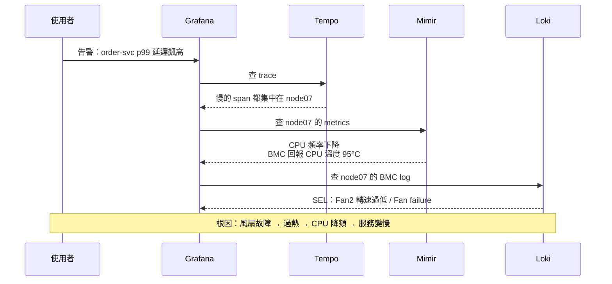

如果只有 host 端的 OTel 資料，只能看到「node07 變慢」。加上 BMC 的 telemetry，才能一路追到「風扇壞了」。

---

## 7. 名詞速查

| 名詞 | 一句話 |
|---|---|
| Telemetry | 從系統收集回來的狀態資料（metrics / logs / traces / profiles） |
| Observability | 能從外部訊號推斷系統內部狀態的能力 |
| OpenTelemetry | 產生與傳輸 telemetry 的開放標準和工具 |
| OTLP | OTel 的傳輸協定 |
| OTel Collector | 接收、加工、轉送 telemetry 的 agent / gateway |
| BMC | 伺服器上獨立的管理控制器，提供 out-of-band 硬體遙測 |
| Redfish TelemetryService | Redfish 定義的 metric 報表與訂閱機制 |
| SEL | System Event Log，BMC 記錄的硬體事件 |
| Prometheus / Mimir | metrics 資料庫（Mimir 是可水平擴展的版本） |
| Loki | 只索引 label 的 log 資料庫 |
| Tempo | trace 資料庫 |
| Grafana | 視覺化與告警 UI，本身不存資料 |
| Alloy | Grafana 版的 OTel Collector[^13] |

## 參考資料

[^1]: OpenTelemetry, *What is OpenTelemetry?*（History 一節）. [https://opentelemetry.io/docs/what-is-opentelemetry/](https://opentelemetry.io/docs/what-is-opentelemetry/)
[^2]: CNCF, *A Brief History of OpenTelemetry (So Far)*, 2019-05-21. [https://www.cncf.io/blog/2019/05/21/a-brief-history-of-opentelemetry-so-far/](https://www.cncf.io/blog/2019/05/21/a-brief-history-of-opentelemetry-so-far/)
[^3]: OpenTelemetry Blog, *OpenTelemetry announces support for profiling*, 2024-03-19. [https://opentelemetry.io/blog/2024/profiling/](https://opentelemetry.io/blog/2024/profiling/)
[^4]: OpenTelemetry, *Collector Architecture*. [https://opentelemetry.io/docs/collector/architecture/](https://opentelemetry.io/docs/collector/architecture/)
[^5]: DMTF Redfish, *TelemetryService* schema. [https://redfish.dmtf.org/schemas/v1/TelemetryService.json](https://redfish.dmtf.org/schemas/v1/TelemetryService.json)
[^6]: openbmc/dbus-sensors. [https://github.com/openbmc/dbus-sensors](https://github.com/openbmc/dbus-sensors)
[^7]: openbmc/telemetry. [https://github.com/openbmc/telemetry](https://github.com/openbmc/telemetry)
[^8]: openbmc/bmcweb. [https://github.com/openbmc/bmcweb](https://github.com/openbmc/bmcweb)
[^9]: opentelemetry-collector-contrib, *CHANGELOG*（v0.131.0：移除 Loki Exporter）. [https://github.com/open-telemetry/opentelemetry-collector-contrib/blob/main/CHANGELOG.md](https://github.com/open-telemetry/opentelemetry-collector-contrib/blob/main/CHANGELOG.md)
[^10]: Grafana Loki, *How is native OTLP endpoint different from Loki Exporter*. [https://grafana.com/docs/loki/latest/send-data/otel/native_otlp_vs_loki_exporter/](https://grafana.com/docs/loki/latest/send-data/otel/native_otlp_vs_loki_exporter/)
[^11]: Grafana Loki, *Understand labels*. [https://grafana.com/docs/loki/latest/get-started/labels/](https://grafana.com/docs/loki/latest/get-started/labels/)
[^12]: Grafana Loki, *Label best practices*. [https://grafana.com/docs/loki/latest/get-started/labels/bp-labels/](https://grafana.com/docs/loki/latest/get-started/labels/bp-labels/)
[^13]: Grafana Alloy, *Introduction*. [https://grafana.com/docs/alloy/latest/introduction/](https://grafana.com/docs/alloy/latest/introduction/)
