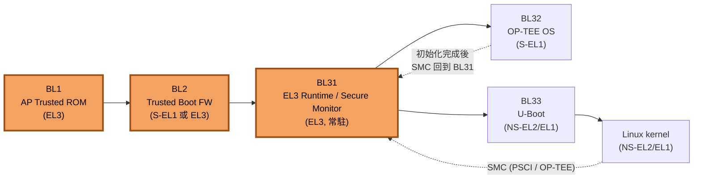
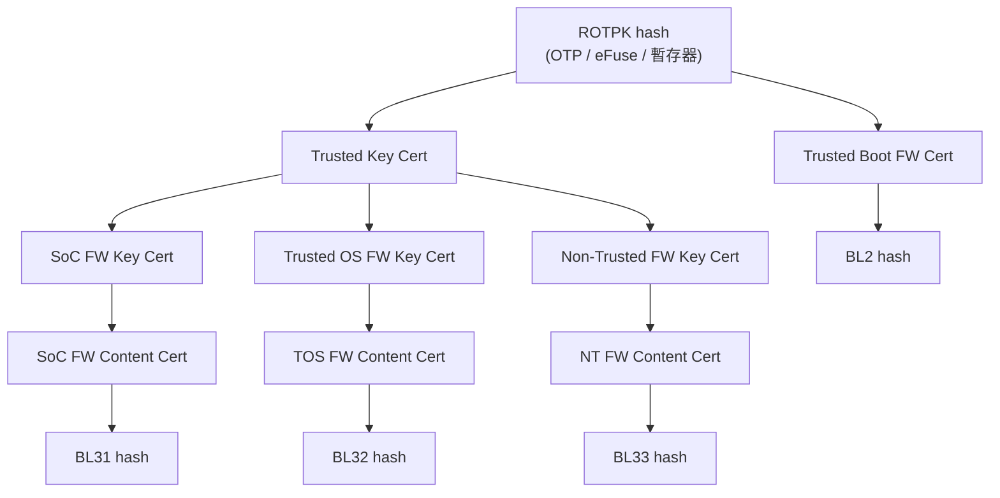
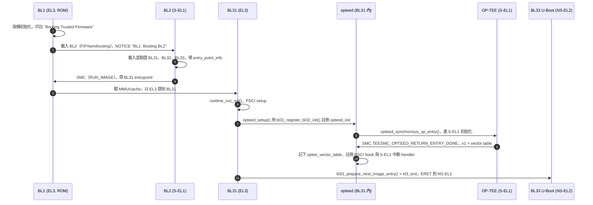
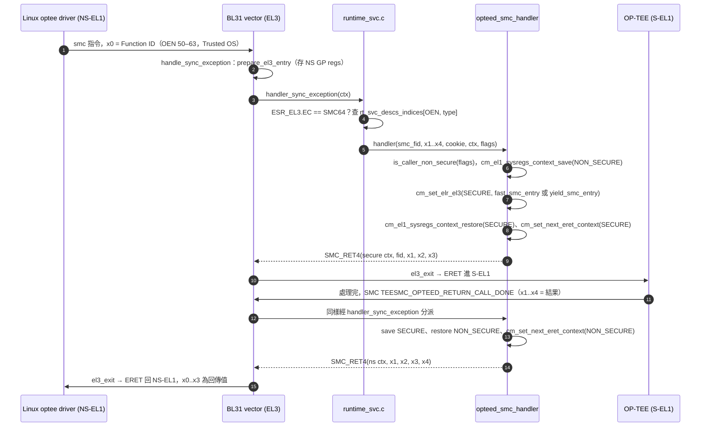
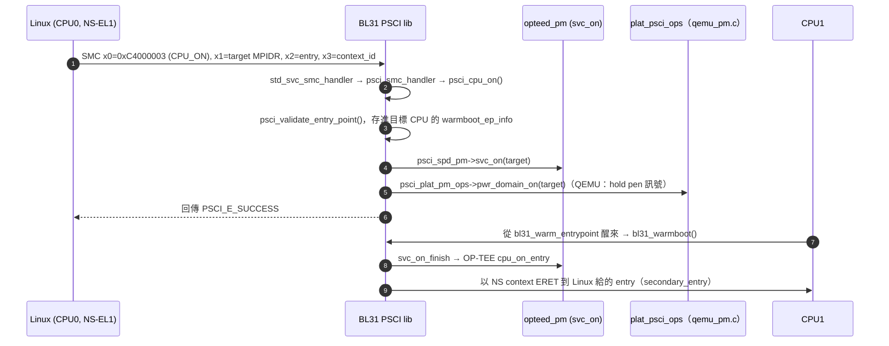

# ARMv8 開機鏈三部曲（一）：Trusted Firmware-A

> **系列文章**：**（一）TF-A（本文）** ｜ [（二）OP-TEE](./optee.md) ｜ [（三）U-Boot](./u-boot.md)
>
> 主軸：BL1 (ROM) → BL2 → **BL31 (EL3 runtime, TF-A)** → BL32 (OP-TEE, S-EL1) → BL33 (U-Boot, NS-EL2/EL1) → Linux

> 本文的原始碼路徑、函式名稱與 build option，都是對照 TF-A upstream `master`（2026-09-18 的 commit `ab0123b9`）以及官方文件確認過的。TF-A 的內部實作一直在重構，如果你手上是舊版 vendor tree，函式名稱可能不一樣。凡是我自己推論、沒有官方來源直接支持的地方，都會標上「（推論）」。

---

## TL;DR

- **TF-A 是 Arm 官方的 Secure World 參考韌體**。它在 AArch64 上把冷開機拆成五段：BL1 *AP Trusted ROM*、BL2 *Trusted Boot Firmware*、BL31 *EL3 Runtime Software*、BL32 *Secure-EL1 Payload*（可選）、BL33 *Non-trusted Firmware*[^1]。BL1、BL2、BL31 是 TF-A 自己的程式；BL32 通常是 OP-TEE，BL33 通常是 U-Boot 或 UEFI。
- **BL31 開完機不會退場，會一直常駐在 EL3**，扮演 Secure Monitor 的角色。Normal World 發出的每一個 `SMC` 都會先進 BL31，再依 SMCCC 的 Function ID 分派給 PSCI、SiP service 或 SPD（例如 `opteed`）[^1][^10]。
- **Linux 的 CPU hotplug、suspend、reboot 最後都是用 PSCI SMC 叫進 BL31 處理的**。Linux 靠 DT 裡的 `psci` node（`method = "smc"`）和每顆 CPU 的 `enable-method = "psci"` 知道要走這條路[^14][^15]。
- **FIP** 是 TF-A 的映像打包格式，由 ToC 加上以 UUID 識別的 payload 組成，用 `fiptool` 產生。**TBB/TBBR** 則以 ROTPK 為根，用 X.509 憑證把 BL2 到 BL33 串成一條 Chain of Trust[^1][^3]。
- 新架構是 **SPMD + SPMC（FF-A）**：SPMC 可以放在 S-EL1、S-EL2（例如 Hafnium）或 EL3，用來取代傳統的「一個 Trusted OS 配一個專用 SPD」模式[^6]。

---

## 在開機鏈中的位置



橘色是本篇的範圍：**BL1、BL2、BL31 都屬於 TF-A**。BL31 開完機後仍然留在 EL3，之後 Linux 和 OP-TEE 之間的每一次往返都要經過它。OP-TEE 的部分請看 [OP-TEE 篇](./optee.md)，BL33 請看 [U-Boot 篇](./u-boot.md)。

---

## 核心概念

### 1. Exception Level 與 Security State

AArch64 有四個 Exception Level：EL0（user）、EL1（OS kernel）、EL2（hypervisor）、EL3（secure monitor），數字越大權限越高。TrustZone 在這之上再加一個維度，也就是 Security State（Secure / Non-secure）。組合起來就是 Linux 在 NS-EL1、KVM 或 pKVM 在 NS-EL2、OP-TEE 在 S-EL1、TA 在 S-EL0。支援 FEAT_SEL2 的平台還多一個 S-EL2，可以放 SPMC（Hafnium）[^6]。

EL3 永遠是 Secure 的，而且是**唯一能切換 Security State 的地方**（CPU 透過 `SCR_EL3.NS` bit 決定下一個 lower EL 是哪個 world）。這就是 BL31 必須存在的根本原因。

### 2. 為什麼需要 EL3 firmware？

TF-A 的 Context Management 文件講得很清楚：general-purpose registers、大部分 system registers 和 vector registers **都沒有按 world 分 bank**，所以在 Secure 和 Non-secure 之間切換時，保存和還原暫存器是 secure monitor 軟體（AArch64 上就是 BL31）的責任，硬體不會幫你做[^8]。

除了 world switch，EL3 還負責一些「只有最高權限才適合做」的事，例如 PSCI 電源管理（CPU on/off、system reset）、平台 errata workaround，以及各家 SoC 的 SiP service。

### 3. BL 各階段的角色與執行位置

| 階段 | TF-A 名稱 | 執行 EL | 典型所在記憶體 | 主要工作 |
|---|---|---|---|---|
| BL1 | AP Trusted ROM | EL3 | Trusted ROM（data section 會被複製到 trusted SRAM） | 最小化架構初始化，載入 BL2 |
| BL2 | Trusted Boot Firmware | S-EL1（預設）/ EL3（`RESET_TO_BL2=1`） | trusted SRAM | 載入並驗證 BL31、BL32、BL33 |
| BL31 | EL3 Runtime Software | EL3 | trusted SRAM | 常駐：SMC 分派、PSCI、world switch |
| BL32 | Secure-EL1 Payload | S-EL1 | 平台決定（QEMU 可設在 secure DRAM） | Trusted OS，例如 OP-TEE |
| BL33 | Non-trusted Firmware | NS-EL2（沒有 EL2 時是 EL1） | non-secure DRAM | U-Boot / UEFI |

以上整理自 firmware design 文件[^1]：BL1 通常放在 Trusted ROM，它的 data section 會在執行時複製到 trusted SRAM；BL1 以 Secure-EL1 身分把控制權交給 BL2；BL31 「executes solely in trusted SRAM」；BL31 會在 EL2 可用時以 EL2 進入 BL33，否則進 EL1。

用 QEMU 平台實際對照一下（`plat/qemu/qemu/include/platform_def.h`）：`BL1_RO_BASE` 等於 `SEC_ROM_BASE`（0x0），`BL31_BASE` 和 `BL2_BASE` 落在 `SEC_SRAM` 區（0x0e000000 起），BL32 則可以用 `BL32_RAM_LOCATION` 改放到 `SEC_DRAM`（0x0e100000 起）[^9]。

### 4. BL2 跑在 EL3：`RESET_TO_BL2`（舊名 `BL2_AT_EL3`）

很多 SoC 有自己的 Boot ROM，不會用 TF-A 的 BL1。這種情況下 BL1 只是浪費記憶體，所以 TF-A 提供一個模式，讓 Boot ROM 直接跳進 BL2，BL2 在 EL3 執行。這時 BL2 會自己帶 reset code，並且直接跳到下一個 image，不再透過 `RUN_IMAGE` SMC 請 BL1 代勞[^1]。

- 目前的 build option 是 **`RESET_TO_BL2`**。TF-A v2.9.0 的 changelog 寫明「BL2_AT_EL3 renamed to RESET_TO_BL2 across the repository」[^22]。
- 另有一個隱含 flag `BL2_RUNS_AT_EL3`：`RESET_TO_BL2=1` 時一定是 1，但在 4-world（RME）系統中，即使 `RESET_TO_BL2=0` 也可能為真[^2]。

> **推論**：面試時如果對方說「BL2_AT_EL3」，多半是在講舊版 tree。先講出新名稱，再補一句「v2.9 改名了」，能顯示你有在追 upstream。手機 SoC 通常都有自家 Boot ROM，所以實務上看到 BL2 跑 EL3、甚至 vendor 自己的 preloader 直接載入 BL31，都很常見。

### 5. FIP（Firmware Image Package）

FIP 把多個 bootloader image 包成一個檔案，讓 TF-A 從 non-volatile storage 載入。格式是「ToC header → 多個 ToC entry → end marker → payload data」。每個 entry 用**預先定義的 UUID** 識別 image，並記錄 offset 和 size。格式定義在 `include/tools_share/firmware_image_package.h`，工具在 `tools/fiptool`[^1]。

```bash
# 依官方 tools-build 文件整理 [^4]
make PLAT=<platform> fiptool
./build/<platform>/<build-type>/tools/fiptool/fiptool create \
    --tb-fw  build/<platform>/<build-type>/bl2.bin \
    --soc-fw build/<platform>/<build-type>/bl31.bin \
    fip.bin
./build/<platform>/<build-type>/tools/fiptool/fiptool info fip.bin
```

`fiptool` 的子指令有 `info`、`create`、`update`、`unpack`、`remove`。命令列名稱對應 image 角色：`--tb-fw` 是 BL2，`--soc-fw` 是 BL31，`--tos-fw` 是 BL32，`--nt-fw` 是 BL33（見 `tools/fiptool/tbbr_config.c`）[^9]。

### 6. Trusted Board Boot（TBB / TBBR）與 Chain of Trust

TF-A 的 TBB 實作的是 Arm 的 *Trusted Board Boot Requirements*（DEN0006D）[^3][^12]。重點如下：

- **信任根（trust anchor）** 有兩個：一是 **ROTPK**（Root of Trust Public Key）或它的 hash，Arm 開發板把 hash 放在 trusted root-key storage registers 裡；二是 **BL1 本身**，前提是它放在 ROM，無法被竄改[^3]。
- 其餘節點都是 **X.509 v3 憑證**，而且都是 self-signed。信任關係靠的是憑證 extension 的內容，不靠 CA 驗證 issuer。憑證分成兩類：**Key certificate** 用來驗證簽 content certificate 的公鑰；**Content certificate** 存放 image 的 hash[^3]。
- 相關 build option：`TRUSTED_BOARD_BOOT=1` 會讓 BL1/BL2 具備載入並驗證 FIP 中憑證與 image 的能力；`GENERATE_COT=1` 會在 build 時呼叫 `cert_create` 產生憑證，再用 `fiptool` 塞進 FIP；`ROT_KEY` 指定 ROT 私鑰[^2]。



> 上圖是 TBBR CoT 的簡化示意。憑證名稱對照 OP-TEE build 在 `TF_A_TRUSTED_BOARD_BOOT=y` 時連結出來的檔案（`trusted_key.crt`、`soc_fw_key.crt`、`soc_fw_content.crt`、`tos_fw_key.crt`、`nt_fw_key.crt`、`tb_fw.crt` 等）[^18]。完整結構請以 TBB 文件為準[^3]。

---

## 架構與原始碼導讀

以下路徑都已在 upstream tree 中確認存在[^9]：

```text
arm-trusted-firmware/
├── bl1/                      # bl1_main.c：印出 "Booting Trusted Firmware"、載入 BL2
├── bl2/                      # bl2_main.c：依 image descriptor 載入 BL31/BL32/BL33
├── bl31/
│   ├── bl31_main.c           # bl31_main()、bl31_prepare_next_image_entry()、bl31_warmboot()
│   └── aarch64/
│       ├── bl31_entrypoint.S # bl31_entrypoint / bl31_warm_entrypoint
│       └── runtime_exceptions.S  # EL3 vector table（sync_exception_aarch64…）
├── common/
│   ├── runtime_svc.c         # runtime_svc_init()、handler_sync_exception()
│   └── bl_common.c           # image 載入共用碼
├── include/
│   ├── common/runtime_svc.h  # DECLARE_RT_SVC、rt_svc_desc_t
│   ├── lib/smccc.h           # FUNCID_* 欄位、OEN_* 範圍
│   ├── lib/psci/psci.h       # PSCI_CPU_ON_AARCH64 等 Function ID
│   └── export/common/ep_info_exp.h  # entry_point_info_t、aapcs64_params_t
├── lib/
│   ├── el3_runtime/aarch64/  # context_mgmt.c（cm_*）、context.S（el3_exit）
│   └── psci/                 # psci_main.c、psci_on.c、psci_off.c、psci_suspend.c …
├── services/
│   ├── std_svc/              # std_svc_setup.c（PSCI 等 Standard Service）、spmd/
│   └── spd/                  # opteed/、tspd/、trusty/、tlkd/、pncd/
├── plat/                     # qemu/、mediatek/、rockchip/、imx/、qti/、nvidia/ …
└── tools/                    # fiptool/、cert_create/、encrypt_fw/ …
```

補充一點：upstream 的 `plat/` 底下確實有 `mediatek/`（包含 mt8173、mt8183、mt8186、mt8188、mt8192、mt8195、mt8196 等 port）、`qti/`、`rockchip/` 等平台[^9]。所以「手機與平板 SoC 大量使用 TF-A」這件事，從 upstream tree 就看得到（這些 upstream port 多半是 Chromebook 等平台用的；各家量產手機實際用的是哪一版 tree，公開資料無法判斷）。

### Runtime Service Framework：`DECLARE_RT_SVC`

BL31 裡每一種 SMC 服務都是一個 `rt_svc_desc_t`，透過 macro 註冊：

```c
/* include/common/runtime_svc.h */
#define DECLARE_RT_SVC(_name, _start, _end, _type, _setup, _smch) \
	static const rt_svc_desc_t __svc_desc_ ## _name \
		__section(".rt_svc_descs") __used = { ... }
```

descriptor 會被放進特殊的 ELF section `.rt_svc_descs`。`runtime_svc_init()` 在開機時掃描這個 section，用「OEN + call type」建出索引表 `rt_svc_descs_indices[]`（`MAX_RT_SVCS` = 128）[^1][^9]。實際例子：

- `services/std_svc/std_svc_setup.c`：`DECLARE_RT_SVC(std_svc, OEN_STD_START, OEN_STD_END, SMC_TYPE_FAST, std_svc_setup, std_svc_smc_handler)`，PSCI 就掛在這裡。
- `services/spd/opteed/opteed_main.c`：註冊了兩個 descriptor，`opteed_fast`（`SMC_TYPE_FAST`）和 `opteed_std`（`SMC_TYPE_YIELD`），OEN 範圍都是 `OEN_TOS_START`～`OEN_TOS_END`（50–63，Trusted OS 區段）。

### SMCCC Function ID 欄位

以 `include/lib/smccc.h` 為準[^9][^10]：

| Bits | 欄位 | 說明 |
|---|---|---|
| 31 | Type | 1 = Fast（`SMC_TYPE_FAST`），0 = Yielding（`SMC_TYPE_YIELD`） |
| 30 | Calling convention | 1 = SMC64，0 = SMC32 |
| 29:24 | OEN（Owning Entity Number） | 0 Arm Arch、1 CPU、2 SiP、3 OEM、4 Standard（PSCI 在此）、5 Std Hyp、6 Vendor Hyp、7 Vendor EL3、48–49 Trusted App、50–63 Trusted OS |
| 23:17 | Reserved | Fast call 時必須為 0，否則 BL31 回 `SMC_UNK` |
| 16 | SVE hint | SMCCC v1.3 新增 |
| 15:0 | Function number | 服務內的編號 |

實際拆一次：`PSCI_CPU_ON_AARCH64 = 0xC4000003`，換成二進位就是 bit31=1（Fast）、bit30=1（SMC64）、OEN=4（Standard）、function number=3。`PSCI_SYSTEM_RESET = 0x84000009` 則是 Fast、SMC32、OEN 4[^9]。

**Fast 和 Yielding 的差別**：Fast call 在 secure 端以 atomic 方式執行完才回來，不會被 Normal World 打斷；Yielding call（又稱 Standard call）可以被搶占，例如被 non-secure interrupt 打斷後先回到 Normal World，之後再恢復[^10]。OP-TEE 的 `opteed` 會依 `GET_SMC_TYPE(smc_fid)` 決定跳到 OP-TEE vector table 的 `fast_smc_entry` 還是 `yield_smc_entry`[^9]。

---

## 關鍵流程

### 流程一：冷開機（BL1 → BL2 → BL31 → BL32 → BL33）



步驟 4～6 是 BL2 跑在 S-EL1 時的標準流程：BL2 透過 SMC 把控制權交回 BL1，由 BL1 關掉 MMU、flush cache，再以 EL3 跳進 BL31[^1]。如果是 `RESET_TO_BL2`，BL2 本身就在 EL3，會直接跳到 BL31。

**BL2 → BL31 的參數傳遞**：BL2 為每個 image 準備一個 `entry_point_info_t`，內容包含 `pc`、`spsr`，以及 `args.arg0..arg3`（`aapcs64_params_t`）[^9]。以 QEMU 為例，`bl31_early_platform_setup2(arg0, ...)` 把 `arg0` 轉成 `bl_params_t *`，再走訪 `bl_params_node_t` linked list，找出 BL32 和 BL33 的 `ep_info`（`plat/qemu/common/qemu_bl31_setup.c`）。之後 BL31 的通用碼透過 `bl31_plat_get_next_image_ep_info()` 取得下一個 image 的資訊[^1]。

**BL31 → BL33 的 x0..x3**：`entry_point_info.args.arg0..arg3` 在 ERET 時會變成 BL33 的 x0..x3。QEMU 平台在 `ARM_LINUX_KERNEL_AS_BL33=1` 時（直接把 Linux 當 BL33）會設 `arg0 = DTB 位址`、`arg1..arg3 = 0`，程式註解直接引用 Linux 的 booting 文件：「Linux expects the physical address of the device tree blob (DTB) in x0, while x1-x3 are reserved」[^9][^16]。

> **推論**：`args` 的內容由各平台的 BL2 code 自己決定，並沒有全域標準。如果 BL33 是 U-Boot，x0 放什麼（DTB、transfer list 或 0）要看平台設定。OP-TEE 的 qemu_v8 建置會開 `TRANSFER_LIST=1`[^18]，這是 Arm Firmware Handoff 這條新路線，細節請另外查閱。

**opteed 為什麼用同步呼叫**：firmware design 文件提到 SPD 有兩種把 BL32 叫起來的方式。一種是 `bl31_set_next_image_type()` 讓 `bl31_main()` 直接 exit 到 BL32；另一種是用 `bl31_register_bl32_init()` 註冊初始化函式，以「world-switch synchronous call」進入 S-EL1，等 BL32 用 SMC 回報完成，再回到 `bl31_main()` 繼續走到 BL33[^1]。`opteed` 用的是第二種：`opteed_setup()` 呼叫 `bl31_register_bl32_init(&opteed_init)`，`opteed_init()` 再呼叫 `opteed_synchronous_sp_entry()`[^9]。

### 流程一之二：BL31 內部的啟動順序

把 `bl31/aarch64/bl31_entrypoint.S` 和 `bl31/bl31_main.c` 對照著讀，冷開機時 BL31 大致依下面的順序執行。以下以目前 upstream 的程式為準[^9]：

1. **`bl31_entrypoint`（assembly）**：先把 x0–x3（BL2 傳來的參數）暫存到 x20–x23，再用 `el3_entrypoint_common` macro 完成 EL3 的基本設定，其中 `_exception_vectors=runtime_exceptions` 就是在安裝 BL31 的例外向量表。接著把參數還原到 x0–x3，執行 `bl bl31_main`。另外，在 `RESET_TO_BL31` 模式下（CPU reset 後直接從 BL31 開始，連 BL1/BL2 都省略），這個 macro 會多做 SCTLR 初始化、warm boot mailbox 和 secondary CPU 處理等工作。從 `bl31_main` 返回後，會先 clean 幾段 dcache，最後 `b el3_exit`。這個 `el3_exit` 就是「第一次離開 EL3」的地方。
2. **`bl31_main()` 前段**：呼叫 `plat_setup_early_console()`，然後依序執行 `bl31_early_platform_setup2(arg0..arg3)` 和 `bl31_plat_arch_setup()`。前者接收 BL2 傳來的參數（QEMU 上是 `bl_params_t *`），後者通常負責建 page table、開 MMU。
3. **印出版本資訊**：`NOTICE("BL31: %s\n", build_version_string)` 等兩行，也就是 QEMU log 裡看到的 `BL31: v2.x...`。
4. **GIC 與平台初始化**：`USE_GIC_DRIVER` 開啟時會執行 `gic_init()`、`gic_pcpu_init()`、`gic_cpuif_enable()`，接著是 `bl31_platform_setup()`。
5. **`bl31_lib_init()`**：裡面呼叫 `cm_init()`，初始化 context management。
6. **（可選）EHF**：`EL3_EXCEPTION_HANDLING` 開啟時執行 `ehf_init()`。
7. **`runtime_svc_init()`**：掃描 `.rt_svc_descs`，逐一呼叫各 service 的 init。PSCI 在這一步由 `std_svc_setup()` 呼叫 `psci_setup()` 初始化（註解也提到 `psci_setup()` 同時負責 EL3 架構設定）；`opteed_setup()` 也在這一步透過 `bl31_register_bl32_init()` 登記 BL32 的初始化函式。
8. **BL32 初始化**：如果 `bl32_init != NULL`，印出 `INFO: BL31: Initializing BL32`，然後呼叫它。對 `opteed` 來說，這一步會同步進入 OP-TEE，等 OP-TEE 回報 `ENTRY_DONE` 才返回。
9. **`bl31_prepare_next_image_entry()`**：透過 `bl31_plat_get_next_image_ep_info()` 取得 BL33 的 `entry_point_info`，印出 `INFO: BL31: Preparing for EL3 exit to normal world`，再用 `cm_init_my_context()` 依 `entry_point_info` 建好 context。目標是 Non-secure 時，會呼叫 `cm_prepare_el3_exit_ns()` 把 EL2/EL1 的初始狀態寫好。
10. **`bl31_plat_runtime_setup()` 與 `console_switch_state(CONSOLE_FLAG_RUNTIME)`**：console 切到 runtime 模式。從這一刻起，只有註冊為 runtime scope 的 console 會輸出。QEMU port 把同一個 UART 同時註冊成 boot 和 runtime scope，所以 runtime 的錯誤訊息仍然看得到。

> **推論**：第 10 步是實機上很常見的坑。很多平台為了避免和 Linux 搶 UART，只把 console 註冊成 boot scope，結果進 Linux 之後，BL31 的 runtime `ERROR()` 完全看不到。除錯時可以先確認 console 的 scope flag（`CONSOLE_FLAG_BOOT`／`CONSOLE_FLAG_RUNTIME`）。

### 流程一之三：Context 裡到底存了什麼

`cpu_context_t` 定義在 `include/lib/el3_runtime/aarch64/context.h`，主要成員有[^9]：

- `gpregs_ctx`：x0–x30 等通用暫存器。SMC 進 EL3 時由 `prepare_el3_entry` 保存；handler 用 `SMC_RET1..SMC_RET4` 寫回的其實就是這裡的 x0–x3。
- `el3state_ctx`：這個 world 對應的 `SCR_EL3`、`SPSR_EL3`、`ELR_EL3`（常數 `CTX_SCR_EL3`、`CTX_SPSR_EL3`、`CTX_ELR_EL3`）。`el3_exit` 會把它們寫回硬體再 ERET。所以「要回到哪個 world、哪個 EL、哪個 PC」全都由這一塊決定。
- `el1_sysregs_ctx` 或 `el2_sysregs_ctx`：EL1 或 EL2 的 system registers（SCTLR、TCR、TTBR、VBAR 等）。**兩者是二選一的**：`CTX_INCLUDE_EL2_REGS=1` 時存 EL2，否則存 EL1。程式註解說明，SPMC 在 S-EL2（`SPMD_SPM_AT_SEL2=1`）時，EL1 暫存器由 S-EL2 的 SPMC 自己保存，BL31 就不再處理。
- 視 build option 而定的其他成員，例如 `pauth_ctx`（`CTX_INCLUDE_PAUTH_REGS`），以及 errata 相關的 context。

每顆 CPU、每個 security state 各有一份 context。`cm_get_context(NON_SECURE)` 和 `cm_get_context(SECURE)` 分別取出目前 CPU 的 NS 和 Secure context，`cm_set_next_eret_context()` 則決定下一次 `el3_exit` 要用哪一份[^8][^9]。理解這一點之後，`opteed` 的 world switch 就很好讀：它只是把 A world 的 EL1 sysregs 存起來、把 B world 的載回去，再把「下一次 ERET 用誰的 context」指向 B。

### 流程二：一個 SMC 從 Linux 到 OP-TEE 再回來



要點：

1. **進 EL3**：`bl31/aarch64/runtime_exceptions.S` 的 `handle_sync_exception` macro 會先呼叫 `prepare_el3_entry` 保存環境，再呼叫 C 函式 `handler_sync_exception()`，最後 `no_ret el3_exit`[^9]。
2. **分派**：`common/runtime_svc.c` 的 `handler_sync_exception()` 確認 `ESR_EL3.EC` 是 AArch64 SMC 之後，進入 `sync_handler()`：先檢查 Fast call 的 reserved bits，再以 `get_handler_for_smc_fid()` 查表呼叫 handler；`flags` 內帶著呼叫者的 `SCR_EL3.NS` bit[^9]。
   > 較舊的 TF-A 版本這一段大多寫在 assembly（`runtime_exceptions.S`）裡，新版才搬到 C。讀 vendor tree 時請以手上的版本為準。
3. **World switch**：`opteed_smc_handler()` 用 `cm_el1_sysregs_context_save/restore()` 換掉 EL1 system registers，再用 `cm_set_next_eret_context()` 指定下一次 `el3_exit` 要回到哪個 world 的 context。`el3_exit`（`lib/el3_runtime/aarch64/context.S`）負責還原暫存器並執行 ERET[^8][^9]。
4. **Context 保存在哪**：每顆 CPU、每個 world 各有一個 `cpu_context_t`，配置在 EL3 firmware 的 BSS 裡[^8]。

### 流程三：PSCI CPU_ON（Linux CPU hotplug）



- Linux 這一側：`arch/arm64/kernel/psci.c` 定義 `cpu_psci_ops`（`.name = "psci"`），`cpu_psci_cpu_boot()` 呼叫 `psci_ops.cpu_on(cpu_logical_map(cpu), pa_secondary_entry)`。`drivers/firmware/psci/psci.c` 則在 `method = "smc"` 時用 `__invoke_psci_fn_smc()`，底層是 `arm_smccc_smc()`[^15]。
- DT 這一側：`psci` node 帶 `compatible = "arm,psci-1.0"`（或 0.2）和 `method = "smc"`（在 hypervisor 底下是 `"hvc"`），每個 cpu node 帶 `enable-method = "psci"`[^14]。QEMU 平台的 BL2 會在執行時修改 QEMU 產生的 FDT，**自動補上 psci node 和 CPU enable-method**（`dt_add_psci_node()`、`dt_add_psci_cpu_enable_methods()`）[^5][^9]。
- TF-A 這一側（PSCI 介面語意見 PSCI 規格[^11]）：`lib/psci/psci_main.c` 的 `psci_smc_handler()` 分派到 `psci_cpu_on()` → `psci_cpu_on_start()`（`lib/psci/psci_on.c`），依序呼叫 SPD hook（`svc_on`）和平台 hook（`pwr_domain_on`）。目標 CPU 醒來後從 `bl31_warm_entrypoint` 進入，完成 `pwr_domain_on_finish` 與 `svc_on_finish`，再 ERET 回 Normal World[^9]。
- OP-TEE 之所以能參與電源管理，是因為 `opteed` 在收到 `TEESMC_OPTEED_RETURN_ENTRY_DONE` 後會呼叫 `psci_register_spd_pm_hook(&opteed_pm)`。vector table 裡的 `cpu_on_entry`、`cpu_off_entry`、`cpu_suspend_entry`、`system_reset_entry` 等就是給這些 hook 用的[^9]。

### 流程四：中斷路由（簡述）

TF-A 的 interrupt management framework 把中斷分成三類[^7]：

- **Secure-EL1 interrupt**：依當下的 security state，會 route 到 EL3 或 S-EL1，但一律在 S-EL1 處理。
- **Non-secure interrupt**：可能 route 到 EL3、S-EL1、NS-EL1 或 EL2，一律在 NS-EL1/EL2 處理。
- **EL3 interrupt**：route 到 EL3 或 S-EL1，一律在 EL3 處理（目前只支援 GICv3）。

路由規則用 **CSS**（Current Security State）和 **TEL3**（Target EL3）兩個 bit 描述[^7]。`opteed` 的做法是：在 Non-secure 狀態下發生的 S-EL1 中斷，註冊 `INTR_TYPE_S_EL1` handler 讓它先進 EL3（`set_interrupt_rm_flag(flags, NON_SECURE)`）。handler 保存 NS context 後，把 ELR 設成 OP-TEE 的 `fiq_entry` 送進 S-EL1。OP-TEE 處理完回 `TEESMC_OPTEED_RETURN_FIQ_DONE`，再切回 Normal World[^9]。

> **推論**：在 GICv3 上，secure Group 1 interrupt 在 Normal World 執行時通常以 FIQ 形式出現，所以文件和程式碼常把 S-EL1 中斷直接叫做「FIQ」。實際是 IRQ 還是 FIQ，要看 GIC group 設定和當下的 security state。

### SPD vs SPMD/SPMC（FF-A）

傳統 SPD 模式下，每一種 Trusted OS 都要在 BL31 裡配一個專屬 dispatcher（`opteed`、`tspd`、`trusty`、`tlkd`），介面也是各自定義的[^1]。新的做法是 **SPM Dispatcher（`SPD=spmd`，位於 `services/std_svc/spmd`）** 搭配 **SPMC**，雙方用標準化的 **FF-A** 協定溝通[^6][^13]：

- **S-EL2 SPMC**：需要 FEAT_SEL2（Armv8.4），通常用 Hafnium，可以把 secure world 虛擬化成多個 partition。
- **S-EL1 SPMC**：給不支援 S-EL2 的平台用，例如讓 OP-TEE 本身擔任 SPMC（`SPMC_OPTEE=1`）。
- **EL3 SPMC**：`SPMC_AT_EL3=1`，SPMC 直接放在 BL31，管理單一 S-EL1 partition[^2][^6]。

OP-TEE 的 qemu_v8 建置以 `SPMC_AT_EL` 切換這幾種模式。預設 `n` 時走 `SPD=opteed`，設成 1 / 2 / 3 則分別對應 `SPD=spmd` 的 S-EL1、S-EL2（Hafnium）、EL3 三種配置[^18]。

---

## 讀 code 路線建議（給 BSP／系統整合工程師）

> **推論**：以下是我整理的閱讀順序，不是官方建議，目的是用最少時間建立「SMC 進來之後發生什麼事」的完整心智模型。

1. **先讀一個最簡單的 runtime service**：`plat/arm/common/arm_sip_svc.c` 用 `DECLARE_RT_SVC(arm_sip_svc, OEN_SIP_START, OEN_SIP_END, SMC_TYPE_FAST, arm_sip_setup, arm_sip_handler)` 註冊 Arm 平台的 SiP service[^9]。handler 的形狀很單純：依 `smc_fid` 分 case，處理完用 `SMC_RET1(handle, ...)` 回傳。讀懂這個，就知道各家 SoC 的 SiP service 在做什麼。upstream 的 `plat/mediatek/common/` 下也有 `mtk_sip_svc.c` 等以同一個 macro 註冊的 service[^9]，結構相同。
2. **再讀分派入口**：`common/runtime_svc.c` 的 `runtime_svc_init()`（建表）和 `handler_sync_exception()`／`sync_handler()`（查表）。這兩個函式加起來不到兩百行，但涵蓋 OEN 查表、reserved bit 檢查、unknown SMC 回 `SMC_UNK`（-1）的完整邏輯。
3. **然後讀 PSCI**：從 `lib/psci/psci_main.c` 的 `psci_smc_handler()` 開始，選一個 API（例如 CPU_ON）一路追到 `psci_on.c` 和平台的 `plat_psci_ops_t`。QEMU 的 `plat/qemu/common/qemu_pm.c` 是最小的實作範例，裡面可以看到 `.pwr_domain_on`、`.pwr_domain_off`、`.system_reset` 等 hook 怎麼接。
4. **最後讀 SPD**：`services/spd/opteed/opteed_main.c`。這時你已經懂 context 和分派，讀起來主要是看「什麼時候存哪個 world、什麼時候切 ELR」。建議搭配 [OP-TEE 篇](./optee.md) 對照 OP-TEE 那一側的 `thread_vector_table`。
5. **有餘力再看 `lib/el3_runtime/aarch64/context.S`** 的 `el3_exit` 和 `prepare_el3_entry`，理解 assembly 層怎麼把 `cpu_context_t` 跟硬體暫存器對起來。

實務上，系統整合工程師最常碰到的 TF-A 問題，多半集中在三個地方（推論）：SiP service 的介面約定（kernel driver 和 BL31 兩邊的 function ID 要對上）、PSCI 平台 hook（suspend/resume 失敗、CPU 起不來），以及 image 的載入位址和 memory map 衝突（BL31/BL32 與 kernel 的 reserved-memory 重疊）。

## 與 Android 的關係

- **Verified Boot 的位置**：AOSP 文件說明，Verified Boot 從「hardware-protected root of trust」開始，一路建立到 bootloader、boot partition 等分區的 chain of trust[^20]。
  > **推論**：在 TF-A 架構的 Android 裝置上，TBB（或 vendor 自己的 secure boot）負責保護 BL2 到 BL33 這一段，AVB（libavb）通常在 BL33 bootloader 裡驗證 `vbmeta`、`boot` 等分區。兩者串起來才是完整的 chain of trust。各廠商實作不同，公開資料只能說到這個程度。
- **pKVM 與 EL2**：AOSP 文件指出 pKVM 和它的 modules 在 EL2 執行，host kernel 被降到 EL1。host 和 TrustZone 之間的記憶體共享／借出由 pKVM 以 FF-A 規範監控[^19]。Linux 的 booting 文件也建議以 EL2 進入 kernel，才能使用虛擬化延伸[^16]。
  > **推論**：這代表 BL31 必須把 BL33 放在 NS-EL2 啟動（TF-A 在 EL2 可用時預設就是這樣[^1]），而且 bootloader 不能自己降到 EL1 才跳進 kernel，否則 pKVM 無法啟用。另外，pKVM 走 FF-A 這件事，也是 SPMD/SPMC 架構在 Android 上越來越重要的原因之一。

---

## QEMU 實作：用 OP-TEE build 環境看 TF-A

> ⚠️ **以下指令依官方文件整理，本文撰寫時未實際執行驗證。**

### 取得與建置

依 OP-TEE 官方 QEMU v8 文件[^17]：

```bash
mkdir optee && cd optee
repo init -u https://github.com/OP-TEE/manifest.git -m qemu_v8.xml
repo sync
cd build
make toolchains
make run
```

`make run` 會開出 QEMU console 和兩個 UART console（Normal World、Secure World），QEMU 會停住等待輸入，要在 QEMU console 打 `c` 才會開始執行[^17]。從 `qemu_v8.mk` 可以看出，QEMU 以 `-serial tcp:...:$(QEMU_NW_PORT) -serial tcp:...:$(QEMU_SW_PORT)` 開兩個序列埠，預設 port 是 54320 和 54321[^18]。

### TF-A 在這個環境中的設定

從 `build/qemu_v8.mk` 可以確認[^18]：

- `PLAT_QEMU ?= virt` 時用 **`TF_A_PLAT = qemu`**，也就是 upstream 的 `plat/qemu/qemu`。選 sbsa 則是 `qemu_sbsa`。
- `SPMC_AT_EL ?= n`，所以預設 **`SPD=opteed`**，BL32 由 `tee-header_v2.bin`、`tee-pager_v2.bin`、`tee-pageable_v2.bin` 組成（對應 `BL32`、`BL32_EXTRA1`、`BL32_EXTRA2`），並設 `BL32_RAM_LOCATION=tdram`。
- `BL33 = U-Boot`，`TF_A_TRUSTED_BOARD_BOOT ?= n`（改這個值之前要先 `make arm-tf-clean`）。
- QEMU 用 `-bios bl1.bin` 加上 semihosting 啟動。TF-A QEMU 文件說明，BL1 扮演 BootROM，其餘 image（`bl2.bin`、`bl31.bin`…）主要透過 semihosting 從 QEMU 的工作目錄載入[^5]。

### 要在哪個視窗看 TF-A log？

這一點容易搞錯。TF-A QEMU port 的 boot 和 runtime console 都註冊在 **`PLAT_QEMU_BOOT_UART_BASE = UART0_BASE`（0x09000000）**，crash console 則用 UART1（`plat/qemu/qemu/include/platform_def.h`、`plat/qemu/common/qemu_console.c`）[^9]。QEMU 的第一個 `-serial` 對應 UART0，而 OP-TEE build 把第一個 serial 接到標題為 **"Normal World"** 的那個 terminal[^18]。

> **推論**：所以 BL1/BL2/BL31 的 NOTICE 應該會出現在 **Normal World** 視窗，排在 U-Boot 和 Linux log 前面；**Secure World** 視窗主要是 OP-TEE OS 的 log（OP-TEE 的 UART 設定請見 [OP-TEE 篇](./optee.md)）。如果你在 Secure World 視窗找不到 TF-A 的 log，先去另一個視窗看看。

### 應該看到哪些 log

以下字串都在 upstream source 裡確認過[^9]。實際的版本字串會隨 build 不同：

```text
NOTICE:  Booting Trusted Firmware              ← bl1_main.c（FIRMWARE_WELCOME_STR）
NOTICE:  BL1: v2.x(release):...                ← build_version_string
NOTICE:  BL1: Built : ...                      ← build_message
NOTICE:  BL1: Booting BL2
NOTICE:  BL2: v2.x(...)
NOTICE:  BL2: Built : ...
NOTICE:  BL2: Booting BL31                     ← NEXT_IMAGE（RESET_TO_BL2 以外的情況）
NOTICE:  BL31: v2.x(...)
NOTICE:  BL31: Built : ...
（接著是 OP-TEE 初始化，然後進入 U-Boot）
```

`DEBUG=1`（INFO level）時還會多出這些行：`INFO: BL1: RAM ...`、`INFO: Loading image id=... at address ...`、`INFO: Image id=... loaded: ...`、`INFO: Entry point address = ...`、`INFO: SPSR = ...`、`INFO: BL31: Initializing runtime services`、`INFO: BL31: Initializing BL32`、`INFO: BL31: Preparing for EL3 exit to normal world`[^9]。從這些 INFO 可以對出每個 image 的載入位址和 SPSR，確認 BL33 是用哪個 EL 進入的。

> 上面每行 log 的精確排版（例如 `Built :` 後面接什麼）是我依 source 推測的樣子，實際輸出請以你的執行結果為準（推論）。

### 只重建 TF-A（debug 版）

TF-A 本身的 build option[^2]：

- `DEBUG`：0 = release（預設），1 = debug。
- `LOG_LEVEL`：0 NONE、10 ERROR、20 NOTICE、30 WARNING、40 INFO、50 VERBOSE。**debug build 預設 40，release 預設 20**。

OP-TEE build 對應的變數是 **`TF_A_DEBUG`**（預設跟著 `DEBUG`，而 `common.mk` 裡 `DEBUG ?= 0`）和 **`TF_A_LOGLVL`**（release 時 30，debug 時 40）。最後會轉成 `PLAT=$(TF_A_PLAT) DEBUG=$(TF_A_DEBUG) LOG_LEVEL=$(TF_A_LOGLVL)` 傳給 TF-A，target 名稱是 `arm-tf`（會執行 `make ... all fip`），清除用 `arm-tf-clean`，輸出目錄是 `trusted-firmware-a/build/qemu/{release,debug}`[^18]。

```bash
cd build
make arm-tf-clean
make arm-tf TF_A_DEBUG=1 TF_A_LOGLVL=50   # debug build + VERBOSE
make run-only                              # 不重建其他元件，直接跑
```

`make run-only` 是官方文件提到「不想重建時可用」的 target[^17]。`arm-tf` target 會把 `bl1.bin`、`bl2.bin`、`bl31.bin` 以 symlink 連到 binaries 目錄[^18]。

> **推論**：切換 debug/release 會改變 `TF_A_OUT` 的路徑，symlink 會跟著更新，所以 `run-only` 應該會吃到新 build 的 image。保險起見，第一次切換時可以直接 `make run TF_A_DEBUG=1`。

直接用 TF-A tree 單獨 build 的做法（取自 TF-A QEMU 文件，flash-based 流程）[^5]：

```bash
make CROSS_COMPILE=aarch64-linux-gnu- PLAT=qemu BL32=bl32.bin \
    BL32_EXTRA1=bl32_extra1.bin BL32_EXTRA2=bl32_extra2.bin \
    BL33=bl33.bin BL32_RAM_LOCATION=tdram SPD=opteed all fip
```

---

## 常見除錯與面試問題（Q&A）

**Q1：Linux 下做 CPU hotplug（`echo 0 > /sys/devices/system/cpu/cpu1/online`，再 `echo 1`）時，是怎麼叫到 TF-A 的？**

A：Kernel 開機時從 DT 的 cpu node 讀到 `enable-method = "psci"`，就會用 `cpu_psci_ops`[^14][^15]。Online 一顆 CPU 時，`cpu_psci_cpu_boot()` 呼叫 `psci_ops.cpu_on(mpidr, pa_secondary_entry)`，最後由 `arm_smccc_smc()` 發出 `SMC`，x0 = `0xC4000003`（CPU_ON, SMC64）。BL31 依 OEN 4 把 SMC 分派到 `std_svc_smc_handler` → `psci_smc_handler()` → `psci_cpu_on()`，先把 entrypoint 存進目標 CPU 的 `warmboot_ep_info`，再依序呼叫 SPD 的 `svc_on` 和平台的 `pwr_domain_on` 讓核心上電。核心醒來後從 `bl31_warm_entrypoint` 進入，最後 ERET 到 Linux 的 secondary entry[^9]。Offline 走的是 `CPU_OFF`，由要下線的 CPU 自己呼叫，並且不會返回。

**Q2：從 Linux 的 OP-TEE driver 到 OP-TEE OS，一個 SMC 的完整路徑？**

A：NS-EL1 執行 `smc #0` → 進 EL3 vector（`runtime_exceptions.S` 的 `handle_sync_exception`）→ 保存 NS GP registers → `handler_sync_exception()` 確認 EC 是 SMC → 依 OEN（Trusted OS 50–63）和 type 查 `rt_svc_descs_indices` → 進 `opteed_smc_handler()` → 因為 `flags` 顯示呼叫者是 non-secure，所以保存 NS EL1 sysregs、依 fast/yield 把 secure ELR 設成 `fast_smc_entry` 或 `yield_smc_entry`、還原 S-EL1 sysregs、`cm_set_next_eret_context(SECURE)` → `el3_exit` ERET 進 OP-TEE。回程時 OP-TEE 發 `TEESMC_OPTEED_RETURN_CALL_DONE`，反向做一次 context 切換，把 x1..x4 當成 NS 的回傳值[^9]。整個過程 BL31 只負責「搬暫存器」，不解讀 OP-TEE 訊息的內容。

**Q3：為什麼 BL31 要常駐，BL1/BL2 卻可以丟掉？**

A：因為只有 EL3 能切換 security state，world switch 又必須由軟體保存和還原非 banked 的暫存器[^8]。另外，PSCI 的 CPU on/off/suspend、system reset 都是在 runtime 由 OS 發起的[^1]。BL1/BL2 只在冷開機時負責載入和驗證，任務完成後記憶體就可以回收。

**Q4：FIP 和 FIT 差在哪？**

A：**FIP** 是 TF-A 的格式：ToC 加上 payload，以預先定義的 UUID 識別 BL2/BL31/BL32/BL33 和憑證，用 `fiptool` 打包，由 TF-A 的 BL1/BL2 解析[^1]。**FIT**（Flat Image Tree）是 U-Boot 用來打包 kernel、DTB、ramdisk 等 image 的標準格式，結構以 device tree 為基礎[^21]。可以這樣記：FIP 包的是「開機韌體」，FIT 包的是「要被 bootloader 開起來的東西」。兩者也可以並存，例如 FIP 裡的 BL33 是 U-Boot，U-Boot 再去載入 FIT。（驗證機制：FIP 搭配 TBBR 的 X.509 CoT[^3]；FIT 有自己的簽章機制，請見 [U-Boot 篇](./u-boot.md)。）

**Q5：`RESET_TO_BL2` 是什麼？什麼時候用？**

A：讓 CPU reset 後直接從 BL2 開始，BL2 在 EL3 執行，不需要 TF-A 的 BL1。適用於 SoC 已經有自家 Boot ROM、而且它預期下一階段在 EL3 執行的情況[^1][^2]。這個選項舊名是 `BL2_AT_EL3`，v2.9.0 改名[^22]。要注意 warm boot 的處理：如果 Boot ROM 每次都跳到同一個位址，BL2 必須保留一段常駐區域，或是由平台設定 warm boot 的跳轉位址[^1]。

**Q6：Fast SMC 和 Yielding SMC 差在哪？OP-TEE 怎麼區分？**

A：由 Function ID 的 bit31 決定：1 是 Fast，0 是 Yielding[^9][^10]。Fast call 不可被搶占，適合很短的查詢（例如取 UID、版本）；Yielding call 可以被 non-secure interrupt 打斷，適合處理時間較長的 TA 呼叫。`opteed` 為兩種 type 分別註冊了 descriptor（`opteed_fast`、`opteed_std`），並依 type 跳到不同的 OP-TEE entry[^9]。

**Q7：開機卡在 TF-A，要怎麼除錯？**

A：（部分為經驗性推論）
1. 先開 `DEBUG=1`，必要時加 `LOG_LEVEL=50`[^2]，看停在哪一行：`Loading image id=...` 可以確認是哪個 image 載入失敗，`Entry point address`/`SPSR` 可以確認跳轉位址和 EL 是否正確。
2. 如果完全沒有輸出，先檢查 console 初始化和 UART base，例如 QEMU 的 `PLAT_QEMU_BOOT_UART_BASE`[^9]。
3. 懷疑 BL1 → BL31 交接有問題時，可以用 `SPIN_ON_BL1_EXIT=1` 讓 BL1 在交給 BL31 之前停住，這時所有 image 都已載入、MMU 和 cache 已關，方便接 debugger[^2]。
4. 開了 TBB 之後，驗證失敗通常是憑證、ROTPK hash 或 FIP 內容對不上。檢查 `GENERATE_COT`、`ROT_KEY` 是否一致，並用 `fiptool info` 確認 FIP 內容[^2][^4]。

**Q8：SPD（opteed）和 SPMD/SPMC 差在哪？為什麼要改？**

A：SPD 是「一個 Trusted OS 配一個 BL31 裡的專屬 dispatcher」，介面各自定義，因為 SMCCC 並沒有規範 EL3 和 S-EL1 payload 之間的介面[^1]。SPMD/SPMC 則以 **FF-A** 標準化 Normal World 和 Secure World（以及 partition 之間）的訊息傳遞與記憶體共享。SPMC 可以放在 S-EL1、S-EL2（Hafnium，需要 FEAT_SEL2）或 EL3[^6]。S-EL2 讓 secure world 也能做 stage-2 隔離，多個 secure partition 之間互不信任。

> **推論**：對 Android 來說，pKVM 也用 FF-A 管理 host 和 TrustZone 之間的記憶體共享[^19]，所以 FF-A 很可能會成為 NS/S 溝通的主流介面。

**Q9：TF-A 怎麼知道 BL33 要用 EL2 還是 EL1 進入？**

A：firmware design 文件說明，BL31 會在 EL2 可用時進入 EL2，否則進 EL1[^1]。實際的 SPSR 由平台 BL2 code 決定，例如 QEMU 的 `qemu_get_spsr_for_bl33_entry()`，並寫進 BL33 的 `entry_point_info.spsr`[^9]。開 `DEBUG=1` 就能在 `INFO: SPSR = ...` 看到實際值。

**Q10：SMC 回來 x0 是 -1（`0xFFFFFFFF...`）代表什麼？**

A：代表 `SMC_UNK`，也就是 BL31 不認得這個 Function ID[^9][^10]。在目前的 upstream 中，`sync_handler()` 遇到兩種情況會回 `SMC_UNK`：一是 Fast call 的 reserved bits [23:17] 不為 0，二是 `rt_svc_descs_indices` 查不到對應的 service，例如該 OEN 的 service 根本沒編進 BL31[^9]。常見原因（推論）：kernel driver 和 BL31 的 SiP function ID 版本不一致、build 時沒開對應的 SPD 或 service，或是把 SMC32 和 SMC64 的 ID 搞混（bit30 不同，對應的 handler 分支也不同）。

**Q11：CPU_SUSPEND 之後，CPU 是怎麼「回來」的？**

A：如果是會斷電的 power-down state，CPU 醒來時等同重新 reset，會從平台設定的 warm boot entry（BL31 的 `bl31_warm_entrypoint`）進入，而不是從 SMC 的下一行繼續執行[^9]。`bl31_warm_entrypoint` 呼叫 `bl31_warmboot()`，後者最後呼叫 `psci_warmboot_entrypoint()`，由 PSCI library 完成 power domain 的 finish 流程和 SPD hook（例如通知 OP-TEE `cpu_resume_entry`），再以該 CPU 的 NS context ERET 回到 Linux 指定的 resume entrypoint[^9][^11]。QEMU 平台的 `qemu_pm.c` 用 hold pen（`PLAT_QEMU_HOLD_BASE`）搭配 magic 值記錄 suspend entry，是理解這個機制最簡單的範例[^9]。

**Q12：`SYSTEM_RESET` 為什麼也要經過 OP-TEE？**

A：`psci_system_reset()`、`psci_system_off()` 會先呼叫 `psci_spd_pm` 的 hook（例如 `svc_system_off`），讓 Secure World 有機會收尾，再呼叫平台的 `system_reset` 或 `system_off`[^9]。對 `opteed` 來說，這些 hook 會進 OP-TEE vector table 的 `system_reset_entry`／`system_off_entry`[^9]。

> **推論**：這樣設計，是讓 Trusted OS 能在重開機前處理 secure storage、RPMB 等狀態。實際 OP-TEE 在這些 entry 做什麼，請見 [OP-TEE 篇](./optee.md)。

**Q13：SiP service 是什麼？跟 PSCI 有什麼不同？**

A：SiP（Silicon Partner）service 使用 OEN 2，是留給 SoC 廠商自訂 EL3 服務的區段；PSCI 則使用 OEN 4（Standard Service），是 Arm 定義的標準介面[^9][^10]。兩者都在 BL31 裡用 `DECLARE_RT_SVC` 註冊，差別只在 OEN 範圍和介面由誰定義。upstream 的 Arm 平台（`plat/arm/common/arm_sip_svc.c`）和 MediaTek 平台（`plat/mediatek/common/`）都有 SiP service 的實作可以參考[^9]。

---

## 參考資料

[^1]: Trusted Firmware-A Documentation — Firmware Design. https://trustedfirmware-a.readthedocs.io/en/latest/design/firmware-design.html
[^2]: Trusted Firmware-A Documentation — Build Options（`DEBUG`、`LOG_LEVEL`、`RESET_TO_BL2`、`BL2_RUNS_AT_EL3`、`SPD`、`SPMC_AT_EL3`、`TRUSTED_BOARD_BOOT`、`GENERATE_COT`、`ROT_KEY`、`SPIN_ON_BL1_EXIT`）. https://trustedfirmware-a.readthedocs.io/en/latest/getting_started/build-options.html
[^3]: Trusted Firmware-A Documentation — Trusted Board Boot. https://trustedfirmware-a.readthedocs.io/en/latest/design/trusted-board-boot.html
[^4]: Trusted Firmware-A Documentation — Building Supporting Tools（fiptool、cert_create）. https://trustedfirmware-a.readthedocs.io/en/latest/getting_started/tools-build.html
[^5]: Trusted Firmware-A Documentation — QEMU virt Armv8-A. https://trustedfirmware-a.readthedocs.io/en/latest/plat/qemu.html
[^6]: Trusted Firmware-A Documentation — Secure Partition Manager（SPMD/SPMC、S-EL1/S-EL2/EL3 SPMC）. https://trustedfirmware-a.readthedocs.io/en/latest/components/secure-partition-manager.html
[^7]: Trusted Firmware-A Documentation — Interrupt Management Framework. https://trustedfirmware-a.readthedocs.io/en/latest/design/interrupt-framework-design.html
[^8]: Trusted Firmware-A Documentation — Context Management Library. https://trustedfirmware-a.readthedocs.io/en/latest/components/context-management-library.html
[^9]: TF-A 原始碼（GitHub mirror，`master`，commit `ab0123b945303ef506a7b41b417dc07c7777fd79`，2026-09-18）。文中引用的檔案：`bl1/bl1_main.c`、`bl2/bl2_main.c`、`bl31/bl31_main.c`、`bl31/aarch64/runtime_exceptions.S`、`bl31/aarch64/bl31_entrypoint.S`、`common/runtime_svc.c`、`include/common/runtime_svc.h`、`include/lib/smccc.h`、`include/lib/psci/psci.h`、`include/export/common/ep_info_exp.h`、`lib/el3_runtime/aarch64/context_mgmt.c`、`lib/el3_runtime/aarch64/context.S`、`lib/psci/psci_main.c`、`lib/psci/psci_on.c`、`services/std_svc/std_svc_setup.c`、`services/spd/opteed/opteed_main.c`、`services/spd/opteed/opteed_private.h`、`services/spd/opteed/teesmc_opteed.h`、`plat/qemu/common/qemu_bl2_setup.c`、`plat/qemu/common/qemu_bl31_setup.c`、`plat/qemu/common/qemu_pm.c`、`plat/qemu/common/qemu_console.c`、`plat/qemu/qemu/include/platform_def.h`、`tools/fiptool/tbbr_config.c`。https://github.com/ARM-software/arm-trusted-firmware （官方 review／主 repo：https://review.trustedfirmware.org/plugins/gitiles/TF-A/trusted-firmware-a/ ）
[^10]: Arm — SMC Calling Convention (SMCCC), DEN0028. https://developer.arm.com/documentation/den0028/latest
[^11]: Arm — Power State Coordination Interface (PSCI), DEN0022. https://developer.arm.com/documentation/den0022/latest
[^12]: Arm — Trusted Board Boot Requirements (TBBR), DEN0006. https://developer.arm.com/documentation/den0006/latest
[^13]: Arm — Firmware Framework for A-profile (FF-A), DEN0077. https://developer.arm.com/documentation/den0077/latest
[^14]: Linux kernel — Devicetree binding `arm/psci.yaml`. https://github.com/torvalds/linux/blob/master/Documentation/devicetree/bindings/arm/psci.yaml
[^15]: Linux kernel — `arch/arm64/kernel/psci.c`、`drivers/firmware/psci/psci.c`. https://github.com/torvalds/linux/blob/master/arch/arm64/kernel/psci.c ， https://github.com/torvalds/linux/blob/master/drivers/firmware/psci/psci.c
[^16]: Linux kernel — Booting AArch64 Linux（x0 = DTB 位址；建議以 EL2 進入）. https://docs.kernel.org/arch/arm64/booting.html
[^17]: OP-TEE Documentation — QEMU v7/v8. https://optee.readthedocs.io/en/latest/building/devices/qemu.html
[^18]: OP-TEE build repo — `qemu_v8.mk`、`common.mk`. https://github.com/OP-TEE/build/blob/master/qemu_v8.mk
[^19]: Android Open Source Project — AVF architecture（pKVM）. https://source.android.com/docs/core/virtualization/architecture
[^20]: Android Open Source Project — Verified Boot. https://source.android.com/docs/security/features/verifiedboot
[^21]: U-Boot Documentation — Flat Image Tree (FIT). https://docs.u-boot.org/en/latest/usage/fit/index.html
[^22]: Trusted Firmware-A Documentation — Change Log（v2.9.0：「BL2_AT_EL3 renamed to RESET_TO_BL2 across the repository」）. https://trustedfirmware-a.readthedocs.io/en/latest/change-log.html
