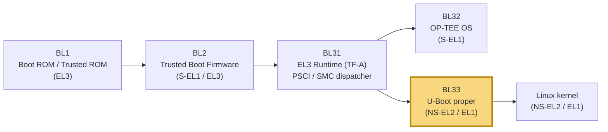
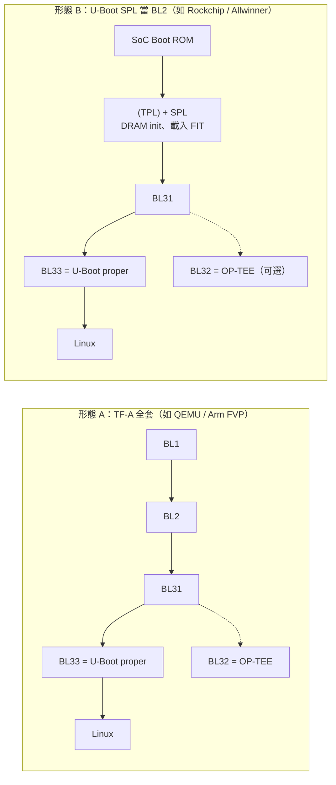
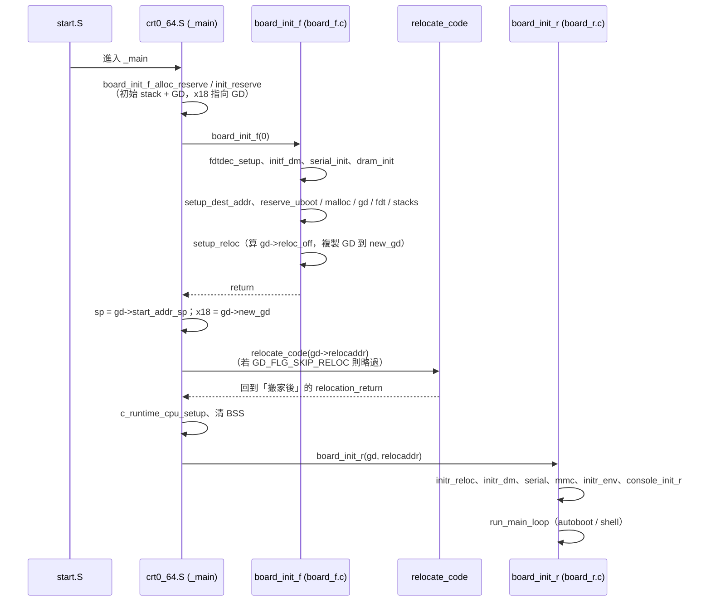
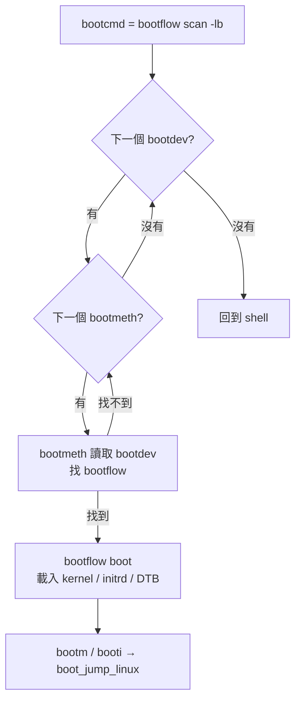

# ARMv8 開機鏈三部曲（三）：U-Boot — 從 BL33 到 Starting kernel

> **系列文章**：[（一）TF-A](./tf-a.md)｜[（二）OP-TEE](./optee.md)｜（三）U-Boot（本文）

> 本文原始碼路徑以 U-Boot 上游 `master`（撰寫時 Makefile 版本為 2026.10 開發週期）為準；不同版本檔名或函式可能有差異，請以你手上的 tree 為主。

## 前言：為什麼 Android SI 也該懂 U-Boot

做 Android 平台系統整合時，我們每天面對的是 `fastboot flash`、A/B slot、AVB 的 `androidboot.verifiedbootstate`、kernel cmdline 與 DTBO overlay；這些東西在手機上多半由 SoC 廠的 bootloader 處理，看起來像個黑盒子。U-Boot 的價值在於：它是**少數完全開源、文件完整、又同時實作了 AVB、A/B、fastboot、FIT 簽章、Driver Model 與 OP-TEE client 的 bootloader**。把它讀懂，等於有一份「可以對照原始碼的 bootloader 參考實作」，以後面對任何 vendor bootloader 都知道該問哪些問題：DTB 從哪來？在哪一步 fixup？rollback index 存哪？kernel 在哪個 EL 被叫起來？

這篇是三部曲的最後一篇，前兩篇分別處理 EL3 的 TF-A 與 S-EL1 的 OP-TEE，本篇則站在 Normal world 的起點，看 U-Boot 怎麼接下 BL31 交來的棒子，再把它交給 Linux。

## TL;DR

- 在 TF-A 的 ARMv8 開機鏈裡，U-Boot 通常扮演 **BL33（Non-trusted Firmware）**：BL31 以「可用的最高 Exception Level（有 EL2 就 EL2，否則 EL1）」跳進 U-Boot[^tfa-design]。
- U-Boot 本身可再拆成 **TPL → VPL → SPL → U-Boot proper** 幾個 phase（前三者皆可選）[^spl]。在 Rockchip、Allwinner 等平台，**SPL 本身就扮演 BL2**，用 `CONFIG_SPL_ATF` 載入 FIT 裡的 BL31（以及可選的 OP-TEE），再讓 BL31 把 U-Boot proper 當 BL33 帶起來[^spl-kconfig][^rockchip]。
- U-Boot proper 的骨幹是 `_main`（`arch/arm/lib/crt0_64.S`）→ `board_init_f()`（`common/board_f.c`）→ **relocation** → `board_init_r()`（`common/board_r.c`）→ `main_loop`；全程靠 `gd`（global data，AArch64 放在 `x18`）傳遞狀態[^crt0][^gd]。
- 裝置驅動統一走 **Driver Model（uclass / udevice / driver，`U_BOOT_DRIVER`）**，硬體描述則來自 **Device Tree（`OF_CONTROL`）**[^dm][^dt-control]。
- 開機方式已從 `distro_bootcmd` 腳本演進到 **Standard Boot（bootdev / bootmeth / bootflow）**，開啟 `BOOTSTD_DEFAULTS` 的板子預設 `bootcmd` 就是 `bootflow scan -lb`[^bootstd]。
- 交棒給 arm64 Linux 時必須符合核心的 booting 協定：**x0 = DTB 實體位址、x1~x3 = 0、MMU off**，並建議在 EL2 進入[^kernel-booting]；U-Boot 會在交棒前 fixup DT（`/chosen` bootargs、memory、OP-TEE 節點與 reserved-memory）[^image-fdt][^optee-lib]。
- 與 Android 相關：U-Boot 有 `avb` 指令與 AVB 整合（可經 OP-TEE 的 AVB TA 把 rollback index 存到 RPMB）、`abootimg`、Android bootmeth、A/B 與 fastboot[^avb2][^bootstd-android][^ab][^fastboot]。但要注意，**大多數量產 Android 手機並不是用 U-Boot**，Android 官方文件把 bootloader 定位為「vendor-proprietary image」[^aosp-bootloader]。

---

## 在開機鏈中的位置



在標準的 TF-A 流程裡，BL2 把 BL31、BL32、BL33 載入記憶體；BL31 常駐 EL3，先初始化 BL32（OP-TEE），最後再把 CPU 以 Normal world 身分送進 BL33。TF-A 的 firmware design 文件寫得很明確：EL3 Runtime Software 會初始化 normal world 的 EL2 或 EL1 context，並「jump to the Non-trusted firmware image (BL33) at the highest available Exception Level (EL2 if available, otherwise EL1)」[^tfa-design]。

但 U-Boot 的角色其實有兩種常見形態：



形態 B 對應到 TF-A 文件中的「Using alternative Trusted Boot Firmware in place of BL1 & BL2」[^tfa-design]，U-Boot 的 SPL 文件也把「Launching BL31 of ARM Trusted Firmware which invokes main U-Boot as BL33」列為 SPL 的用途之一[^spl]。本文前半段講 U-Boot 自己的內部結構，後半段講它怎麼把棒子交給 Linux。

---

## 核心概念

### 1. U-Boot 的 boot phases：TPL / VPL / SPL / U-Boot proper

官方文件定義的 phase 如下（TPL、VPL、SPL 皆為可選，許多板子只用 SPL，用 TPL 的較少）[^spl]：

| Phase | 全名 | 職責（依官方文件） |
|---|---|---|
| TPL | Tertiary Program Loader | 非常早期的初始化，越小越好，負責載入 SPL（或 VPL） |
| VPL | Verifying Program Loader | 可選的驗證步驟，可在 A/B verified boot 下選擇多個 SPL 之一（官方註明仍在發展中） |
| SPL | Secondary Program Loader | 設定 SDRAM 並載入 U-Boot proper，也可能載入其他 firmware |
| U-Boot proper | — | 有 command line 與開機邏輯的完整 U-Boot |

這些統稱為 **xPL**，編譯時會分別放在 `spl/`、`tpl/`、`vpl/` 子目錄，並自動開啟 `CONFIG_XPL_BUILD`；Kconfig 以 `CONFIG_IS_ENABLED(FOO)` 自動對應到 `CONFIG_FOO` / `CONFIG_SPL_FOO` / `CONFIG_TPL_FOO`[^spl]。

為什麼要切這麼多段？因為剛上電時通常只有 SoC 內部的 SRAM 可用，容量可能只有幾十 KB，塞不下完整的 U-Boot；得先有一段小程式把 DRAM 初始化起來，才能把大的東西載進 DRAM 執行。SRAM 小到連 SPL 都塞不下時，就再往前切一段 TPL（推論：這是通則，實際切法取決於 SoC Boot ROM 的限制與 DRAM init 程式的大小）。

### 2. SPL 載入 TF-A：`CONFIG_SPL_ATF`

`common/spl/Kconfig` 中的 `SPL_ATF` 說明寫著：ATF 是 AArch64 的元件，「is loaded by SPL (which is considered as BL2 in ATF terminology)」，並且相依於 `SPL_LOAD_FIT`[^spl-kconfig]。實作在 `common/spl/spl_atf.c`，其中 `spl_invoke_atf()` 會算出 BL32/BL33 的 entry point，再經 `bl31_entry()` 跳進 BL31[^spl-atf]。

以 Rockchip 為例，官方文件要求 build 前 `export BL31=.../bl31.elf`（開源 TF-A 或 Rockchip 提供的 binary），binman 會把它包進 `u-boot.itb`（FIT），最後產出單一的 `u-boot-rockchip.bin`[^rockchip]。在 `arch/arm/dts/rockchip-u-boot.dtsi` 中可以看到 FIT 內有 `atf-bl31` 與 `tee-os` 節點，config 則用 `fit,firmware = "atf-1", "u-boot"` 或 `"op-tee", "u-boot"` 這種組合[^rk-dtsi]。Allwinner 64-bit SoC 的文件也寫明需要 `BL31`，可選 `SCP`（crust）[^sunxi]。

### 3. `gd`：global data

在 `board_init_f()` 階段 BSS 還不能用、全域變數不可寫，所以 U-Boot 把跨階段需要的狀態都放在 `struct global_data`（`include/asm-generic/global_data.h`），以 `gd` 指標存取。多數架構把 `gd` 放在固定暫存器，**ARM 32-bit 是 `r9`，ARM 64-bit 是 `x18`**[^gd]；在 `arch/arm/include/asm/global_data.h` 裡可以看到 `DECLARE_GLOBAL_DATA_PTR` 被定義為 `register gd_t *gd asm ("x18")`[^arm-gd]。

### 4. Driver Model（DM）

DM 的三個核心名詞[^dm]：

- **uclass**：一群「用同樣介面操作」的裝置，例如 GPIO uclass 提供 get/set value。
- **driver**：跟周邊溝通、並對上提供高階介面的程式碼。
- **device（`struct udevice`）**：driver 的實例，綁定到特定的 port 或周邊。

Driver 用 `U_BOOT_DRIVER()` 巨集宣告；讓裝置可用的順序是 **bind → of_to_plat（若用 DT）→ probe**，而 bind 是「讓 DM 知道這個裝置」，probe 才是「讓裝置真正可用」[^dm]。這個 lazy probe 的設計讓 U-Boot 只初始化真正會用到的硬體，對開機時間很重要。

真實例子：OP-TEE 驅動 `drivers/tee/optee/core.c`[^optee-drv]

```c
static const struct udevice_id optee_match[] = {
	{ .compatible = "linaro,optee-tz" },
	{},
};

U_BOOT_DRIVER(optee) = {
	.name = "optee",
	.id = UCLASS_TEE,
	.of_match = optee_match,
	.of_to_plat = optee_of_to_plat,
	.probe = optee_probe,
	.bind = optee_bind,
	.ops = &optee_ops,
	...
};
```

它屬於 `UCLASS_TEE`（uclass 定義在 `drivers/tee/tee-uclass.c`），透過 DT 中 `compatible = "linaro,optee-tz"` 的節點 match，並以 SMC Calling Convention（`arm_smccc`）呼叫 secure world。

**使用端怎麼拿到裝置？**消費者程式碼不會直接呼叫 driver，而是透過 uclass API 取得 `udevice`，例如 `drivers/core/uclass.c` 裡的 `uclass_get_device()`、`uclass_get_device_by_seq()`、`uclass_get_device_by_name()`、`uclass_first_device_err()`；這些 API 在回傳前會確保裝置已經 probe。TEE 這邊則包了一層 `tee_find_device()`（`drivers/tee/tee-uclass.c`），`common/avb_verify.c` 就是用它找到 OP-TEE 裝置再開 session[^avb-verify]。

這種分層對 BSP 工程師的意義是：換 SoC 時，上層的 `avb`、`mmc`、`bootflow` 程式碼完全不用動，只需要替新的硬體寫符合 uclass ops 的 driver，並在 DT 放好對應的 `compatible`。Linux kernel 的 platform driver + `of_match_table` 也是同一套思路（推論：概念類比，兩者實作並不共用）。

> 在 shell 裡打 `dm tree`，就能看到每個 udevice 所屬的 uclass、綁定的 driver 名稱與是否已 probe；某個周邊「不會動」時，第一步就是看它有沒有被 bind、有沒有 probe 成功。

### 5. Device Tree control 與 Kconfig

U-Boot 自己也吃 DT（稱為 control DTB），由 `CONFIG_OF_CONTROL` 開啟。DTB 的來源有幾種[^dt-control]：

- `OF_SEPARATE`：DTB 另外編成 `u-boot.dtb`，再與 `u-boot-nodtb.bin` 合併成 `u-boot.bin`。
- `OF_EMBED`：直接編進 image，官方註明只適合 debug/開發。
- `OF_BOARD`：由 board 的 `board_fdt_blob_setup()` 在 runtime 提供，例如前一階段 bootloader 傳進來的 DT。
- `BLOBLIST`：DT 也可以來自前一階段傳入的 bloblist。

`BLOBLIST` 值得多講一句：它是 **Firmware Handoff** 協定的實作[^bloblist]；在 Arm FVP 的 `vexpress_fvp_bloblist_defconfig`，TF-A 會在 non-secure memory 放一份 **Transfer List**，裡面包含 DT、ACPI 等交接資料，U-Boot 直接拿來用[^vexpress64]。這就是「BL31 把 DTB/參數交給 BL33」的現代標準化做法；對應程式碼在 `arch/arm/lib/xferlist.c`，會用開機時保存的暫存器（`saved_args[]`）去檢查 transfer list 的 register convention。

設定則全走 Kconfig：`configs/<board>_defconfig` 只存與預設值不同的選項，`make <board>_defconfig` 展開成 `.config`。例如 `configs/qemu_arm64_defconfig`。

---

## 架構 / 原始碼導讀

| 路徑 | 內容 |
|---|---|
| `arch/arm/cpu/armv8/start.S` | AArch64 reset 進入點，之後跳到 `_main` |
| `arch/arm/lib/crt0_64.S` | `_main`：建立 C runtime、呼叫 `board_init_f`、`relocate_code`、清 BSS、呼叫 `board_init_r`[^crt0] |
| `arch/arm/lib/relocate_64.S` | AArch64 的 `relocate_code` |
| `common/board_f.c` | `board_init_f()`：relocation 前的初始化序列[^board-f] |
| `common/board_r.c` | `board_init_r()`：relocation 後的初始化序列，最後 `run_main_loop`[^board-r] |
| `common/spl/` | SPL 框架；`spl_atf.c`、`spl_fit.c` 等 |
| `drivers/core/` | Driver Model 核心 |
| `drivers/tee/`、`drivers/tee/optee/` | TEE uclass 與 OP-TEE 驅動 |
| `lib/optee/optee.c` | OP-TEE 相關共用函式，含 DT 節點複製 `optee_copy_fdt_nodes()`[^optee-lib] |
| `boot/` | bootm、FIT（`image-fit.c`、`image-fit-sig.c`）、DT fixup（`image-fdt.c`、`fdt_support.c`）、Standard Boot（`bootflow.c`、`bootmeth_*.c`） |
| `arch/arm/lib/bootm.c` | ARM 的 `boot_jump_linux()`，真正跳進 kernel 的地方[^arm-bootm] |
| `arch/arm/lib/image.c` | `booti_setup()`：解析 arm64 `Image` header[^arm-image] |
| `cmd/` | shell 指令（`bootflow.c`、`dm.c`、`fdt.c`、`avb.c`、`abootimg.c`、`bcb.c`、`fastboot.c`…） |
| `common/avb_verify.c`、`lib/libavb/` | AVB 2.0 整合與 vendored libavb[^avb2] |
| `board/emulation/qemu-arm/` | QEMU virt 板級程式碼 |

---

## 關鍵流程

### 流程一：`_main` → `board_init_f` → relocation → `board_init_r`

`crt0_64.S` 開頭的註解把整個流程寫得非常清楚，重點如下[^crt0]：

1. 建立最初的環境：只有 stack 和 GD，放在「readily available RAM（SRAM、locked cache…）」；BSS 與可寫的初始化資料都**還不能用**。
2. 呼叫 `board_init_f()`：讓硬體能從 system RAM（DRAM）執行，並把 relocation 目的地、未來的 stack、新 GD 位置記錄在 GD 中。
3. 切到中間環境：stack 與 GD 已改用 `board_init_f()` 在 DRAM 中配好的位置，但 BSS 仍不可用。
4. U-Boot proper 呼叫 `relocate_code()` 把自己搬到目的地；**SPL 不做 code relocation**，`board_init_f()` 直接 return。
5. 建立最終環境：清 BSS、stack 在 DRAM。
6. 跳到 `board_init_r()`。



幾個讀 code 時會踩到的細節：

- **初始化序列的寫法有變**：舊版 `board_f.c` 用 `init_sequence_f[]` 函式指標陣列，本文參考的 master 則改成 `initcall_run_f()` 裡用 `INITCALL(xxx)` 巨集逐一呼叫，例如 `INITCALL(fdtdec_setup)`、`INITCALL(initf_dm)`、`INITCALL(dram_init)`、`INITCALL(setup_reloc)`[^board-f]。`board_r.c` 同樣以 `INITCALL(initr_reloc)`、`INITCALL(initr_dm)`、`INITCALL(initr_env)` 到 `INITCALL(run_main_loop)` 收尾[^board-r]。
- **ARM 在 `crt0` 裡呼叫 `relocate_code`**：`board_f.c` 中的 `jump_to_copy()` 只給非 ARM、非 sandbox 架構用，原始碼註解直接寫「ARM calls relocate_code from its crt0.S」[^board-f]。
- **relocation 去哪？**`board_init_f()` 從 RAM 頂端往下保留一塊塊區域（`reserve_*`），U-Boot 程式碼被搬到 DRAM 上方；預設會盡量放在 4 GiB 以下，開 `RELOC_ADDR_TOP` 則會找最高的 DRAM bank，但官方提醒只能對 4 GiB 以下做 DMA 的裝置可能出問題[^memory]。
- relocation 之後 DM 會**重新 bind/probe 一次**；`board_init_f` 階段只會 bind DT 中標了 pre-relocation 屬性（`bootph-all`、`bootph-pre-ram` 等）的節點[^spl]。

**relocation 到底做了什麼？**看 `arch/arm/lib/relocate_64.S` 就很清楚[^relocate]：

1. `copy_loop`：以 16 bytes 為單位，把 `__image_copy_start` 到 `__image_copy_end` 整段 image 複製到 `gd->relocaddr`。
2. `fixloop`：走訪連結器產生的 `.rela.dyn` 表，只處理 `R_AARCH64_RELATIVE` 類型的項目，把「addend + 位移量」寫回搬家後的位置。這就是為什麼 U-Boot 能在連結位址以外的地方跑：所有絕對指標（函式指標表、字串指標、`U_BOOT_DRIVER` 產生的結構裡的 `.probe` 等）都靠這張表修正。
3. `relocate_done`：依目前的 EL 讀 `SCTLR_ELx`，若 cache 有開就 invalidate I-cache，避免 CPU 執行到舊內容。

回到 `crt0_64.S` 後，`lr` 已經事先加上 `gd->reloc_off`，所以 `relocate_code` 一 return，就直接落在**新位置**的 `relocation_return` 標籤繼續跑[^crt0]。

這也衍生出一個 debug 常識：用 GDB 除錯 relocation 之後的程式碼時，符號位址全部偏移了。官方文件建議先用 `bdinfo` 查出 `relocaddr`（或在 GDB 裡從 `gd` 暫存器讀，AArch64 是 `x18`），再 `symbol-file` 清掉舊符號、`add-symbol-file u-boot <relocaddr>` 重新載入[^gdb]。

> **推論**：「relocation 前把某個位址存進變數、relocation 後還拿來用」是移植新板子時很常見的 bug 型態。凡是在 `board_init_f` 階段記錄、指向 image 內部的指標，都要確認有沒有經過 `.rela.dyn` 修正，或在 `board_init_r` 重新取得。

### 流程二：Standard Boot（bootstd）

傳統上 U-Boot 靠 `distro_bootcmd` 這組環境變數腳本去掃 MMC/USB/網路找 `extlinux/extlinux.conf`。官方認為這些腳本「hard to understand and extend」且沒有測試，所以推出 Standard Boot，引入三個概念[^bootstd]：

- **bootdev**：能存取 OS 的裝置（MMC、NVMe、Ethernet…）。某些 bootdev 要等匯流排列舉後才看得到（例如 USB 隨身碟），所以每種 bootdev 有對應的 *hunter*。
- **bootmeth**：在 bootdev 上找出 bootflow 的方法，例如 extlinux bootmeth 找 `extlinux/extlinux.conf`；也有 EFI、script、Android、ChromeOS、VBE 等（見 `boot/bootmeth_*.c`）。
- **bootflow**：描述「怎麼開這個 OS」的單位。



開 `BOOTSTD_DEFAULTS` 且有 `CMD_BOOTFLOW_FULL` 時，`CONFIG_BOOTCOMMAND` 預設就是 `"bootflow scan -lb"`；只開 `DISTRO_DEFAULTS` 的舊路線則是 `"run distro_bootcmd"`（`boot/Kconfig`）。

### 流程三：FIT 與 verified boot

**FIT（Flat Image Tree）** 是 U-Boot 讀取與開機用的標準封裝格式[^fit]，本質上是一個 DTB 格式的容器：`images` 節點放 kernel、fdt、ramdisk、firmware（甚至 TF-A、OP-TEE），`configurations` 節點描述要怎麼組合。

簽章流程（`doc/usage/fit/signature.rst`）[^fit-sig]：

1. `mkimage` 對 FIT 中的 image 算 hash，以私鑰簽章，把 signature 存回 FIT。
2. 公鑰以 `mkimage -K control.dtb` 寫進 **U-Boot 自己的 control DTB** 的 `/signature` 節點；可設 `required = "conf"` 或 `"image"`，官方範例指令為 `tools/mkimage -f fit.its -K control.dtb -k keys -r image.fit`。
3. U-Boot 開機時用 control DTB 中的公鑰驗證。

官方特別強調要用 **signed configurations** 而非只簽 image：只簽 image 擋不住「mix and match attack」（把已簽的 image 換成另一種組合）或「roll-back attack」（把舊版已簽 image 塞進新 FIT）[^fit-sig]。Kconfig 為 `CONFIG_FIT_SIGNATURE`，SPL 端為 `CONFIG_SPL_FIT_SIGNATURE`。

> **推論**：因為公鑰放在 control DTB，信任根其實就是「U-Boot binary + control DTB 本身沒被竄改」。所以實務上 U-Boot 必須被前一階段（Boot ROM secure boot、TF-A TBBR 或 SPL 的 FIT 簽章）驗過，才構成完整的 chain of trust。

### 流程四：把 Linux 開起來（arm64）

**核心那邊的要求**（`docs.kernel.org/arch/arm64/booting.html`）[^kernel-booting]：

- bootloader 要做：初始化 RAM、設定 device tree、解壓縮 kernel image、呼叫 kernel image。
- `Image` 的 64-byte header 有 `code0/code1`、`text_offset`、`image_size`、`flags`，以及 magic `0x644d5241`（"ARM\x64"）。
- DTB 要放在 8-byte 對齊處，且不能超過 2 MB。
- 進入點暫存器：**x0 = 系統 RAM 中 DTB 的實體位址，x1、x2、x3 = 0**（保留）。
- **MMU 必須關閉**，I-cache 可開可關但不能有 stale entry，kernel 載入範圍必須 clean 到 PoC。
- 要在 non-secure 狀態進入，EL2 為 RECOMMENDED（以使用虛擬化延伸），否則 EL1。

**U-Boot 這邊的對應**：

1. `booti [<addr> [<initrd>[:<size>]] [<fdt>]]` 用來開 flat 或壓縮的 `Image`[^booti]；`arch/arm/lib/image.c` 的 `booti_setup()` 會檢查 magic，錯了就印出 `Bad Linux ARM64 Image magic!`，並依 `text_offset` 決定搬移位置[^arm-image]。
2. `image_setup_libfdt()`（`boot/image-fdt.c`）依序做 DT fixup：`fdt_root()`、`fdt_chosen()`（把環境變數 `bootargs` 寫進 `/chosen`）、`arch_fixup_fdt()`（ARM 上會修正 memory 節點）、`optee_copy_fdt_nodes()`、ethernet、`ft_board_setup()`（`OF_BOARD_SETUP`）、`ft_system_setup()`（`OF_SYSTEM_SETUP`）、`fdt_initrd()`[^image-fdt]。
3. `boot_jump_linux()`（`arch/arm/lib/bootm.c`，ARM64 版本）呼叫 `bootm_final()` 印出大家熟悉的 **`Starting kernel ...`**，再 `cleanup_before_linux()`（關 D-cache/I-cache 並 flush/invalidate），然後 `armv8_switch_to_el2((u64)images->ft_addr, 0, 0, 0, images->ep, ES_TO_AARCH64)`——第一個參數就是 DTB 位址，成為 kernel 的 x0[^arm-bootm]。若開 `CONFIG_ARMV8_SWITCH_TO_EL1`，則先到 EL2 再切到 EL1 進 kernel。

在跳躍之前，`boot_jump_linux()` 還會視設定呼叫 `armv8_setup_psci()`（`CONFIG_ARMV8_PSCI`，給 U-Boot 自己提供 PSCI 的平台用）與 `do_nonsec_virt_switch()`，並透過 `update_os_arch_secondary_cores()` 處理次要核心[^arm-bootm]。在 TF-A 平台上，PSCI 由 BL31 提供，U-Boot 通常不需要自己實作（推論：依 TF-A 將 PSCI 放在 EL3 runtime 的設計）。

**EL2 還是 EL1？**核心文件把 EL2 列為 RECOMMENDED，因為這樣 KVM 才能使用虛擬化延伸[^kernel-booting]；TF-A 則是「有 EL2 就以 EL2 進 BL33」[^tfa-design]。所以典型的 ARMv8 開機鏈裡，U-Boot 在 NS-EL2 執行，交棒時也維持在 EL2，由 Linux 自己決定要不要以 VHE 模式留在 EL2 或降到 EL1。若 U-Boot 在 EL1 被叫起來（例如 hypervisor 底下的 guest），kernel 也只能在 EL1 啟動，KVM 就不可用（推論：依上述兩份文件的規則推得）。

### 流程五：U-Boot × OP-TEE

**(a) DT 節點轉交**：`lib/optee/Kconfig` 說明，當 OP-TEE 在 U-Boot proper 之前載入時，通常會修改傳給 U-Boot 的 FDT、加入 `reserved-memory` 節點，而 U-Boot 必須把這些節點複製到要給下一個 OS 的 FDT[^optee-kconfig]。`optee_copy_fdt_nodes()` 的邏輯是[^optee-lib]：

- control DT 裡沒有 `/firmware/optee` 就什麼都不做；目標 DT 已有該節點也不覆蓋（「assume that the system knows better」）。
- 否則在目標 DT 建立 `/firmware/optee`，複製 `compatible` 與 `method`（`smc`/`hvc`）。
- 走訪 `/reserved-memory` 下名稱以 `optee` 開頭的子節點，把這些 carveout 也加到目標 DT。

這一步漏掉的話，Linux 可能不知道那塊記憶體是 secure world 的，一碰就 external abort（推論：常見症狀，實際行為依平台 TZC 設定而異）。

**(b) U-Boot 當 TEE client**：透過 `UCLASS_TEE` 的 OP-TEE 驅動開 session 呼叫 TA。最典型的是 AVB：`CONFIG_OPTEE_TA_AVB` 讓 `avb` 的 `read_rb`、`write_rb`、`is_unlocked` 走 OP-TEE 的 AVB TA[^optee-ta-avb]；`common/avb_verify.c` 中可看到以 `TA_AVB_UUID` 呼叫 `tee_open_session()`，再用 `TA_AVB_CMD_READ_ROLLBACK_INDEX` 等命令[^avb-verify]。U-Boot 官方文件說明，在這種配置下 rollback index 與 device lock state 會存在由 OP-TEE 管理的 **RPMB**[^avb2]。這對應到 AVB README 的要求：rollback index、驗證用 key、LOCKED/UNLOCKED 狀態必須存在 **tamper-evident storage**[^avb-readme]。

---

## Android 相關：U-Boot 能做什麼、實務上用不用

U-Boot 上游有完整的 Android 支援積木：

- **Boot image**：`bootm` 可直接開 Android Boot Image；`abootimg` 指令可取出 DTB（`abootimg get dtb --index=<num>`）、ramdisk、DTB load address 等[^boot-image]。
- **AVB 2.0**：啟用 `CONFIG_LIBAVB`、`CONFIG_AVB_VERIFY`、`CONFIG_CMD_AVB`；`avb init <dev>` + `avb verify [slot_suffix]`。libavb 是從 AOSP `external/avb` vendor 進 `lib/libavb/`，官方也註明 U-Boot 自身與環境變數的完整性不在 AVB 範圍內[^avb2]。
- **A/B**：`CONFIG_ANDROID_AB` + `CONFIG_CMD_BCB`，用 `bcb ab_select <slot_var_name> <interface> <dev[:part_number|#part_name]>` 從 `misc` 分割區的 A/B metadata 選 slot[^ab]。
- **Android bootmeth**：`CONFIG_BOOTMETH_ANDROID`，會讀 `misc` 分割區判斷 boot mode（Normal / Recovery / Bootloader）與 slot suffix，最後以 `bootm` 開機；若開 `AVB_VERIFY` 也會跑 AVB 驗證[^bootstd-android]。
- **Fastboot**：`fastboot usb 0` 進入 USB fastboot gadget 模式[^fastboot]。

但從 Android 平台 SI 的角度要有正確認知：Android 官方把 bootloader 描述為「a vendor-proprietary image responsible for bringing up the kernel on a device」，負責守護裝置狀態、初始化 TEE、綁定 root of trust、驗證 boot/recovery、決定 A/B slot 等[^aosp-bootloader]。各 SoC 廠多半有自己的 bootloader；Android 16 起官方強烈建議 ARM64 晶片商導入 **Generic Bootloader（GBL）**，而 GBL 文件提到其 reference implementation 存在於「EDK2, UBoot, LK」等 boot firmware 專案[^gbl]。所以 U-Boot 的 Android 功能較常見於開發板、IoT 或部分 SoC 的參考平台（推論）；不過 AVB、A/B、fastboot 的概念是共通的，懂 U-Boot 的實作能直接幫你讀懂其他 bootloader。

---

## QEMU 實作

> 以下指令依官方文件整理，本文撰寫時未實際執行驗證。

### 方法一：OP-TEE `build`（完整 TF-A + OP-TEE + U-Boot + Linux）

OP-TEE 官方的 QEMU v8 流程[^optee-qemu]：

```bash
mkdir optee && cd optee
repo init -u https://github.com/OP-TEE/manifest.git -m qemu_v8.xml
repo sync
cd build
make toolchains
make run
```

**BL33 是不是 U-Boot？是。**OP-TEE 的 readthedocs 頁面沒有直接寫，但原始檔很清楚：`qemu_v8.xml` manifest 把 `u-boot/u-boot.git` checkout 到 `refs/tags/v2025.07`（撰寫時的 master）[^optee-manifest]；`build/qemu_v8.mk` 中 `BL33_BIN ?= $(UBOOT_BIN)`，並以 `BL33=$(BL33_BIN)` 傳給 TF-A[^optee-mk]。U-Boot 設定則是 `qemu_arm64_defconfig` 合併 `kconfigs/u-boot_qemu_v8.conf`，其 `CONFIG_BOOTCOMMAND` 透過 semihosting 的 `hostfs` 載入 `uImage` 與 `rootfs.cpio.uboot`，最後 `bootm ${kernel_addr_r} ${ramdisk_addr_r} ${fdt_addr}`[^optee-uboot-conf]。QEMU 以 `-bios bl1.bin`、`-machine virt,...,secure=on` 啟動，所以你會依序看到 BL1 → BL2 → BL31 → OP-TEE → U-Boot → Linux 的 log。另外 `qemu_v8.mk` 也有 `XEN_BOOT` 選項，會換一份 U-Boot 設定。

### 方法二：只跑 U-Boot（non-secure，最快上手）

`doc/board/emulation/qemu-arm.rst`[^qemu-arm]：

```bash
# 設好 CROSS_COMPILE，例如 aarch64-linux-gnu-
export CROSS_COMPILE=aarch64-linux-gnu-
make qemu_arm64_defconfig
make
qemu-system-aarch64 -machine virt -nographic -cpu cortex-a57 -bios u-boot.bin
```

文件特別提醒 `qemu-system-aarch64` 必須明確指定 64-bit CPU，否則會以 32-bit 模式開機；離開用 `Ctrl-A X`。QEMU 會在 RAM 起點放一份自動產生的 DTB，`board/emulation/qemu-arm/qemu-arm.c` 的 `board_fdt_blob_setup()` 直接回傳 `CFG_SYS_SDRAM_BASE`，這就是 `OF_BOARD` 的具體例子。

同一份文件也提供 **secure 版本**：先 `make qemu_arm64_defconfig && make` 產出 `u-boot.bin`，再編 OP-TEE（`PLATFORM=vexpress-qemu_armv8a`）與 TF-A（`PLAT=qemu SPD=opteed ... BL33=path/to/u-boot.bin ... all fip`），最後[^qemu-arm]：

```bash
qemu-system-aarch64 -machine virt,secure=on,virtualization=on \
    -nographic -cpu cortex-a57 -bios qemu_fw.bios
```

加上 `virtualization=on` 後 QEMU 會模擬 EL2，U-Boot 就能以 BL33 身分在 NS-EL2 執行（推論：依 TF-A「EL2 if available」規則）。

### 進 shell 後可以玩的指令

以下指令皆確認存在於上游原始碼；我也以上游 `qemu_arm64_defconfig` 展開 `.config`，確認 `CMD_BDI`、`CMD_DM`、`CMD_FDT`、`CMD_BOOTFLOW`、`CMD_BOOTFLOW_FULL` 都是啟用的：

```text
=> printenv                  # 看環境變數，注意 bootcmd、fdt_addr、kernel_addr_r
=> bdinfo                    # board info：DRAM bank、relocaddr、fdt_blob 等
=> dm tree                   # Driver Model 裝置樹：uclass、driver、probe 狀態
=> dm uclass                 # 依 uclass 列出裝置
=> fdt addr $fdtcontroladdr  # 指向 U-Boot 的 control DTB
=> fdt print /chosen         # 印出 /chosen 節點
=> bootflow scan -l          # 掃描並列出所有 bootflow
=> bootflow list             # 列出已掃到的 bootflow
=> bootflow info             # 目前選取的 bootflow 細節
```

`bootflow` 的 full 版子指令包含 `scan [-abeGl] [bdev]`、`list`、`select`、`info`、`read`、`boot`、`menu`、`cmdline`[^bootflow-cmd]；`dm` 的子指令包含 `tree`、`uclass`、`drivers`、`compat`、`devres`、`static`、`mem`（`cmd/dm.c`）[^dm-cmd]。

> 小提醒：`fdtcontroladdr` 環境變數是 `board_r.c` 在啟動時以 `env_set_hex("fdtcontroladdr", ...)` 設定的 control DTB 位址[^board-r]；`bdinfo` 輸出中的 `fdt_blob`、`relocaddr`、`reloc off` 欄位也能對照前面講的 relocation 流程[^gdb]。

---

## 從 SI 角度看：一張 U-Boot 除錯地圖

把前面的流程對應到「log 停在哪裡」，大致可以這樣判斷（推論：依本文整理的流程歸納，不是官方分類）：

| 症狀 | 可能卡住的階段 | 先查什麼 |
|---|---|---|
| 完全沒有任何輸出 | Boot ROM / SPL 之前、或 console 還沒起來 | 開 `CONFIG_DEBUG_UART`（官方說明它就是給「very early」除錯用的）[^debug-uart]；確認 BL31 是否有印 log |
| 只有 SPL banner，沒有 U-Boot proper | SPL 載入 FIT / 跳 BL31 失敗 | FIT 內 BL31/U-Boot 的 load address、`SPL_ATF` 設定、DRAM init |
| U-Boot banner 出來後掛掉 | `board_init_f` 或 relocation | DRAM 大小、`relocaddr`、pre-relocation 的 DM 節點（`bootph-*`） |
| 進 shell 但 autoboot 找不到 OS | bootstd | `bootflow scan -l`、`bootdev list`、`bootmeth list`，確認儲存裝置 driver 有 probe |
| `Starting kernel ...` 之後無聲 | 交棒給 kernel | earlycon、DTB 位址與內容、reserved-memory、EL 與 PSCI（見 Q3） |

環境變數也是常見地雷：`board_init_f` 只做 `env_init`，真正從儲存裝置載入是在 `board_init_r` 的 `initr_env`[^board-f][^board-r]；存放位置由 `CONFIG_ENV_IS_IN_MMC`、`CONFIG_ENV_IS_IN_FLASH`（QEMU 的 `qemu_arm64_defconfig` 用這個）、`CONFIG_ENV_IS_NOWHERE` 等 Kconfig 決定。量產時如果 env 可被寫入，等於任何人都能改 `bootargs`／`bootcmd`，這也是為什麼驗證開機的產品常會鎖住 env 或不啟用 shell（推論）。

## 常見除錯 / 面試問題

**Q1. U-Boot relocation 為什麼要做？**
U-Boot 可能從 XIP flash 執行，或被 SPL 載到 DRAM 較低的位址。在 DRAM 初始化並量出大小後，U-Boot 會把自己搬到 DRAM 頂端，下方依序保留 malloc 區、board info、stack 等，把低位址的大片連續記憶體留給要載入的 kernel/ramdisk/DTB[^memory]。另外 `board_init_f()` 時 BSS 與可寫資料都不能用，搬到 DRAM 後才有完整的 C 執行環境[^crt0]。某些平台可設 `GD_FLG_SKIP_RELOC` 跳過（`crt0_64.S` 有檢查這個 flag）。

**Q2. SPL 和 TPL 差在哪？**
兩者都是 xPL。TPL 是「very early init, as tiny as possible」，只負責載入 SPL（或 VPL）；SPL 負責設定 SDRAM 並載入 U-Boot proper，也可以載入 TF-A BL31、OP-TEE 等 firmware[^spl]。多數板子只用 SPL；當 Boot ROM 能載入的 SRAM 大小連 SPL 都塞不下時才需要 TPL（推論）。還有一點：SPL 不做 code relocation[^crt0]。

**Q3. Linux 卡在 `Starting kernel ...` 之後沒輸出，怎麼查？**
`Starting kernel ...` 是 `bootm_final()` 印的，表示 U-Boot 已經要跳了[^arm-bootm]。排查順序：
1. **先開 earlycon**：bootargs 加上 `earlycon`（或指定 UART），確認 kernel 到底有沒有跑。
2. **DTB**：位址是否 8-byte 對齊、是否超過 2 MB、是否與 kernel/initrd 重疊[^kernel-booting]；`fdt addr <addr>; fdt print /chosen` 檢查 bootargs 與 `stdout-path`。
3. **Image 位置**：`booti` 會依 `text_offset` 處理搬移；確認 `kernel_addr_r` 與解壓縮用的 `kernel_comp_addr_r`/`kernel_comp_size` 設定合理[^booti]。
4. **記憶體衝突**：memory 節點是否正確、OP-TEE/BL31 保留區是否有出現在 `reserved-memory`；漏掉 OP-TEE 節點會讓 kernel 碰到 secure memory[^optee-lib]。
5. **Exception level / PSCI**：確認 kernel 在 EL2/EL1 non-secure 進入，且 DT 中 PSCI 的 method 與 BL31 相符，否則 SMP 開不起來（推論）。

**Q4. FIT 和 FIP 差在哪？**
- **FIT**（Flat Image Tree）：U-Boot 的封裝格式，以 DTB 結構描述多個 image 與 configuration，支援 hash 與簽章（`FIT_SIGNATURE`），由 `mkimage` 產生[^fit][^fit-sig]。SPL 用它載入 BL31/OP-TEE/U-Boot，U-Boot proper 用它載入 kernel/DTB/ramdisk。
- **FIP**（Firmware Image Package）：TF-A 的封裝格式，把 bootloader images 打包成單一 archive，由 TF-A 的 FIP driver 從 non-volatile storage 載入，工具是 `fiptool`[^tfa-design]。信任鏈由 TF-A 的 Trusted Board Boot（cert chain）處理。
- 一句話：**FIP 是 BL1/BL2 用來載入 BL3x 的容器；FIT 是 U-Boot（SPL 或 proper）用來載入下一階段的容器**。在 QEMU 的 OP-TEE build 中兩者同時出現：`fip.bin` 內含 BL33 = `u-boot.bin`[^qemu-arm]。

**Q5. U-Boot 如何把 DTB 交給 kernel？**
DTB 來源可以是 `load` 進來的檔案、FIT 裡的 fdt、Android boot image 裡的 dtb，或 control DTB 本身。`bootm`/`booti` 準備階段呼叫 `image_setup_libfdt()`，在 `/chosen` 寫入 `bootargs`、initrd 範圍，修正 memory、OP-TEE 節點，跑 board/system fixup[^image-fdt]。最後 `boot_jump_linux()` 以 `armv8_switch_to_el2(images->ft_addr, 0, 0, 0, ep, ES_TO_AARCH64)` 跳進 kernel，讓 **x0 = DTB 實體位址**、x1~x3 = 0，符合核心的 booting 協定[^arm-bootm][^kernel-booting]。

**Q6. BL31 怎麼把參數交給 U-Boot？U-Boot 自己的 DT 從哪來？**
由 `OF_*` 選項決定：`OF_SEPARATE` 用自己編的 `u-boot.dtb`；`OF_BOARD` 由 `board_fdt_blob_setup()` 取得前一階段提供的 DT（QEMU 就是這樣）；`BLOBLIST` 則可從前一階段傳來的 bloblist 拿[^dt-control]。新做法是 Firmware Handoff 的 **Transfer List**：TF-A 在 non-secure memory 放一份包含 DT、ACPI 的 transfer list，U-Boot 當 bloblist 用[^bloblist][^vexpress64]。OP-TEE build 開 `ARM_FIRMWARE_HANDOFF=y` 時也會多合併一份 `u-boot_tl.conf`[^optee-mk]。

**Q7. Driver Model 中 bind 和 probe 差在哪？為什麼 relocation 前後都要處理？**
bind 只是讓 DM 知道有這個裝置並建立 `udevice`；probe 才會真正初始化硬體。順序是 bind → of_to_plat → probe[^dm]。relocation 前記憶體有限，只 bind 標了 `bootph-*` 的節點（例如 serial、DRAM controller）；relocation 後在 `board_init_r()` 的 `initr_dm` 重新建立完整的 DM 樹[^spl][^board-r]。

**Q8. U-Boot 的 verified boot 和 Android AVB 是什麼關係？**
兩者是不同機制：U-Boot 的 FIT signature 驗 FIT 裡的 image/configuration，公鑰在 control DTB[^fit-sig]；AVB 用 vbmeta 驗 boot 分割區與 dm-verity 的 root hash，並提供 rollback protection，U-Boot 透過 libavb 與 `avb` 指令實作[^avb2]。兩者都不會驗 U-Boot 自己，U-Boot 的完整性必須由更前面的 secure boot 保障[^avb2]。

**Q9（加分題）. `distro_bootcmd` 和 `bootflow` 差在哪？**
前者是環境變數腳本，後者（bootstd）把「去哪找（bootdev）」「怎麼找（bootmeth）」「找到什麼（bootflow）」變成 DM 裡有 uclass、可測試、可擴充的元件，並支援 EFI、Android、ChromeOS、VBE 等[^bootstd]。

---

## 小結

把 U-Boot 放回 ARMv8 開機鏈來看，它的工作其實可以濃縮成三件事：

1. **把自己帶起來**：xPL 分段解決 SRAM 太小的問題 → `board_init_f` → relocation → `board_init_r`，靠 `gd` 串起整個過程。
2. **把硬體與策略抽象化**：Driver Model + Device Tree + Kconfig 管硬體；bootstd + FIT/AVB 管「開誰、怎麼驗」。
3. **遵守交棒協定**：對上遵守 TF-A 的 BL33 契約（EL2/EL1、DT 或 transfer list），對下遵守 arm64 Linux booting 協定（x0 = DTB、MMU off、non-secure），並把 secure world 的資訊（OP-TEE 節點、reserved-memory）正確轉交。

搭配 [TF-A](./tf-a.md) 與 [OP-TEE](./optee.md) 兩篇，就能把從 reset vector 到 `Starting kernel ...` 的每一步串起來。

---

## 參考資料

[^tfa-design]: TF-A, *Firmware Design*（BL33 execution、Using alternative Trusted Boot Firmware in place of BL1 & BL2、Firmware Image Package）. https://trustedfirmware-a.readthedocs.io/en/latest/design/firmware-design.html
[^spl]: U-Boot docs, *Generic xPL framework*（U-Boot Boot Phases）. https://docs.u-boot.org/en/latest/develop/spl.html
[^spl-kconfig]: U-Boot source, `common/spl/Kconfig`（`config SPL_ATF`）. https://github.com/u-boot/u-boot/blob/master/common/spl/Kconfig
[^spl-atf]: U-Boot source, `common/spl/spl_atf.c`. https://github.com/u-boot/u-boot/blob/master/common/spl/spl_atf.c
[^rockchip]: U-Boot docs, *Rockchip*. https://docs.u-boot.org/en/latest/board/rockchip/rockchip.html
[^rk-dtsi]: U-Boot source, `arch/arm/dts/rockchip-u-boot.dtsi`. https://github.com/u-boot/u-boot/blob/master/arch/arm/dts/rockchip-u-boot.dtsi
[^sunxi]: U-Boot docs, *Allwinner SoC based boards*. https://docs.u-boot.org/en/latest/board/allwinner/sunxi.html
[^crt0]: U-Boot source, `arch/arm/lib/crt0_64.S`. https://github.com/u-boot/u-boot/blob/master/arch/arm/lib/crt0_64.S
[^board-f]: U-Boot source, `common/board_f.c`. https://github.com/u-boot/u-boot/blob/master/common/board_f.c
[^board-r]: U-Boot source, `common/board_r.c`. https://github.com/u-boot/u-boot/blob/master/common/board_r.c
[^gd]: U-Boot docs, *Global data*. https://docs.u-boot.org/en/latest/develop/global_data.html
[^arm-gd]: U-Boot source, `arch/arm/include/asm/global_data.h`. https://github.com/u-boot/u-boot/blob/master/arch/arm/include/asm/global_data.h
[^memory]: U-Boot docs, *Memory Management*. https://docs.u-boot.org/en/latest/develop/memory.html
[^dm]: U-Boot docs, *Design Details*（Driver Model）. https://docs.u-boot.org/en/latest/develop/driver-model/design.html
[^optee-drv]: U-Boot source, `drivers/tee/optee/core.c`. https://github.com/u-boot/u-boot/blob/master/drivers/tee/optee/core.c
[^relocate]: U-Boot source, `arch/arm/lib/relocate_64.S`. https://github.com/u-boot/u-boot/blob/master/arch/arm/lib/relocate_64.S
[^gdb]: U-Boot docs, *Debugging U-Boot with GDB*. https://docs.u-boot.org/en/latest/develop/gdb.html
[^avb-verify]: U-Boot source, `common/avb_verify.c`. https://github.com/u-boot/u-boot/blob/master/common/avb_verify.c
[^debug-uart]: U-Boot source, `drivers/serial/Kconfig`（`config DEBUG_UART`）. https://github.com/u-boot/u-boot/blob/master/drivers/serial/Kconfig
[^dt-control]: U-Boot docs, *Devicetree Control in U-Boot*. https://docs.u-boot.org/en/latest/develop/devicetree/control.html
[^bloblist]: U-Boot docs, *Blob Lists - bloblist*. https://docs.u-boot.org/en/latest/develop/bloblist.html
[^vexpress64]: U-Boot docs, *Arm Versatile Express*（Bloblist Support）. https://docs.u-boot.org/en/latest/board/armltd/vexpress64.html
[^bootstd]: U-Boot docs, *Standard Boot Overview*. https://docs.u-boot.org/en/latest/develop/bootstd/overview.html
[^fit]: U-Boot docs, *Flat Image Tree (FIT)*. https://docs.u-boot.org/en/latest/usage/fit/index.html
[^fit-sig]: U-Boot docs, *U-Boot FIT Signature Verification*. https://docs.u-boot.org/en/latest/usage/fit/signature.html
[^kernel-booting]: Linux kernel docs, *Booting AArch64 Linux*. https://docs.kernel.org/arch/arm64/booting.html
[^booti]: U-Boot docs, *booti command*. https://docs.u-boot.org/en/latest/usage/cmd/booti.html
[^arm-image]: U-Boot source, `arch/arm/lib/image.c`. https://github.com/u-boot/u-boot/blob/master/arch/arm/lib/image.c
[^image-fdt]: U-Boot source, `boot/image-fdt.c`（`image_setup_libfdt()`）. https://github.com/u-boot/u-boot/blob/master/boot/image-fdt.c
[^arm-bootm]: U-Boot source, `arch/arm/lib/bootm.c`（`boot_jump_linux()`）；`bootm_final()` 位於 `boot/bootm.c`. https://github.com/u-boot/u-boot/blob/master/arch/arm/lib/bootm.c
[^optee-lib]: U-Boot source, `lib/optee/optee.c`（`optee_copy_fdt_nodes()`）. https://github.com/u-boot/u-boot/blob/master/lib/optee/optee.c
[^optee-kconfig]: U-Boot source, `lib/optee/Kconfig`. https://github.com/u-boot/u-boot/blob/master/lib/optee/Kconfig
[^optee-ta-avb]: U-Boot source, `drivers/tee/optee/Kconfig`（`config OPTEE_TA_AVB`）. https://github.com/u-boot/u-boot/blob/master/drivers/tee/optee/Kconfig
[^avb2]: U-Boot docs, *Android Verified Boot 2.0*. https://docs.u-boot.org/en/latest/android/avb2.html
[^avb-readme]: AOSP, `platform/external/avb` README. https://android.googlesource.com/platform/external/avb/+/refs/heads/main/README.md
[^boot-image]: U-Boot docs, *Android Boot Image*. https://docs.u-boot.org/en/latest/android/boot-image.html
[^ab]: U-Boot docs, *Android A/B updates*. https://docs.u-boot.org/en/latest/android/ab.html
[^bootstd-android]: U-Boot docs, *Android Bootmeth*. https://docs.u-boot.org/en/latest/develop/bootstd/android.html
[^fastboot]: U-Boot docs, *Android Fastboot*. https://docs.u-boot.org/en/latest/android/fastboot.html
[^aosp-bootloader]: Android Open Source Project, *Bootloader overview*. https://source.android.com/docs/core/architecture/bootloader
[^gbl]: Android Open Source Project, *Generic Bootloader (GBL)*. https://source.android.com/docs/core/architecture/bootloader/generic-bootloader
[^qemu-arm]: U-Boot docs, *QEMU ARM*. https://docs.u-boot.org/en/latest/board/emulation/qemu-arm.html
[^optee-qemu]: OP-TEE docs, *QEMU v7/v8*. https://optee.readthedocs.io/en/latest/building/devices/qemu.html
[^optee-manifest]: OP-TEE manifest, `qemu_v8.xml`. https://github.com/OP-TEE/manifest/blob/master/qemu_v8.xml
[^optee-mk]: OP-TEE build, `qemu_v8.mk`. https://github.com/OP-TEE/build/blob/master/qemu_v8.mk
[^optee-uboot-conf]: OP-TEE build, `kconfigs/u-boot_qemu_v8.conf`. https://github.com/OP-TEE/build/blob/master/kconfigs/u-boot_qemu_v8.conf
[^bootflow-cmd]: U-Boot docs, *bootflow command*；原始碼 `cmd/bootflow.c`. https://docs.u-boot.org/en/latest/usage/cmd/bootflow.html
[^dm-cmd]: U-Boot docs, *dm command*；原始碼 `cmd/dm.c`. https://docs.u-boot.org/en/latest/usage/cmd/dm.html
