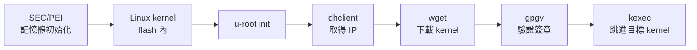

# u-root 與 LinuxBoot：20 秒伺服器開機是怎麼做到的

> 最後更新：2026-10-07

## TL;DR：「20 秒」指的是開機，不是 build

這個數字常被誤傳成「u-root 能在 20 秒內構建系統」。實際出處是 Ron Minnich 2017 年 10 月在 coreboot mailing list 的回報：一台 OCP Winterfell 伺服器以 NERF（flash 內放 Linux + u-root）開機，從 flash 中的 Linux 啟動、dhclient、wget 到 kexec 的完整流程約 20 秒，他重複跑了 10,000 次都穩定。[^1]

三個容易混淆的地方先講清楚：

- **量的是什麼**：從韌體階段到 kexec 進目標 kernel 的時間，不是從 `u-root` 指令產出 initramfs 的時間。
- **在哪裡量**：OCP Winterfell 上的工程實驗，不是 Google 資料中心公開的生產指標。
- **對比基準**：34C3 議程介紹以「少於 20 秒 vs 數分鐘」對比傳統 UEFI[^2]；LinuxBoot 官方則宣稱開機通常快 20 倍。[^4]

本文區分兩類敘述：**【已驗證】** 有公開一手來源；**【推論】** 是依架構原理的合理解釋，沒有直接量測數據支持。

## 背景：從 NERF 到 LinuxBoot + u-root

NERF 由 Ron Minnich 於 2017 年 1 月在 Google 發起，後來拆成三個名字。**【已驗證】** Minnich 是 LinuxBIOS 作者、當時 Google 的 coreboot 負責人。[^2]

| 名稱 | 角色 |
| --- | --- |
| LinuxBoot | 放在 flash 裡、取代部分韌體功能的 Linux kernel，不綁定 initramfs |
| u-root | Go 撰寫的 initramfs 與開機工具（PXE、讀 GRUB 設定、kexec 等） |
| NERF | LinuxBoot + u-root 的組合 |
| Heads | 另一種 initramfs runtime，偏重 TPM 與 measured boot |

這組定義來自 LinuxBoot FAQ，原本三者都叫 NERF，因容易混淆才改名。[^5] LinuxBoot 於 2018 年成為 Linux Foundation 正式專案。[^6]

u-root 本身更早：2015 年 Minnich（Google）與 Mirtchovski（Cisco）已在 USENIX ATC '15 發表論文。[^3]

## 架構：保留 PEI，其餘換成 Linux

NERF 只保留初始化記憶體控制器所需的最少 PEI 模組，把廠商 UEFI 的整個 DXE 階段換成可重現建構的 Linux runtime。**【已驗證】**[^2]

| UEFI 階段 | 傳統伺服器韌體 | NERF |
| --- | --- | --- |
| SEC / PEI | CPU、記憶體初始化 | 保留最少模組 |
| DXE | 數百個 driver、option ROM、網路堆疊 | Linux kernel（flash 內） |
| BDS | 開機選單、PXE、GRUB | u-root initramfs 決定開機策略 |
| 交棒 | 載入 bootloader → OS | kexec 直接進目標 kernel |

「數百個 DXE driver」為一般伺服器 UEFI 的通則描述 **【推論】**，實際數量依平台而異。實務上 flash 容量是主要限制：coreboot 支援的主機板理論上都能跑 LinuxBoot，但實際受限於 flash 大小。[^6]

## 20 秒開機流程拆解

Minnich 描述的流程中沒有 GRUB：Linux 啟動 u-root，u-root 依序執行 dhclient、wget、gpgv、kexec，全部以 Go 撰寫。**【已驗證】**[^1]



1. **SEC/PEI**：只做 CPU 與 DRAM 初始化。
2. **Linux in flash**：用 Linux 自己的 driver 帶起 NIC、儲存裝置。
3. **dhclient → wget**：透過網路取得目標 kernel 與 initramfs。
4. **gpgv**：在交棒前驗證簽章。
5. **kexec**：在記憶體中直接載入並跳進新 kernel，不經過硬體 reset。

公開資料只給出整體約 20 秒，**沒有各階段的細部時間分布**；下一節「為什麼快」中的部分歸因屬推論。

## 為什麼快：已驗證 vs 推論

快的關鍵是移除 UEFI 中最慢、最不透明的部分，而不是 u-root 本身有特殊加速。

| 因素 | 類型 | 說明 |
| --- | --- | --- |
| 移除不必要的韌體程式碼 | 【已驗證】 | LinuxBoot 官方列為開機加速的主因[^4] |
| 以 Linux driver 取代韌體 driver | 【已驗證】 | 官方同時強調可靠度：以久經考驗的 Linux driver 取代測試不足的韌體 driver[^4] |
| 不經過 GRUB | 【已驗證】 | Minnich 明確表示此流程沒有 GRUB[^1] |
| kexec 省掉 reset 與第二輪韌體 | 【推論】 | kexec 的一般特性；此處無量測拆分 |
| Linux 裝置探測可平行化 | 【推論】 | 相對 DXE 常見的循序 dispatch；依平台而異 |
| 省去 option ROM 與 UEFI 網路堆疊 | 【推論】 | 伺服器 UEFI 開機緩慢的常見來源 |

換句話說，20 秒是「架構簡化」的結果：把原本 DXE + BDS + bootloader 三層，壓成一個 Linux kernel 加一段 Go 寫的開機策略。

## u-root 的構建：從 source mode 到 gbb mode

ATC '15 論文的原始設計是 **source mode**：initramfs 只放 init 與 4 個 Go 編譯器 binary，其餘全是 Go 原始碼，指令第一次執行時才編譯到 RAM 檔案系統。[^3]

現在的 u-root README 只列兩種模式，用 `-build` 指定。**【已驗證】**[^7]

| 模式 | 內容 | 特點 |
| --- | --- | --- |
| `gbb` mode | 單一 busybox 式 binary | 複製並改寫各工具原始碼，合併編譯成一個執行檔 |
| `binary` mode | 每個工具一個 binary | 各自獨立編譯後放進 initramfs |

`gbb` mode 背後是 gobusybox：產出的 binary 依 `os.Args` 判斷要執行哪個指令，不支援 CGO。**【已驗證】**[^8]

典型用法：

```bash
u-root core boot
u-root ./cmds/core/{init,ls,ip,dhclient,wget,cat,gosh}
```

**【推論】** 構建快的原因在於 Go 編譯速度快、產出靜態 binary、不需要交叉編譯整套 C toolchain 與 libc。與 Buildroot/Yocto 相比通常快上一個數量級，但這沒有官方 benchmark，實際時間依指令數量與機器而定。

## 安全性與可重現建構

開機策略寫在 Go userland，讓簽章驗證與 measured boot 變成一般程式邏輯，而不是廠商韌體裡的黑盒子。

- **簽章驗證**：流程中的 gpgv 在 kexec 前驗證下載的 kernel。**【已驗證】**[^1]
- **使用者可控**：34C3 議程強調使用者能自訂開機腳本、建構自己的 runtime，並用自己的金鑰重燒韌體。**【已驗證】**[^2]
- **Heads 與遠端證明**：Heads 以 Linux、TPM、GPG、kexec 載入並量測、驗證真正的 kernel；移植到 NERF 伺服器時加入 Keylime，讓伺服器能向使用者證明韌體符合預期。**【已驗證】**[^2]
- **記憶體安全**：Go 的型別安全與 GC 降低 C 寫的韌體工具常見的記憶體錯誤。**【推論】** 屬語言層面的一般性優勢，非針對 u-root 的安全稽核結果。

## 結語

20 秒開機靠的是「Linux 取代 DXE/BDS + Go 寫的精簡開機策略 + kexec 直接交棒」這個組合。u-root 的貢獻是讓開機策略可讀、可改、可驗證，並能快速重建。

仍待查證的開放問題：

- Google 生產機群目前實際部署 LinuxBoot 的範圍與開機時間，公開資料有限。
- 20 秒內各階段（PEI、kernel 初始化、DHCP、下載、kexec）的時間分布，目前找不到公開量測。

延伸閱讀：Trammell Hudson 在 34C3 的「Bringing Linux back to server boot ROMs with NERF and Heads」演講，以及 LinuxBoot Book 的 u-root 章節。[^9]

## 參考資料

[^1]: Ron Minnich, coreboot mailing list 回覆（OCP Winterfell，約 20 秒）, 2017-10. [https://mail.coreboot.org/pipermail/coreboot/2017-October/085300.html](https://mail.coreboot.org/pipermail/coreboot/2017-October/085300.html)
[^2]: 34C3, *Bringing Linux back to server boot ROMs with NERF and Heads* 議程頁, 2017-12-29. [https://fahrplan.events.ccc.de/congress/2017/Fahrplan/events/9056.html](https://fahrplan.events.ccc.de/congress/2017/Fahrplan/events/9056.html)
[^3]: R. G. Minnich, A. Mirtchovski, *U-root: A Go-based, Firmware Embeddable Root File System with On-demand Compilation*, USENIX ATC '15. [https://www.usenix.org/conference/atc15/technical-session/presentation/minnich](https://www.usenix.org/conference/atc15/technical-session/presentation/minnich)
[^4]: LinuxBoot 官網. [https://www.linuxboot.org/](https://www.linuxboot.org/)
[^5]: LWN, *LinuxBoot: a new Linux Foundation project for boot firmware*（留言引述 LinuxBoot FAQ）, 2018-01. [https://lwn.net/Articles/745498/](https://lwn.net/Articles/745498/)
[^6]: Wikipedia, *LinuxBoot*. [https://en.wikipedia.org/wiki/LinuxBoot](https://en.wikipedia.org/wiki/LinuxBoot)
[^7]: u-root README, *Build Modes*. [https://github.com/u-root/u-root#build-modes](https://github.com/u-root/u-root#build-modes)
[^8]: gobusybox. [https://github.com/u-root/gobusybox](https://github.com/u-root/gobusybox)
[^9]: LinuxBoot Book, *All about u-root*. [https://book.linuxboot.org/u-root.html](https://book.linuxboot.org/u-root.html)
